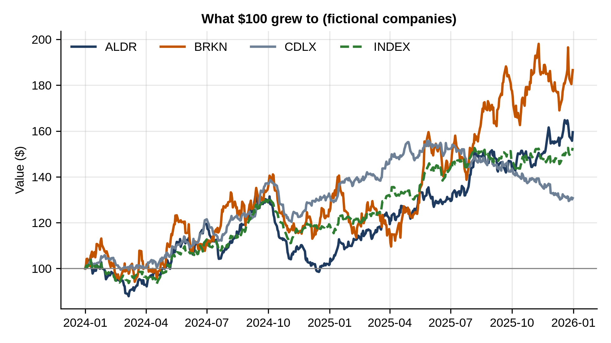

# Chapter 24: Project: Stock Price Study

`prices.csv` holds two years of daily closing prices for three fictional companies, Alder (ALDR), Brookline (BRKN) and Cedarlux (CDLX), and a market index. The question: how did each perform, how risky was each, and how much did each move with the market?

> **Note:** The companies and prices are invented, generated as random walks. Nothing in this chapter is investment advice; it's practice with the tools analysts use on any time series.

## Returns, Volatility and Correlation

Analysts work with **returns**, the percentage change from one day to the next, rather than prices, because returns are comparable between a $30 stock and a $120 stock:

```python
@include code/ch24/returns.py
```

```
@include code/ch24/returns.out
```

- `pct_change()` turns prices into daily returns; `dropna()` drops the first day, which has no previous day.
- **Total return** compares the last price with the first: Brookline gained 87% over two years, Alder 60%, Cedarlux 31%, and the index 53%.
- **Volatility** is the standard deviation of daily returns, multiplied by the square root of 252 (the number of trading days in a year) to put it on a yearly scale. Brookline's 32% is more than twice Cedarlux's 13%: its higher return came with a much bumpier ride.
- The **correlation** table shows how the returns move together. Each company correlates more with the index (0.52 to 0.59) than with the others (0.31 to 0.35), because the index represents the shared market movement.

## Drawdown and Beta

```python
@include code/ch24/drawdown_beta.py
```

```
@include code/ch24/drawdown_beta.out
```

A **drawdown** is the fall from the highest price so far. `cummax()` gives the running peak, and dividing by it shows how far below its peak each day was. Alder's worst drawdown was 25.5%, despite its lower volatility than Brookline: averages don't show the worst stretch an investor sat through.

**Beta** measures how strongly a stock moves with the market: the slope of a straight line fitted through the stock's daily returns against the index's. `np.polyfit(x, y, 1)` fits that line. Brookline's beta of 1.19 means it moves about 1.2% for each 1% the index moves; Cedarlux, at 0.57, about half as much.

## Growth of $100

```python
@include code/ch24/growth_chart.py
```

```
@include code/ch24/growth_chart.out
```



Dividing each column by its first value and multiplying by 100 puts all four on the same footing: the value of $100 invested on the first day. The index is dashed to set it apart. The chart shows both return and risk: Brookline ends highest, but with the deepest dips along the way.

## Key Takeaways

- Analyze returns, not prices; `pct_change` converts one to the other.
- Annualized volatility, maximum drawdown and beta describe risk in different ways; report more than one.
- `cummax` finds running peaks; `np.polyfit` fits a straight line.
- "Growth of $100" charts compare series that start at different levels.
