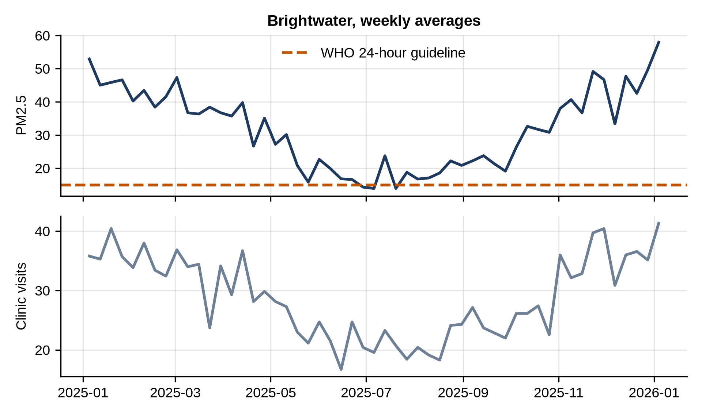

# Chapter 25: Project: Air Quality and Clinic Visits

Three fictional cities, Avonford, Brightwater and Cedarvale, record daily fine-particle pollution (PM2.5) from roadside sensors, and their clinics record daily visits for breathing problems. A city health officer asks: are clinic visits higher after polluted days, and how much higher?

**PM2.5** means particles smaller than 2.5 micrometers, small enough to be breathed deep into the lungs. It's measured in micrograms per cubic meter of air.

## Preparing the Data

```python
@include code/ch25/health_prepare.py
```

```
@include code/ch25/health_prepare.out
```

- The sensors failed on 21 days in total. `interpolate(limit=3)` fills each gap with values on a straight line between the readings on either side, but only for gaps of up to three days. Longer gaps stay missing, because inventing a week of pollution data would be guessing. `groupby("city")` with `transform` makes sure each city is filled only from its own readings.
- `merge(..., validate="one_to_one")` joins the two files on date and city, and checks that each pair appears once in each file. All 1,095 rows (365 days times 3 cities) match.
- The quarterly averages show strong seasons: pollution in the first and fourth quarters (winter) is roughly double the third quarter (summer), and Brightwater is the most polluted city all year.

## Are Visits Higher After Polluted Days?

Chapter 16 found that visits in Brightwater follow pollution with a two-day delay. This program measures that delay's effect in all three cities:

```python
@include code/ch25/health_analysis.py
```

```
@include code/ch25/health_analysis.out
```

The World Health Organization's 2021 guideline for fine particles is a 24-hour average of no more than 15 micrograms per cubic meter (and a yearly average of 5). The program shifts each city's pollution by two days with `groupby("city")["pm25"].shift(2)`, so each day is paired with the pollution two days earlier, and compares visits after days above and below the guideline:

- In **Brightwater**, visits after polluted days average 30.0, against 17.8 after clean days, and the correlation is strong (0.76).
- In **Avonford** and **Cedarvale**, the pattern is the same but smaller, with correlations around 0.5.
- Brightwater exceeded the guideline on 321 days of the year, Avonford on 216 and Cedarvale on 106.

## Seeing It

```python
@include code/ch25/health_chart.py
```

```
@include code/ch25/health_chart.out
```



Two charts stacked with a shared date axis (`sharex=True`) let the reader compare the two series' shapes directly, without the confusion of two different y-axes on one chart. Weekly averages smooth the daily noise.

## Careful Conclusions

This is where honest analysis matters most. The data shows a strong **association**: more clinic visits two days after polluted days. It doesn't prove pollution *causes* the visits on its own. Winter brings both more pollution and more colds and flu; a careful study would compare days within the same season, or control for temperature and flu activity. (In this book's data, the link was built in on purpose, so you know it's real; with real data you wouldn't.)

A good summary for the health officer:

- Clinic visits are substantially higher two days after days above the WHO guideline, most clearly in Brightwater (30 against 18 visits a day).
- The pattern is consistent across all three cities, which makes chance unlikely.
- Seasonal factors such as flu may explain part of the link; a follow-up analysis should account for season and temperature.

## Key Takeaways

- Fill only short gaps in time series, within each group, and say how you handled the rest.
- Validate joins with `validate` and check that the row count is what you expect.
- Use `groupby(...).shift()` to pair each day with an earlier day in the same city.
- Separate association from causation, and name the likely confounders, such as season.
