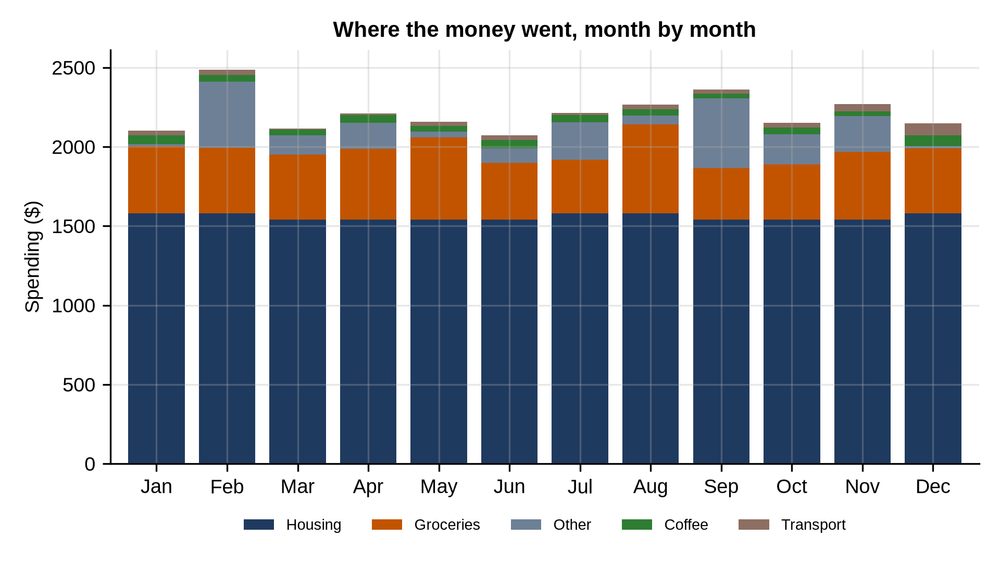

# Chapter 26: Project: Household Budget

The final project is personal: a household's bank transactions for 2025, exported as a CSV, like most banks allow. The questions are the ones anyone asks about their own money: where does it go, how much are we saving, and which regular payments are we committed to?

## Where the Money Goes

```python
@include code/ch26/budget_review.py
```

```
@include code/ch26/budget_review.out
```

The program categorizes each transaction with patterns, as in Chapter 13, then:

- splits money in (positive amounts) from money out (negative), giving a savings rate of 47%: a fortunate household;
- pivots spending into months and categories, flips the sign (`mul(-1)`) so spending shows as positive numbers, and fills empty cells with 0;
- averages each category over the twelve months.

Housing (rent and utilities) dominates at about $1,557 a month, followed by groceries at $415. Coffee, at about $45 a month, is small, but that's still over $500 a year.

> **Tip:** Average *monthly* spending by category is more useful than yearly totals for a budget, because that's how bills arrive. Filling missing months with zero matters: a category with no spending in some months would otherwise have its average computed over fewer months, and look bigger than it is.

## Finding Recurring Payments

```python
@include code/ch26/recurring.py
```

```
@include code/ch26/recurring.out
```

A payment counts as recurring if the same description and the same amount appear in at least 10 different months. Two qualify: rent ($17,400 a year) and a streaming subscription ($155.88 a year). The power bill is regular too, but its amount changes with the season, so the "same amount" rule misses it. Rules like this need tuning: you might allow a 30% variation in amount, or look for regular timing instead.

## The Chart

```python
@include code/ch26/budget_chart.py
```

```
@include code/ch26/budget_chart.out
```



`DataFrame.plot.bar(stacked=True)` draws a stacked bar per month in one call, with one color per column. Housing is the steady base; the variable categories on top are where a budget can actually change.

## Your Turn

- Export your own bank transactions (most banks offer CSV), adjust the patterns to your merchants, and run the same analysis. Keep the file on your own computer, and don't share it.
- Add a check that every transaction landed in a category other than "Other", and print the ones that didn't, so you can add patterns.

## Key Takeaways

- Categorize transactions with patterns, and keep refining the rules as you meet new descriptions.
- Pivot into months by category, fill empty months with zero, then average.
- Simple rules find recurring payments, but test them against cases you know.
- Your own data is the best practice of all, and it's yours: keep it private.
