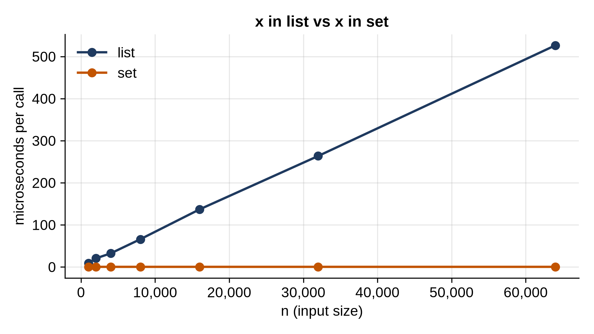

# Part I: Foundations

# Chapter 1: Why Build It Yourself

Python gives you excellent data structures for free. Lists, dictionaries, sets, tuples and strings cover most everyday needs, and the standard library adds `collections.deque`, `heapq` and `bisect`. So why build your own?

Because using a tool well means knowing what it costs. Two programs can give exactly the same answer while one finishes instantly and the other runs for an hour, and the difference is almost always the choice of data structure or algorithm. The only way to really know why one is fast and the other slow is to look inside, and the best way to look inside is to build it.

This chapter shows the method the whole book follows, using one small question.

## One Question, Two Answers

Here is the question: is a value in a collection? In Python you write `x in collection`, and it works for lists and sets alike. The answer is the same. Is the time?

```python
@include code/ch01/first_benchmark.py
```

Don't worry about the `bench` module yet; Chapter 3 builds it line by line. For now, `bench.doubling` times a function for each input size in `sizes`, `bench.table` prints the results, and `bench.chart` draws them. The value searched for, `-1`, is never in the collection, so every search has to give its final answer, "no", the hard way. Here are the results:

```
@include code/ch01/first_benchmark.out
```



Read the table row by row. Each size is twice the one before, and the "x" number after each time says how many times longer that size took than the previous one. For the list, it's about 2: double the items, double the time. The list checks its items one by one until it finds the value or runs out, so a list with twice as many items takes twice as long to say "no".

For the set, the time hardly changes at all. A set with 64,000 items answers as fast as one with 1,000, in well under a microsecond. It doesn't look through the items; it computes where the value would be, and looks there. Chapter 9 builds a hash table, the structure behind sets and dictionaries, so you'll see exactly how.

At 64,000 items the set is thousands of times faster. At a million items, the gap would be bigger still. A program that checks membership in a loop, say, removing duplicates from a list of a million emails by checking each against what it has seen, would take hours with a list and well under a second with a set.

> **Tip:** When you write `if x in something` inside a loop, stop and check what `something` is. If it's a list that grows with the input, a set will almost always be dramatically faster.

## Build, Test, Time

The list-versus-set comparison follows the three steps that every chapter of this book follows:

1. **Build.** Write the structure or algorithm yourself, in plain Python, short enough to read in one sitting. You'll understand it better than any description could make you, and you'll know exactly what each operation does.
2. **Test.** Check that it works, with a few hand-picked cases and then with thousands of random operations compared against something you trust, usually Python's built-in equivalent. If your hash table and a dictionary give the same answers after twenty thousand random insertions, lookups and deletions, it works.
3. **Time.** Measure how its running time grows as the input grows, and compare it with alternatives. Theory predicts the shape of the curve; a benchmark shows the real numbers, including the constant factors that theory leaves out.

Theory comes in too, of course. Chapter 3 introduces **Big O notation**, the standard way to describe how running time grows. But in this book every Big O claim is followed by a measurement, so you never have to take it on faith.

## The Same Problem, Many Solutions

The first lesson of data structures is that the same task can be done in very different ways, and the right one depends on what you'll do most. A list keeps items in order and gives instant access by position, but finding a value means searching. A set finds values instantly, but keeps no order and can't hold duplicates. Neither is better; each is right for some jobs.

Throughout the book you'll keep asking the same three questions about every structure:

- **What operations does it make fast?** Adding at the end, finding by key, getting the smallest item, finding by prefix.
- **What does it make slow, or impossible?** And does your program need those operations?
- **What does it cost in memory?** Speed is often bought with space.

> **Real-World Use:** Python answers "is this name defined?" constantly while your program runs. A module's global variables live in a dictionary, the one `globals()` returns, and every object's attributes usually do too (`vars(obj)` shows it). So each time your code uses a global name or an attribute, Python does a hash-table lookup like the set lookup in this chapter's benchmark. If those lookups scanned a list, every Python program would slow down as it grew.

## Python Is Not the Whole Story

One more thing the benchmarks will show again and again: in Python, *where* code runs matters as much as what it does. Python's built-in structures are written in C and compiled to machine code. Code you write in Python runs in the interpreter, typically ten to a hundred times slower per step. So your hand-built dynamic array will be slower than `list`, and your hash table slower than `dict`, even though they do the same work.

That's fine. You're not building these to replace the built-ins; you're building them to understand the built-ins, and to have the techniques ready for the problems the built-ins don't solve. And sometimes, as you'll see with linked lists, heaps and tries, the structure you build does something no built-in does.

## Key Takeaways

- The same question can take microseconds or hours, depending on the data structure that answers it.
- Checking `x in list` takes time proportional to the list's length; `x in set` takes about the same time at any size.
- Every chapter follows the same method: build it, test it against something you trust, and time it.
- Ask three questions of every structure: what it makes fast, what it makes slow, and what it costs in memory.
- Python's built-ins run in compiled C, so they usually beat hand-written Python doing the same work. Build structures to understand them, then choose wisely.

## Exercises

This chapter has no programming exercises; Chapter 2 sets up your tools. Instead, before you turn the page, write down your guess: how long would `x in a_list` take for a list of 10 million items on your computer? How about `x in a_set`? You'll be able to check both by the end of Chapter 3.
