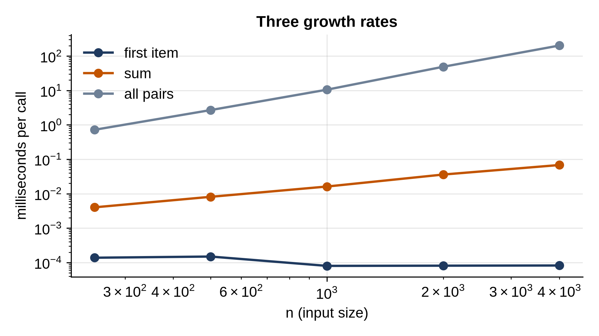

# Chapter 3: Measuring Speed: Big O You Can See

How fast is a piece of code? "0.3 seconds" is an answer, but a fragile one: it depends on the computer, on what else is running, and above all on the input. A better question is: **how does the time grow as the input grows?** An algorithm whose time doubles when its input doubles will handle a million items happily; one whose time quadruples will grind to a halt somewhere around a hundred thousand. This chapter teaches the language for that question, Big O notation, and builds the small timing library, `bench.py`, that measures it throughout the book.

## Counting Steps

Before timing anything, count. Here are two functions, instrumented to count their basic steps: a linear search that compares the target with each item, and a duplicate check that compares every pair of items.

```python
@include code/ch03/count_steps.py
```

```
@include code/ch03/count_steps.out
```

Each row doubles n. The search's steps double too: it makes exactly n comparisons when the target is missing. The duplicate check's steps roughly quadruple: it compares every pair, and n items have n(n - 1)/2 pairs. For 160 items that's 12,720 comparisons; for 160,000 items it would be about 12.8 billion.

Notice that the counts don't depend on the computer at all. That's what makes step counts useful: they describe the algorithm, not the machine.

## Big O Notation

**Big O notation** summarizes how the number of steps grows with the input size n, keeping only the part that matters for large n:

- Drop constant factors: 3n steps and n steps are both **O(n)**, because doubling n doubles both.
- Drop smaller terms: n(n - 1)/2 = n²/2 - n/2 is **O(n²)**, because for large n the n² part dwarfs the rest.

So linear search is O(n) and the all-pairs check is O(n²). You read O(n²) as "big O of n squared", or "order n squared", and it means "grows no faster than n² times some constant".

These are the growth rates you'll meet in this book, from fastest to slowest:

| Notation | Name | Example in this book |
| --- | --- | --- |
| O(1) | constant | reading `items[i]`; a dict lookup |
| O(log n) | logarithmic | binary search (Chapter 10) |
| O(n) | linear | searching a list; summing it |
| O(n log n) | "n log n" | merge sort; Python's `sorted()` |
| O(n²) | quadratic | insertion sort; checking every pair |
| O(2ⁿ) | exponential | trying every subset (Chapter 31) |

To see how differently they grow:

```python
@include code/ch03/growth_table.py
```

```
@include code/ch03/growth_table.out
```

## Logarithms in One Paragraph

**log₂ n** (log base 2 of n) is the number of times you can halve n before reaching 1. Halve 1,000 ten times and you're at about 1, so log₂ 1,000 ≈ 10. Halve a million twenty times; a billion, thirty times. Every time n doubles, log₂ n goes up by just one. That's why an O(log n) algorithm, which halves its problem at each step, is almost as good as constant time: searching a billion sorted items takes about thirty steps. That is all the math the book needs about logarithms. (The base doesn't matter in Big O, because changing base only multiplies by a constant, so people just write O(log n).)

## Timing Code: Harder Than It Looks

Counting steps is exact but tedious, and it hides the fact that some steps are far more expensive than others. So we also time code. The obvious way is a stopwatch:

```python
@include code/ch03/time_once.py
```

```
@include code/ch03/time_once.out
```

The same work, five times, five different answers. The first run is often slowest, while the processor's caches fill and its clock speeds up; after that, other programs, the operating system, and Python's garbage collector all steal a little time now and then. A single measurement of a fast operation tells you very little.

Good benchmarks fix this with three habits:

1. **Repeat until the measurement is long enough.** A single call of something that takes 50 nanoseconds can't be timed accurately; a million calls in a loop can.
2. **Take the fastest of several rounds.** Interruptions only ever add time. The fastest round is the one least disturbed, so it's the best estimate of the code's own speed. (This is also what Python's `timeit` module recommends.)
3. **Pause the garbage collector** while timing, so its occasional sweeps don't land in one measurement and not another.

## bench.py: A Small Timing Library

Every benchmark in this book uses the same small module, `bench.py`. A copy sits in every chapter folder of the book's code, so each chapter runs on its own. It starts like this:

```python
@include code/ch03/bench.py#L1-L15
```

`QUICK` exists for the book's own automated checks, which run every benchmark on four Python versions just to confirm it works; you can ignore it. Here is the heart of the module:

```python
@include code/ch03/bench.py::measure,_batch,_fresh
```

`measure` takes a function to time, `run`, and returns the seconds per call, the fastest of five rounds. Each round runs `_batch` or `_fresh`:

- `_batch` calls `run` in a loop of `number` calls, doubling `number` until the loop takes at least `min_time` seconds (0.02 by default). Dividing the total by `number` gives the time per call. This is how the standard library's `timeit` decides how many times to run something.
- `_fresh` is for operations that change their input. Sorting a list sorts it, so a second sort would get an already-sorted list, a completely different (and easier) job. With `setup`, every call gets fresh input from `setup()`, and only `run` itself is inside the timer.

`time.perf_counter()` is Python's most precise clock for measuring short intervals. `gc.disable()` pauses the garbage collector, and the `try`/`finally` makes sure it's switched back on even if the timed code raises an error.

Most benchmarks time an operation at several input sizes:

```python
@include code/ch03/bench.py::doubling
```

`doubling` builds each size's input once (unless `fresh=True`), then times every size in turn, five times over. The rounds are **interleaved**: round one times every size, then round two times every size again, and so on, and each size keeps its fastest round. The first version of this book's benchmarks timed all five rounds of one size before moving to the next, and its tables had odd jumps: a burst of activity from another program would spoil all five rounds of whichever size happened to be running. Interleaving spreads each size's rounds over the whole run.

Finally, showing the results:

```python
@include code/ch03/bench.py::UNITS,unit_for,show_time,table
```

```python
@include code/ch03/bench.py::chart
```

`show_time` picks the unit that gives a number of at least 1, so you read "45.6 ms" rather than "0.0456". (`us` stands for microseconds, millionths of a second; the proper symbol is µs.) `table` prints one row per size and one column per series, and after each time, the ratio to the size before. `chart` draws the same data with matplotlib; with `log=True`, both axes use a logarithmic scale, where equal steps are equal multiples.

## Reading the Ratios

The ratio column is the most useful number in every benchmark in this book, so it's worth practicing. When each size is double the one before:

- **×1**: the time doesn't depend on n. **O(1)**.
- **×2**: the time doubles with n. **O(n)**.
- **a little over ×2**: **O(n log n)**: doubling n doubles the n and adds one to log n.
- **×4**: doubling n quadruples the time. **O(n²)**.
- **×8**: **O(n³)**.

Here are three functions with three growth rates, measured:

```python
@include code/ch03/bench_growth.py
```

```
@include code/ch03/bench_growth.out
```



Reading the first item takes the same tens of nanoseconds at every size: ratios near 1. The sum doubles. The all-pairs check roughly quadruples. Real measurements wobble: a ratio of 1.7 or 2.3 where theory says 2 is normal, especially for very fast operations where a few nanoseconds of noise is a large fraction. Look at the trend across the rows, not one ratio.

On the chart, with both axes logarithmic, each growth rate becomes a straight line, and the steepness of the line is the power of n: flat for O(1), slope 1 for O(n), slope 2 for O(n²). It's the quickest way to read a growth rate off a picture.

> **Tip:** To find the growth rate of any code, time it at a few sizes that double, and look at the ratios. It takes a minute, and it's more reliable than reasoning about code you didn't write.

## Best, Worst and Average Cases

The same algorithm can take very different times on different inputs of the same size. Linear search finds the first item immediately and a missing item only after checking everything:

```python
@include code/ch03/bench_cases.py
```

```
@include code/ch03/bench_cases.out
```

The **best case** is the fastest any input can be, the **worst case** the slowest, and the **average case** what to expect from typical inputs. When people give one Big O for an algorithm, they usually mean the worst case, because it's a promise: no input will be slower. Linear search is O(n) in the worst case, even though its best case is O(1).

## Amortized Cost

One more idea you'll need in Chapter 6. Some operations are usually cheap but occasionally expensive. Appending to a Python list is like that: most appends just write the new item into space the list already reserved, but now and then the list is full and must move everything to a bigger block of memory. If the expensive step is rare enough, the *average over many operations* is still constant. That average over a sequence of operations is the **amortized cost**, and list append is O(1) amortized. Chapter 6 builds a dynamic array and counts exactly how rare the expensive steps are.

## Memory Counts Too

Everything in this chapter applies to memory as well as time. An algorithm that makes a copy of its input uses O(n) extra memory; one that keeps only a few variables uses O(1). The duplicate check above uses O(1) extra memory, while the faster approach from Chapter 1, putting items in a set, uses O(n). Trading memory for time like that is one of the most common moves in the whole subject.

## Key Takeaways

- Big O describes how time (or memory) grows with input size, ignoring constant factors and smaller terms.
- O(1), O(log n), O(n), O(n log n), O(n²) and O(2ⁿ) cover most of what you'll meet; the gaps between them become enormous as n grows.
- log₂ n is the number of halvings to get from n to 1: about 30 for a billion.
- Time code by repeating it until the measurement is long, taking the fastest of several rounds, interleaving the rounds, and pausing garbage collection. `bench.py` does all four.
- When n doubles, a time ratio of about 1, 2 or 4 means O(1), O(n) or O(n²).
- Worst-case Big O is a promise; amortized cost is an average over a sequence of operations.

## Exercises

1. **Count the steps.** This function counts pairs that add up to zero, but its inner loop only looks *before* position i:

   `for i in range(n): for j in range(i): steps += 1`

   How many steps does it take for n = 10, 100 and 1,000? What is its Big O? Write the code and check.
2. **Read a benchmark.** A function was timed at n = 1,000, 2,000, 4,000 and 8,000, taking 0.5, 2.1, 8.3 and 33 milliseconds. Another took 1.0, 2.2, 4.6 and 9.8 milliseconds. Classify each, and predict each one's time at n = 64,000. Write a short program that computes the ratios and the predictions.
