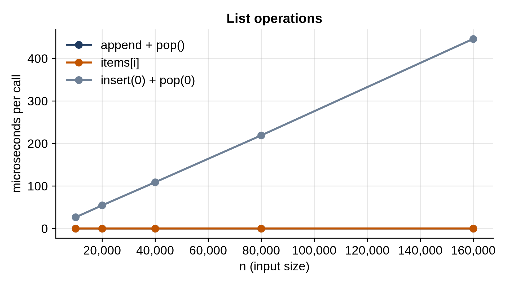

# Chapter 4: Python's Built-ins Under the Hood

Before building any structures of your own, it pays to know the ones you already use. This chapter looks inside Python's list, dictionary, set and string: how each stores its data, what each operation costs, and the measurements that prove it. Everything later in the book builds on these facts, and they'll change how you write everyday Python.

## A List Is an Array of References

A Python list stores its items in one contiguous block of memory, as an **array**: slot 0, slot 1, slot 2, and so on, side by side. Each slot holds a **reference**, the memory address of the object, not the object itself. That's why a list can hold items of different types and sizes: every slot is the same size, 8 bytes on a 64-bit computer, whatever it points to.

Because the slots are side by side and all the same size, Python can find slot i by arithmetic: start of the block plus 8 × i. So `items[i]` takes the same time whether the list has ten items or ten million. That's **O(1) access by position**, the list's great strength.

## Watching a List Grow

A block of memory can't simply grow; the memory right after it may belong to something else. So how does `append` work? Watch the list's size in memory as items go in:

```python
@include code/ch04/list_growth.py
```

```
@include code/ch04/list_growth.out
```

`sys.getsizeof` reports the list object's own size: a 56-byte header plus 8 bytes per slot. The size doesn't change on every append. When the first item arrives, the list reserves room for 4. It stays at 88 bytes for the next three appends, then jumps to room for 8, then 16, 24, 32, 40. Each time the list is full, Python allocates a bigger block, copies the references across, and frees the old one. The extra room means most appends just write into a spare slot, which is why `append` is fast on average. Chapter 6 builds this mechanism yourself and counts exactly what it costs.

> **Interesting Fact:** The growth rule is one line of C in CPython's `listobject.c`: the new capacity is the needed size plus an eighth of it, plus 6, rounded down to a multiple of 4. The source code's own comment lists the pattern you just measured: "0, 4, 8, 16, 24, 32, 40, 52, 64, 76, ..." It grows by about 12.5% each time once lists get large, a more frugal choice than doubling.

## What Each List Operation Costs

Adding or removing at the *end* touches one slot. Adding or removing at the *front* is another matter: every item after the change must shift over by one slot, so the time grows with the list's length. Measured:

```python
@include code/ch04/bench_list_ops.py
```

```
@include code/ch04/bench_list_ops.out
```



`append` plus `pop()` and reading `items[i]` stay flat at every size: O(1). Inserting at position 0 and popping it again doubles with the list's length: O(n). At 160,000 items it's thousands of times slower than working at the end. The shifting is done by a fast memory copy in C, which is why it's "only" hundreds of microseconds; but it's linear, and it adds up fast inside a loop.

Here is the cost of each common list operation:

| Operation | Cost | Why |
| --- | --- | --- |
| `items[i]`, `items[i] = x` | O(1) | Arithmetic finds the slot |
| `append(x)`, `pop()` | O(1) amortized | Spare room at the end |
| `insert(i, x)`, `pop(i)` | O(n) | Later items shift |
| `x in items`, `index(x)`, `remove(x)` | O(n) | Checks items one by one |
| `items[a:b]` | O(b - a) | Copies the slice |
| `sort()` | O(n log n) | Chapter 12 |
| `len(items)` | O(1) | The length is stored |

> **Tip:** If your program takes items from the front of a list, `items.pop(0)` makes every removal O(n). Use `collections.deque`, whose `popleft()` is O(1). Chapter 8 measures the difference: thousands of times faster for a large queue.

## Dictionaries and Sets: Hash Tables

A dictionary finds a key without looking through the others. It does that with a **hash table**: Python turns the key into a number, its **hash**, and uses that number to choose where in a table to store and later find the entry. Chapter 9 builds two kinds of hash table; for now, look at the hashes themselves:

```python
@include code/ch04/hashing.py
```

```
@include code/ch04/hashing.out
```

The rules that make hashing work:

- **Equal values must have equal hashes**, because a lookup with `42.0` must find the key `42`. So `hash(42) == hash(42.0)`.
- A small integer usually hashes to itself, except `-1`, which becomes `-2`, because CPython's C code uses `-1` to signal an error.
- **Only unchangeable values can be keys.** If a list could be a key and you appended to it, its hash would change and the dictionary could never find it again. So lists raise `TypeError`; tuples of hashable values are fine.

Because the table position comes from arithmetic on the hash, dictionary and set operations take about the same time at any size:

```python
@include code/ch04/bench_dict_set.py
```

```
@include code/ch04/bench_dict_set.out
```

Around a tenth of a microsecond for a lookup, an insertion or a deletion, whether the table holds ten thousand entries or a million. That's what O(1) looks like. (Strictly, it's O(1) on average; Chapter 9 shows the rare inputs where hash tables slow down badly, and how Python defends against them.)

| Operation | Cost |
| --- | --- |
| `d[key]`, `d[key] = v`, `del d[key]`, `key in d` | O(1) average |
| `s.add(x)`, `s.remove(x)`, `x in s` | O(1) average |
| `a & b`, `a | b` for sets | O(len(a) + len(b)) |
| Looping over a dict or set | O(n) |

> **Note:** Since Python 3.7, dictionaries keep keys in the order they were inserted, as a guarantee of the language. Sets make no such promise: never rely on the order of a set.

## Strings Can't Change

Strings are **immutable**: no operation changes a string; operations make new ones. So `text += word` builds a new string containing the old text plus the word, which means copying the old text. In a loop, that copying adds up: the first time copies a little, the last time copies almost everything, which is O(n²) in total. Here is the measurement, against `"".join()`, which computes the total length once and copies each piece once:

```python
@include code/ch04/bench_strings.py
```

```
@include code/ch04/bench_strings.out
```

Surprise: the plain `+=` loop grows linearly, not quadratically. CPython has an optimization: when the string has no other references, it can extend it in place instead of copying. But the third column shows how fragile that is. One extra name for the same string, `alias = text`, and the optimization can't apply, because changing the string in place would change `alias` too. The time jumps to quadratic: the ratio is about 4.

The optimization is a detail of CPython, not a promise of the Python language; other Pythons may not have it, and an innocent change to a loop can switch it off. Python's own style guide, PEP 8, says not to rely on it, and to use `"".join()` in code where speed matters.

> **Tip:** To build a string from many pieces, append the pieces to a list and call `"".join(pieces)` once at the end. It's always linear, in every version of Python.

## Tuples

A tuple is like a list that can't change. It stores references side by side, so indexing is O(1), but there's no `append`, so no spare room is needed. Tuples are hashable when their items are, which makes them the natural dictionary key for several values together, as in `point[(1, 2)]` above.

## Key Takeaways

- A list is an array of references: O(1) by position, O(n) to search, and O(n) to insert or remove anywhere but the end.
- A list keeps spare room and grows in jumps, so `append` is O(1) amortized. CPython's rule adds about 12.5% plus a little.
- Dictionaries and sets are hash tables: lookups, insertions and deletions are O(1) on average, at any size.
- Only hashable (unchangeable) values can be dictionary keys or set members; equal values have equal hashes.
- Strings are immutable. Build long strings with `"".join()`, not `+=` in a loop.

## Exercises

1. **Membership in a loop.** Write two functions that return the items of list `a` that are also in list `b`: one with `x in b` on a list, one with a set made from `b`. Count the comparisons each makes for lists of 1,000 items (count the list version's comparisons with a loop; the set version makes about one hash lookup per item).
2. **When does the list grow?** Using `sys.getsizeof`, find the lengths at which a list grows between 1 and 200 appends, and compare the capacities with the rule in CPython's source: new capacity = n + n // 8 + 6, rounded down to a multiple of 4, where n is the length needed.
