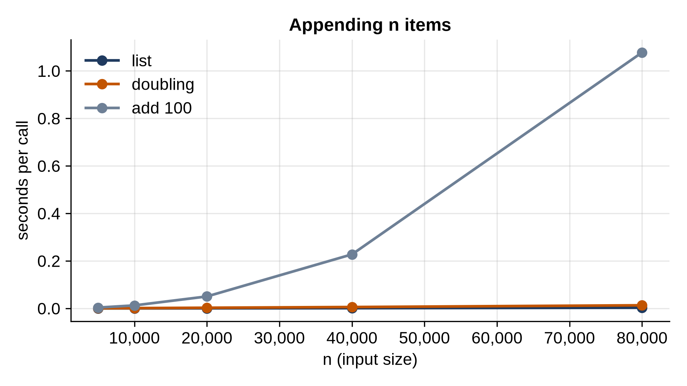

# Part II: Linear Structures

# Chapter 6: A Dynamic Array

Chapter 4 showed that a Python list is an array that grows in jumps. In this chapter you'll build one: a `DynamicArray` class with indexing, `append`, `insert` and `pop`, on top of storage that can't grow. Then you'll count exactly how much copying the growth costs, discover why doubling works and adding a fixed amount doesn't, and time your array against Python's list.

## Fixed-Size Storage

Real arrays live in a block of memory of a fixed size. Python doesn't let us allocate raw memory, but we can imitate it with a list that we promise never to grow or shrink, only to read and write by index:

```python
@include code/ch06/dynamic_array.py#L1-L7
```

From now on, the only things `DynamicArray` does with its storage are `storage[i]` and `storage[i] = value`, exactly what real memory allows. Its job is to look like a list that can grow, while the storage beneath it never does.

## The Class

The array keeps three things: the storage, its **capacity** (how many slots it has), and the number of items actually stored, `_n`. Only the first `_n` slots hold items; the rest are spare room.

```python
@include code/ch06/dynamic_array.py#L10-L33
```

`_check` handles negative indexes the way lists do, so `a[-1]` is the last item, and raises `IndexError` for anything outside the stored items. Note that it compares with `_n`, not the capacity: the spare slots exist, but they don't hold items, so reading them is an error.

`copies` isn't part of a real array. It counts how many items have been copied during resizing, so we can measure the cost of growing.

## Growing

When the storage is full, `append` makes new storage, bigger by the growth factor (2 by default, so twice the size), and copies every item across:

```python
@include code/ch06/dynamic_array.py#L35-L49
```

The `max(self._n + 1, ...)` guards against growth factors so small that `int()` would round the new capacity down to the old one. Watch it work:

```python
@include code/ch06/grow_demo.py
```

```
@include code/ch06/grow_demo.out
```

The capacity doubles each time it runs out: 1, 2, 4, 8, 16, 32. Each resize copies every item stored so far, so the resizes copy 1, 2, 4, 8 and 16 items: 31 in total for 17 appends, fewer than two copies per append.

## Why Doubling Works

That pattern holds at every size. With doubling, the copies done by all the resizes add up to 1 + 2 + 4 + ... + (the last capacity), which is less than twice the final size. So n appends cost n writes plus fewer than 2n copies: O(n) in total, and **O(1) amortized** per append. Most appends are cheap; the occasional expensive one is paid for by all the cheap ones before it.

What if the array grew by a fixed amount instead, say 100 slots at a time? Then a resize happens every 100 appends, and each copies everything so far: 100, 200, 300, ... items. The total grows with n², and the average cost per append grows with n. This program simulates three growth rules and reports the copies per appended item:

```python
@include code/ch06/count_copies.py
```

```
@include code/ch06/count_copies.out
```

Doubling stays below 2 copies per item at every size: where exactly it lands depends on how far n is past the last power of two. Growing by half (times 1.5) costs a few more copies but wastes less memory: at most a third of the slots are spare, instead of half. Adding 100 slots at a time is a disaster: 4,999.5 copies per item at a million items, and it keeps growing.

> **Real-World Use:** The growable arrays of popular languages all grow by a *factor*, but they choose different factors. CPython's list grows by about 1.125 plus a little (Chapter 4). Java's `ArrayList` grows by half, and Go's slices double while they're small, then move toward growing by a quarter once they pass 256 elements. Each is a different trade between copying time and wasted memory, all with O(1) amortized appends.

## Inserting and Removing

Inserting anywhere but the end means making room: every item from the insertion point on shifts one slot to the right, starting from the end so nothing is overwritten. Removing shifts them back left:

```python
@include code/ch06/dynamic_array.py#L51-L73
```

Both are O(n): inserting at the front shifts every item. `pop` also sets the vacated slot back to `None`, so the array doesn't keep the removed object alive.

`pop` also **shrinks** the storage when it falls to a quarter full, halving the capacity. Why a quarter and not a half? Imagine an array that's exactly full at 8 items, then a program that alternately appends and pops. With "shrink at half full", the append grows it to 16, the pop leaves 8 items in 16 slots, exactly half, so it shrinks back to 8, and the next append grows it again: every single operation copies the whole array. Exercise 2 measures it. Shrinking at a quarter leaves a gap between the grow point and the shrink point, so a run of operations near the boundary can't make the array bounce.

Finally, iteration and a readable `repr`:

```python
@include code/ch06/dynamic_array.py#L75-L80
```

Defining `__iter__` makes the array work in `for` loops, `list(...)`, and everywhere else Python iterates.

## Testing It

The tests check the basics, the errors, insertion and removal, growing and shrinking, and then run 5,000 random operations side by side on a `DynamicArray` and a Python list, checking after each that they agree:

```python
@include code/ch06/test_dynamic_array.py
```

```
@include code/ch06/test_dynamic_array.out
```

The random test checks thousands of combinations, including inserts at negative positions and positions past the end, which `list.insert` clamps to the ends, and our `insert` must too.

## Timing It

Now the benchmark: append n items to a Python list, to our doubling array, and to a version that grows by 100 slots:

```python
@include code/ch06/bench_append.py
```

```
@include code/ch06/bench_append.out
```



Python's list and our doubling array both grow linearly: double the items, about double the time. Ours is several times slower, because every step of `append` runs as Python code (a method call, a comparison, two attribute updates) while `list.append` is a few machine instructions in C. The fixed-step version is in another league: its time roughly quadruples with each doubling, and at 80,000 items it's on the order of a hundred times slower than our own doubling array. Same code, different growth rule.

> **Tip:** When you know how many items a list will hold, you can avoid growth entirely: `[None] * n` makes the whole list at once, and so does a list comprehension, which can size the list from its input.

## Key Takeaways

- A dynamic array keeps items in fixed-size storage with spare room, and grows by moving everything to bigger storage.
- Growing by a constant factor makes append O(1) amortized: the total copying stays below a constant times n.
- Growing by a constant amount makes append O(n) on average and filling the array O(n²).
- Insertion and removal in the middle are O(n), because items must shift.
- Shrink at a quarter full, not at half, so a mix of appends and pops near the boundary can't trigger a copy every time.

## Exercises

1. **extend.** Add an `extend(items)` method that appends every item of an iterable. When the number of new items is known, resize at most once, to a capacity big enough for all of them.
2. **Why a quarter?** Simulate an array that starts full at 8 items, then alternately appends and pops 1,000 times. Count the items copied when it shrinks at half full, and when it shrinks at a quarter full.
3. **remove.** Add `remove(value)`, which deletes the first item equal to `value` and raises `ValueError` if there is none, like `list.remove`.
