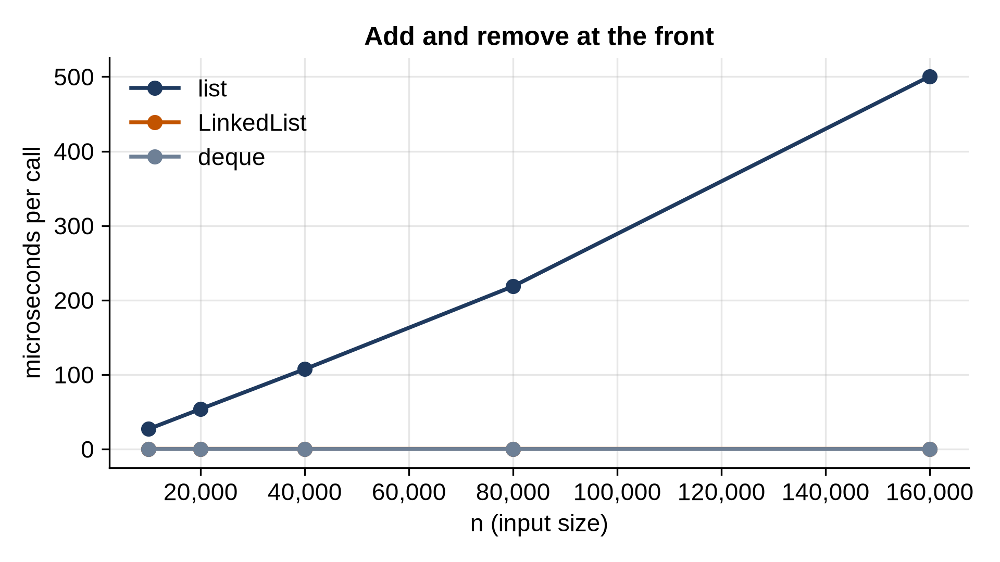

# Chapter 7: Linked Lists

An array keeps its items side by side, which makes reading by position instant and inserting at the front slow. A **linked list** makes the opposite trade. Each item lives in its own small object, a **node**, that points to the next node. Nothing is side by side, so nothing ever needs to shift: adding at the front is instant at any size. But finding the 1,000th item means following 1,000 pointers.

This chapter builds a singly linked list and a doubly linked list with a sentinel, solves three classic interview problems, and measures where linked lists win and where they lose.

## Nodes

A node holds a value and a reference to the next node, or `None` at the end of the list:

```python
@include code/ch07/linked_list.py#L1-L9
```

`__slots__` tells Python that a `Node` has exactly these two attributes. Normally every object carries a dictionary for its attributes; with `__slots__` it doesn't, which saves memory and makes attribute access a little faster. That matters when a list has a million nodes.

## A Singly Linked List

The list itself keeps a reference to the first node, the **head**, and to the last node, the **tail**, so that appending doesn't have to walk the whole list:

```python
@include code/ch07/linked_list.py#L12-L56
```

`push_front` makes a new node pointing at the old head and makes it the new head: two assignments, whatever the length. That's O(1). `append` links the new node after the tail, also O(1). `pop_front` moves the head along one node. The empty list is the special case each method must handle: when the list is empty, the head and the tail are both `None`, and the first node added is both.

`__iter__` follows the `next` references from the head until it reaches `None`. Every way of reading the list, `for` loops, `list(s)`, `repr`, goes through it.

Finding and removing a value means walking from the head:

```python
@include code/ch07/linked_list.py#L57-L78
```

`remove` keeps a second pointer, `before`, one node behind, because unlinking a node means changing the `next` of the node *before* it. Removing the head changes `self.head` instead, and removing the last node must move `self.tail` back. Each of these is a place where a linked list implementation typically goes wrong, and each is covered by the tests.

## Reversing in Place

Reversing a linked list without making new nodes is the most famous linked-list interview question:

```python
@include code/ch07/linked_list.py#L79-L85
```

Walk the list once. At each node, turn its `next` arrow around to point at the node before, then move both pointers forward. Python's simultaneous assignment does all three steps in one line: it evaluates the whole right side first, so `node.next`'s old value is saved before it's overwritten. When the walk ends, `before` is the old last node, the new head. The old head becomes the tail. O(n) time and O(1) extra memory.

```python
@include code/ch07/list_demo.py
```

```
@include code/ch07/list_demo.out
```

## A Doubly Linked List with a Sentinel

A singly linked list can't remove its last node in O(1): to unlink it, you need the node before it, and finding that means walking from the head. A **doubly linked list** gives every node a `prev` pointer as well, so you can step backward and unlink any node in O(1).

The code becomes much simpler with one trick, a **sentinel**: a dummy node that isn't part of the data. The sentinel sits before the first node and after the last, joining the list into a circle. An empty list is just the sentinel pointing at itself. Now every real node always has a real `prev` and `next`, and no method needs a special case for the ends:

```python
@include code/ch07/doubly_linked.py
```

Everything is built from two small operations. `_insert_after` links a new node between `node` and `node.next` by updating four pointers. `unlink` removes a node by connecting its neighbors to each other. `append` inserts after the last node (the sentinel's `prev`), and `appendleft` after the sentinel itself; `pop` and `popleft` unlink the node at either end.

`unlink` takes a node, not a value. Once you hold a reference to a node, removing it is O(1). Chapter 32 uses exactly this to build an LRU cache, where a dictionary maps each key to its node so any entry can be found and moved in constant time.

> **Real-World Use:** Python's own `collections.deque` is a doubly linked list, with a twist: each node holds a block of 64 items, not one. The blocks keep most operations as fast as an array's, and the links between blocks make adding and removing at both ends O(1). The Linux kernel uses circular doubly linked lists with a head node, exactly the sentinel design above, throughout its code.

## Testing Both Lists

```python
@include code/ch07/test_linked_lists.py
```

```
@include code/ch07/test_linked_lists.out
```

The random test drives both lists and a `deque` with the same 5,000 operations. The singly linked list can only remove from the front, so to pop from the back the test reverses it, pops the front, and reverses it back, which also tests `reverse` thousands of times.

## Three Interview Problems

Linked lists are a favorite in interviews because the pointer manipulation is easy to get wrong. Three classics:

```python
@include code/ch07/list_problems.py
```

```
@include code/ch07/list_problems.out
```

- **The middle node** uses two pointers moving at different speeds: `fast` moves two steps for each step of `slow`, so when `fast` reaches the end, `slow` is halfway. With an even number of nodes it returns the second of the two middle nodes. One pass, no counting.
- **Cycle detection** uses the same two pointers. If the list ends, `fast` reaches `None` and there's no cycle. If it loops, `fast` enters the loop and, moving one step faster per round than `slow`, eventually lands on it. This is **Floyd's cycle-finding algorithm**, also called "the tortoise and the hare", and it uses O(1) extra memory. Storing visited nodes in a set would also work, but with O(n) memory.
- **Merging two sorted lists** reuses the existing nodes instead of making new ones. A dummy head node, a sentinel again, means the first node needs no special case.

> **Interview Tip:** For almost any linked-list question, consider a dummy head node, and consider two pointers: one ahead of the other by k steps, or one moving twice as fast. Draw three or four nodes on paper and trace your pointers before writing code.

## When Linked Lists Win, and When They Lose

Here's the case for linked lists: adding and removing at the front, against Python's list and `deque`:

```python
@include code/ch07/bench_front.py
```

```
@include code/ch07/bench_front.out
```



The Python list's time doubles with its length, because every item shifts. The linked list stays flat at a few hundred nanoseconds at every size. And `deque`, a linked list of blocks written in C, is flat and faster still.

Now walking through every item:

```python
@include code/ch07/bench_walk.py
```

```
@include code/ch07/bench_walk.out
```

Both are O(n), but the linked list is about twice as slow. Each step follows a pointer to a node object that could be anywhere in memory, and runs `__iter__`'s Python code, while iterating a list reads references stored side by side, in C. Modern processors are much faster at reading memory in order than at jumping around, so arrays win most whole-list operations, even in languages where both are compiled.

So: use a linked list (or `deque`) when you add and remove at the ends, or when you hold references to nodes and need to remove them in O(1). Use a list for almost everything else.

## Key Takeaways

- A linked list stores each item in a node that points to the next; nothing ever shifts.
- Adding or removing at the head is O(1); finding an item or the k-th position is O(n).
- A doubly linked list with a sentinel can add and remove at both ends, and unlink any node it holds, in O(1), with no special cases.
- Two pointers, one faster or further ahead, solve many linked-list problems in one pass: the middle, cycles, the k-th node from the end.
- In practice arrays are faster for walking through items; `collections.deque` is the right choice for a queue or a double-ended list in Python.

## Exercises

1. **k-th from the end.** Remove the k-th node from the end of a list in one pass. (Hint: start one pointer k nodes ahead of another.)
2. **Palindrome.** Check whether a linked list reads the same forward and backward, using O(1) extra memory: find the middle, reverse the second half, compare, and reverse it back.
3. **Where does the cycle start?** Extend Floyd's algorithm to return the first node of the cycle. (Hint: after the pointers meet, start one of them again from the head and move both one step at a time.)
