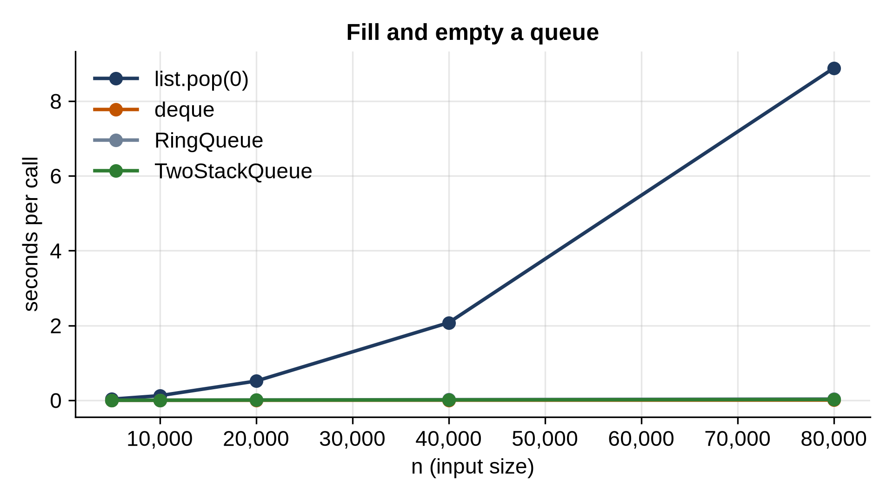

# Chapter 8: Stacks and Queues

A **stack** is a pile: you add to the top and take from the top, so the last item in is the first out (LIFO). A **queue** is a line: you join at the back and leave from the front, first in, first out (FIFO). They're the simplest structures in this book and among the most used. The call stack from Chapter 5 is a stack; so are "undo" in an editor and "back" in a browser. Print jobs, web requests waiting for a server and the breadth-first search of Chapter 21 are queues.

What makes them interesting is not the idea but the cost. A stack is trivially fast on a Python list. A queue on a Python list is a trap, and this chapter measures just how big a trap.

## A Stack

A Python list is already a perfect stack, as long as the top is the *end* of the list, where `append` and `pop` are O(1):

```python
@include code/ch08/stack.py
```

Why wrap a list in a class at all? To give the structure a narrow interface: a `Stack` can only push, pop and peek, so code that uses it can't accidentally insert in the middle. It also gives clearer error messages and makes intent obvious to anyone reading the code. In quick scripts and interviews, a plain list with `append` and `pop` is perfectly idiomatic.

## Balanced Brackets

The classic stack problem: are the brackets in a piece of text balanced? Every opener must be closed by the matching closer, in the right order:

```python
@include code/ch08/brackets.py
```

```
@include code/ch08/brackets.out
```

The stack holds the openers still waiting to be closed, innermost on top. A closer must match the top; `"([)]"` fails because `)` arrives while `[` is on top. Text that ends with openers still on the stack, like `"(("`, is unbalanced too. Every code editor that highlights a matching bracket, and every parser that reads Python or JSON, does a version of this.

## Monotonic Stacks

A more advanced use: for each day's temperature, how many days until a warmer one?

```python
@include code/ch08/monotonic.py
```

```
@include code/ch08/monotonic.out
```

The obvious solution checks every later day for every day: O(n²). The stack version keeps the days still waiting for a warmer day, and their temperatures decrease from the bottom of the stack to the top: a **monotonic stack**. Each new day pops every waiting day that's colder, answering their question, then joins the stack itself. Each day is pushed once and popped at most once, so the whole thing is O(n). This pattern answers any "next greater" or "next smaller" question, and appears regularly in interviews.

## Queues: The Trap

A queue on a Python list looks easy: `append` to join at the back, `pop(0)` to leave from the front. But `pop(0)` shifts every remaining item left, so it's O(n), and emptying a queue of n items costs O(n²). The rest of this chapter builds two queues that avoid the shifting, then measures all of them.

## A Ring Buffer

The first is a **ring buffer**, also called a circular buffer. The items sit in fixed storage, and two positions move forward through it: the front (where items leave) and the back (where they join). When the back reaches the end of the storage, it wraps around to slot 0, if that slot is free. Nothing ever shifts.

```python
@include code/ch08/ring_queue.py
```

The back position is computed as `(front + n) % size`: the `%` (remainder) operator makes positions wrap around. `dequeue` moves the front forward the same way. When the storage is full, `_grow` copies the items, in queue order, to the start of storage twice the size, as the dynamic array did in Chapter 6, so enqueue is O(1) amortized and dequeue is O(1).

> **Real-World Use:** Ring buffers are everywhere that data streams through a fixed amount of memory: audio and video playback, network cards, keyboard input and logging systems that keep only the newest messages. The Linux kernel provides one as a general-purpose building block, `kfifo`.

## A Queue from Two Stacks

The second is an interview favorite: build a queue using only two stacks.

```python
@include code/ch08/two_stack_queue.py
```

New items go onto the `inbox` stack. To take one out, pop from `outbox`; if it's empty, pour the whole inbox into it first. Pouring reverses the order, so the oldest item ends up on top. A single `dequeue` can be slow (pouring n items is O(n)), but each item is poured exactly once in its lifetime, so the average over any sequence of operations is O(1): the same amortized argument as for the dynamic array.

## Testing

```python
@include code/ch08/test_stacks_queues.py
```

```
@include code/ch08/test_stacks_queues.out
```

`@pytest.mark.parametrize` runs a test once for each value given, here once for each queue class, so both queues face the same 5,000 random operations against a `deque`. The last test checks the ring really wraps around: after two dequeues, two enqueues fit into the freed slots without growing.

## Timing Four Queues

Fill a queue with n items, then empty it, four ways:

```python
@include code/ch08/bench_queues.py
```

```
@include code/ch08/bench_queues.out
```



The `list.pop(0)` column quadruples at every row: O(n²). At 80,000 items it takes about 9 seconds. The other three double: O(n). `deque` empties the same 80,000-item queue in about 5 milliseconds, well over a thousand times faster. Our two Python queues are slower than `deque` (Python code against C) but on the same straight line, and the two-stack queue is faster than the ring buffer, because its work is mostly `list.append` and `list.pop`, which run in C.

> **Tip:** In Python, use `collections.deque` for any queue: `append` to join, `popleft` to leave. Reach for `queue.Queue` only when several threads share the queue, since it adds locking.

## Key Takeaways

- A stack is last in, first out; a Python list is an excellent stack when you push and pop at the end.
- A queue is first in, first out; `list.pop(0)` makes a list a quadratic queue.
- A ring buffer stores a queue in fixed storage that wraps around, so nothing shifts.
- Two stacks make a queue with O(1) amortized operations, because each item moves between them once.
- A monotonic stack answers "next greater element" questions in O(n).
- In Python, `collections.deque` is the queue to use.

## Exercises

1. **Min stack.** Make a stack that can also report its smallest item in O(1), at any moment. (Hint: a second stack.)
2. **Reverse Polish notation.** Evaluate expressions like `"3 4 + 2 *"`, where each operator follows its two operands, with a stack.
3. **Next greater element.** For each number in a list, find the first larger number to its right, or -1, in O(n).
