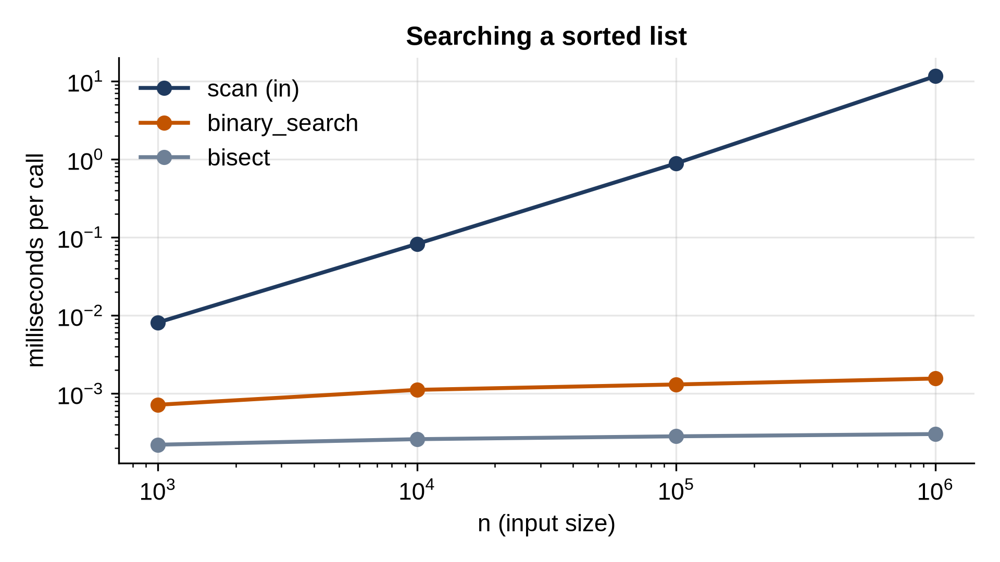

# Part III: Searching and Sorting

# Chapter 10: Binary Search

Finding a value in an unsorted list means checking items one by one: O(n). If the list is sorted, you can do something much better. Look at the middle item. If it's too small, the target can only be in the right half; if too big, only in the left half. Either way, one comparison throws away half the list. Repeat, and a million items take twenty steps.

That's **binary search**, and it's both one of the simplest algorithms and one of the easiest to get subtly wrong. This chapter builds it carefully, with an invariant that makes it correct by construction, then its two more useful cousins, the standard library's `bisect`, and a powerful generalization: binary search on the answer.

## The Algorithm and Its Invariant

```python
@include code/ch10/binary_search.py::binary_search
```

The key to getting binary search right is to decide exactly what `lo` and `hi` mean, and keep that true at every step. Here the meaning, the **invariant**, is: *if the target is anywhere, it's in `items[lo:hi]`*. Note the half-open range: `lo` is included, `hi` is not.

- At the start, `lo = 0` and `hi = len(items)`, so the range is the whole list. True.
- If `items[mid]` is too small, the target, if present, is after `mid`, so `lo = mid + 1` keeps the invariant. If too big, it's before `mid`, so `hi = mid` (not `mid - 1`, because `hi` is excluded).
- The loop runs while the range `lo:hi` isn't empty. When it's empty, the invariant says the target isn't anywhere: return -1.

Each step at least halves the range, so the loop runs at most about log₂ n + 1 times. Here's how many steps that is in practice. A `range` object can be indexed like a list without storing its items, so we can search a billion numbers for free:

```python
@include code/ch10/count_steps.py
```

```
@include code/ch10/count_steps.out
```

Thirty steps for a billion items. A linear search would need up to a billion.

> **Interesting Fact:** In 2006, Joshua Bloch reported that the binary search he had written for Java's standard library, and the one in Jon Bentley's classic book *Programming Pearls*, proved correct and tested there, shared a bug that went unnoticed for years (two decades, in the book's case): computing `(low + high) / 2` overflows when `low + high` exceeds the largest 32-bit integer, which can happen with arrays of about a billion elements. Python's integers never overflow, so `(lo + hi) // 2` is safe here. In languages with fixed-size integers, write `lo + (hi - lo) / 2`.

## Lower Bound and Upper Bound

"Is it there?" is often the less useful question. With duplicates, you may want the first or the last occurrence; for a missing value, where it would go. Two variants answer these:

```python
@include code/ch10/binary_search.py::lower_bound,upper_bound
```

`lower_bound` returns the first position whose item is at least the target: where you'd insert the target to keep the list sorted, before any equal items. `upper_bound` returns the first position whose item is *greater*, so after any equal items. They differ only in `<` against `<=`. Together they're very powerful: `upper_bound(x) - lower_bound(x)` counts the copies of x, and the items in a range of values sit between `lower_bound(low)` and `upper_bound(high)`. Neither variant stops early when it finds the target; both always narrow the range down to a single position.

## Testing Against bisect

```python
@include code/ch10/test_binary_search.py
```

```
@include code/ch10/test_binary_search.out
```

The random test builds 2,000 sorted lists of random lengths, full of duplicates (values from 0 to 20), and checks the bounds against the standard library's `bisect_left` and `bisect_right`, which are exactly the same functions. Off-by-one errors, the usual binary-search bug, can't survive 2,000 random cases with empty lists, single items and long runs of duplicates.

## The bisect Module

In real code, use `bisect`: it's written in C and well tested.

```python
@include code/ch10/bisect_demo.py
```

```
@include code/ch10/bisect_demo.out
```

The grade lookup is a neat trick: `bisect_right(cutoffs, score)` counts how many cutoffs the score has reached, which indexes straight into the string of grades. `insort` inserts into a sorted list at the right place. Finding the position is O(log n), but inserting still shifts later items, so it's O(n) overall. For a list that changes often, Chapter 17's balanced tree is the better structure.

## Binary Search on the Answer

Here's a problem that doesn't look like searching at all. Packages of given weights must be shipped, in order, within a number of days; each day a truck carries a run of consecutive packages up to its capacity. What is the smallest capacity that works?

```python
@include code/ch10/search_answer.py
```

```
@include code/ch10/search_answer.out
```

The trick is to search the space of *answers*. The capacity must be at least the heaviest package and at most the total weight. And the question "does capacity c work?" is easy to check by simulation, `days_needed`, and has a special shape: if c works, every bigger capacity works too. Whenever a yes-or-no question flips from "no" to "yes" exactly once as the answer grows, binary search finds the flip point, here in about log₂(total) checks of O(n) each. This pattern, **binary search on the answer**, solves a whole family of interview problems: minimum speed to finish on time, maximum minimum distance, smallest largest sum when splitting an array.

> **Real-World Use:** `git bisect` uses binary search to find the commit that introduced a bug. You mark one commit as good and a later one as bad; Git checks out the commit in the middle, you test it and say good or bad, and it halves the range again. A bug introduced somewhere in 1,000 commits is found in about 10 tests. It's binary search on the answer, where the answer is a commit and "is the bug present?" flips once.

## Timing

```python
@include code/ch10/bench_search.py
```

```
@include code/ch10/bench_search.out
```



The scan grows by about 10 times for each 10 times more items: O(n). Binary search grows by a fraction of a microsecond for each 10 times: O(log n), adding about 3.3 steps (log₂ 10) each time. At a million items, our binary search is thousands of times faster than the scan, and `bisect`, in C, is about five times faster again.

> **Tip:** Sorting costs O(n log n), so it only pays for itself if you search many times. To search once, scan. To search a thousand times, sort once and binary search, or build a set.

## Key Takeaways

- Binary search halves the remaining range with each comparison: O(log n), about 30 steps for a billion items.
- State the invariant ("the target is in `items[lo:hi]`") and keep it true; that's how to avoid off-by-one errors.
- `lower_bound` and `upper_bound` find the first position not less than, and greater than, a value; they count duplicates and find ranges.
- Use the `bisect` module in real code.
- If a yes-or-no question about a number flips once as the number grows, binary search on the answer finds the smallest number that works.

## Exercises

1. **First and last.** Return the first and last positions of a target in a sorted list, or `[-1, -1]`, in O(log n).
2. **Rotated list.** A sorted list was rotated, like `[4, 5, 6, 7, 0, 1, 2]`. Find a target in O(log n). (Hint: one half around `mid` is always in order.)
3. **Integer square root.** Compute the largest r with r × r ≤ n, by binary search on the answer, and check it against `math.isqrt` for very large n.
