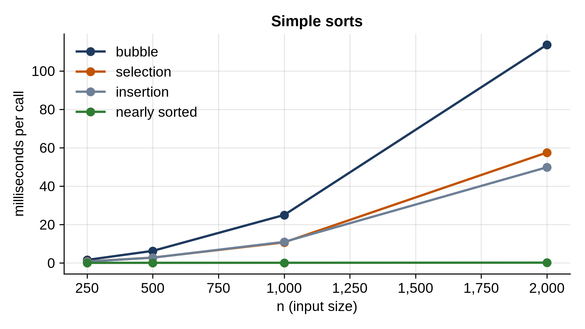

# Chapter 11: Simple Sorts

Sorting is the most studied problem in computer science, and for good reason: sorted data makes searching, merging, finding duplicates and finding ranges easy, and a surprising number of algorithms start by sorting. Python sorts with `sorted()` and `list.sort()`, and you should use them. But the classic sorting algorithms are the best possible training ground for thinking about algorithms: simple to state, easy to test, and different enough in their behavior to teach real lessons.

This chapter covers three simple sorts, all O(n²): selection sort, insertion sort and bubble sort. Chapter 12 covers the fast ones. The simple ones are worth knowing, because one of them, insertion sort, turns out to be excellent on small or nearly sorted lists, and it's part of how Python's own sort works.

## Three Simple Sorts

```python
@include code/ch11/simple_sorts.py
```

All three sort the list **in place**: they rearrange the list they're given rather than returning a new one, using O(1) extra memory.

- **Selection sort** finds the smallest remaining item and swaps it to the front of the unsorted part, then repeats with the rest. It always makes the same number of comparisons, n(n - 1)/2, whatever the input looks like.
- **Insertion sort** grows a sorted part on the left. Each new item is shifted left past every larger item, like sorting a hand of cards. On a list that's already sorted, each new item is already in place after one comparison, so it does only n - 1 comparisons.
- **Bubble sort** compares neighbors and swaps them if they're out of order, so each pass "bubbles" the largest remaining item to the end. Stopping when a pass makes no swaps lets it finish early on sorted input.

## Testing Sorts

Sorts are easy to test: the answer must equal `sorted()`'s.

```python
@include code/ch11/test_simple_sorts.py
```

```
@include code/ch11/test_simple_sorts.out
```

The hand-picked cases cover the empty list, one item, two items, all items equal, and lists already sorted and reversed, which are the classic places for sorting bugs. Then 300 random lists of random lengths, with values that repeat often.

## Counting the Work

How much work does each sort do, and does the input's arrangement matter? This program counts comparisons with a class whose comparison methods count each call, on 1,000 items arranged three ways:

```python
@include code/ch11/count_work.py
```

```
@include code/ch11/count_work.out
```

`Counted` defines `__lt__` and `__gt__`, the methods Python calls for `<` and `>`, so each comparison adds one to a counter. Read the table by rows:

- Selection sort makes exactly 499,500 comparisons on every input, the n(n - 1)/2 pairs. It can't take advantage of order already present.
- Insertion sort makes about half as many on random input (each item travels about halfway back on average), the maximum on reversed input, and only 1,009 on a nearly sorted list: practically linear.
- Bubble sort with early stopping is also fast on nearly sorted input, but on random input it's as bad as selection sort, and it makes many more swaps than either.

A sort that runs faster on input that's already partly in order is called **adaptive**. Insertion sort is the champion here: its work is proportional to n plus the number of **inversions**, the pairs of items that are out of order. Exercise 1 uses that fact to count inversions.

## Stability

When two items compare equal, a **stable** sort keeps them in the order they had before sorting. That matters when you sort records by one field:

```python
@include code/ch11/stability.py
```

```
@include code/ch11/stability.out
```

Sorting people by age, insertion sort keeps Ada before Cy (they were in that order) because it only moves an item past *strictly* greater items. Selection sort's long-distance swap moves Ada behind Cy. Insertion sort and bubble sort are stable; selection sort isn't.

Stability is what lets you sort by several keys: sort by the least important key first, then by the most important, and items that tie on the second sort keep the order of the first. Python's `sorted()` is guaranteed stable, which Exercise 2 relies on.

## Timing

```python
@include code/ch11/bench_simple.py
```

```
@include code/ch11/bench_simple.out
```



The `nearly sorted` column is insertion sort on lists with one neighbor swap per 100 items. On random lists all three quadruple when n doubles: O(n²). Bubble sort is the slowest by a factor of about two, because it does many more swaps. On nearly sorted input, insertion sort only doubles: linear, and at 2,000 items it's hundreds of times faster than on random data.

> **Real-World Use:** Many fast sorting implementations switch to insertion sort for small pieces, because for a few dozen items its low overhead beats their cleverness. Python's own sort, described in the next chapter, does: it first looks for runs of items already in order (reversing descending runs in place), and uses a binary insertion sort to extend short runs to a minimum length before merging them.

> **Interview Tip:** You'll rarely be asked to write a simple sort, but you will be asked about their properties: which are stable, which are adaptive, which work in place. And "insertion sort on nearly sorted data is linear" is a fact worth remembering.

## Key Takeaways

- Selection, insertion and bubble sort are all O(n²) on random input and sort in place with O(1) extra memory.
- Selection sort always does n(n - 1)/2 comparisons; insertion sort's work grows with the number of inversions, so it's linear on nearly sorted input.
- A stable sort keeps equal items in their original order; insertion and bubble sort are stable, selection sort isn't.
- Sort by several keys with a stable sort: least important key first.
- Test any sort against `sorted()` on random lists with many duplicates.

## Exercises

1. **Count inversions.** Count the pairs `i < j` with `items[i] > items[j]` by counting the shifts insertion sort makes.
2. **Two keys.** Sort a list of (name, city, age) records by age, and by city within each age, using two calls to a stable sort. Check the result against a single sort with a tuple key.
