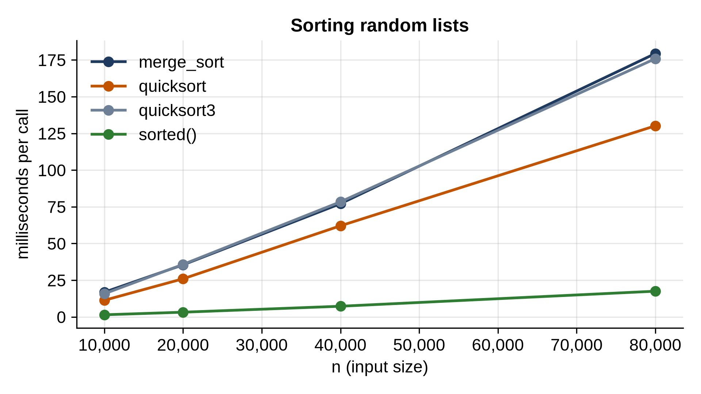

# Chapter 12: Merge Sort and Quicksort

The simple sorts of Chapter 11 compare every item with many others, which is why they're O(n²). The fast sorts use **divide and conquer**: split the problem into smaller pieces, solve each piece, and combine the answers. Splitting in half repeatedly gives about log₂ n levels, and if each level does O(n) work, the whole sort is O(n log n). For a million items that's about 20 million steps instead of 500 billion.

This chapter builds the two classic divide-and-conquer sorts, merge sort and quicksort. You'll see quicksort's famous worst case happen, fix it with a random pivot, make it fast on duplicates with a three-way partition, and then race everything against Python's `sorted()`.

## Merging

Merge sort is built on one operation: merging two sorted lists into one.

```python
@include code/ch12/merge_sort.py::merge
```

Two positions, `i` and `j`, walk through the two lists. At each step the smaller of the two front items is the smallest left overall, so it goes next. When one list runs out, the rest of the other is already in order. Each item is looked at once: O(len(left) + len(right)). Taking from the left on ties (`<=`) keeps equal items in their original order, which makes merge sort stable.

## Merge Sort

```python
@include code/ch12/merge_sort.py::merge_sort
```

Split the list in half, sort each half recursively, merge. A list of one item is already sorted. The recursion goes log₂ n levels deep, and the merges at each level together handle all n items, so merge sort is **O(n log n) on every input**: best, worst and average. The price is memory: it builds new lists as it goes, O(n) extra in all.

## Quicksort

Quicksort divides differently. Pick one item, the **pivot**, and **partition** the list: move everything smaller than the pivot to its left and everything else to its right. The pivot is now in its final place. Sort the two sides recursively, and you're done; there's no merge step.

```python
@include code/ch12/quicksort.py#L1-L5
```

```python
@include code/ch12/quicksort.py::partition,quicksort_naive
```

`partition` uses the **Lomuto** scheme: the pivot is the last item, `items[hi]`; `store` marks the end of the "smaller than pivot" region, and each smaller item found is swapped into it. Finally the pivot is swapped into place just after that region. `quicksort_naive` partitions and recurses on each side. It sorts in place, with no extra lists.

When the pivot splits the list roughly in half, quicksort is O(n log n). But nothing guarantees that. Watch what happens on a list that's already sorted:

```python
@include code/ch12/worst_case.py
```

```
@include code/ch12/worst_case.out
```

On random input, the naive quicksort makes about 24,000 comparisons for 2,000 items, close to n log₂ n. On *sorted* input it makes 1,999,000, exactly n(n - 1)/2. The last item is always the largest, so each partition peels off just the pivot and leaves everything else on one side: n levels of recursion instead of log₂ n, and O(n²) work. That's why the listing raises the recursion limit. A sorted list is not a rare input; it's one of the most common things anyone sorts.

`worst_case.py` counts comparisons by **monkey-patching**: it replaces the module's `partition` with a wrapper that counts, then calls the original. Because the sorting functions look up `partition` in the module each time they call it, they use the counting version. It's a handy trick for measuring code you don't want to edit.

## Fixing the Worst Case

```python
@include code/ch12/quicksort.py::quicksort
```

Two changes. First, the pivot is chosen at **random** and swapped to the end. No particular input is bad anymore: a sorted list is as easy as any other, and the chance of a run of unlucky pivots on a large list is astronomically small. In the table above, the random-pivot version makes about 24,000 comparisons on sorted input too.

Second, the function recurses only into the *smaller* side, and handles the larger side by looping. The smaller side is at most half the range, so the recursion is at most log₂ n deep, even if the pivots are unlucky.

## Many Equal Items: Three-Way Partitioning

A list with lots of repeated values is another trap. Lomuto partitioning puts items equal to the pivot on one side, so a list of identical values degrades to O(n²) again. The fix is to partition three ways: smaller, equal and larger.

```python
@include code/ch12/quicksort.py::quicksort3
```

Three markers divide the range as it's scanned: `[lo, lt)` is less than the pivot, `[lt, i)` equals it, `(gt, hi]` is greater, and `[i, gt]` hasn't been looked at yet. Each step looks at `items[i]` and grows one region. When `i` passes `gt`, the equal items sit in the middle in their final positions and are never touched again. This is Dijkstra's **Dutch national flag** problem: sort three colors in one pass. Exercise 3 uses it directly.

## Testing

```python
@include code/ch12/test_fast_sorts.py
```

```
@include code/ch12/test_fast_sorts.out
```

The cases include lists of a single repeated value and lists drawn from only 4 values, to exercise the duplicate handling. The stability test tags each item with its original position and checks that equal keys come out in position order.

## The Race

```python
@include code/ch12/bench_sorts.py
```

```
@include code/ch12/bench_sorts.out
```



All four grow a little faster than double when n doubles: the "a little over ×2" of O(n log n). Our quicksort is the fastest of ours, as quicksort usually is in practice: it works in place and its inner loop is simple. Merge sort pays for building new lists. And Python's `sorted()`, written in C, is seven to ten times faster than any of them.

On many duplicates, three-way partitioning makes a dramatic difference:

```python
@include code/ch12/bench_duplicates.py
```

```
@include code/ch12/bench_duplicates.out
```

With only ten distinct values, the two-way quicksort degrades to quadratic (the ratios approach 4), while the three-way version stays linear, about eighty times faster at 16,000 items.

## How Python Sorts: Timsort

Python's `sorted()` and `list.sort()` use **Timsort**, written by Tim Peters for Python 2.3. It's a merge sort designed for real data, which is rarely random: it's often partly sorted, or sorted in reverse, or a sorted list with a few new items added. Timsort first scans for **runs**, stretches already in order (reversing descending ones), extends short runs with binary insertion sort, and merges runs in a careful order. On data with structure, it does far less work:

```python
@include code/ch12/bench_timsort.py
```

```
@include code/ch12/bench_timsort.out
```

A million items in random order take about half a second; already sorted, reversed, or sorted with a hundred swaps, about 20 to 25 times less. A sorted list is just one run, so "sorting" it means checking it once: O(n).

> **Real-World Use:** Timsort spread far beyond Python: V8, the JavaScript engine in Chrome and Node.js, switched `Array.prototype.sort` to it in 2018 (V8 7.0), which also made JavaScript's sort stable. Python itself refined it in 3.11, adopting the "powersort" rule of Ian Munro and Sebastian Wild for choosing which runs to merge. And Go's `sort` package uses yet another design, pattern-defeating quicksort, since Go 1.19: real-world sorting is still an active area.

> **Interesting Fact:** Tony Hoare invented quicksort around 1960, as a visiting student in Moscow, where he needed to sort words for a machine-translation project. He later said it only became easy to explain once he learned recursion.

## Key Takeaways

- Divide and conquer splits a problem into halves; log₂ n levels of O(n) work make O(n log n).
- Merge sort is O(n log n) on every input and stable, but needs O(n) extra memory.
- Quicksort sorts in place and is fast in practice, but a fixed pivot makes sorted input O(n²). Choose the pivot at random, and recurse on the smaller side to bound the stack.
- Three-way partitioning keeps quicksort linear-ish on data with many duplicates.
- Python's Timsort exploits existing order: already-sorted data sorts in O(n). Use `sorted()` in real code.

## Exercises

1. **Count inversions fast.** Modify merge sort to count inversions in O(n log n). (Hint: when an item is taken from the right half, it's smaller than every item still waiting in the left half.)
2. **Quickselect.** Find the k-th smallest item in O(n) average time by partitioning and keeping only the side that contains position k.
3. **Sort colors.** Sort a list of 0s, 1s and 2s in one pass, with a three-way partition around 1.
