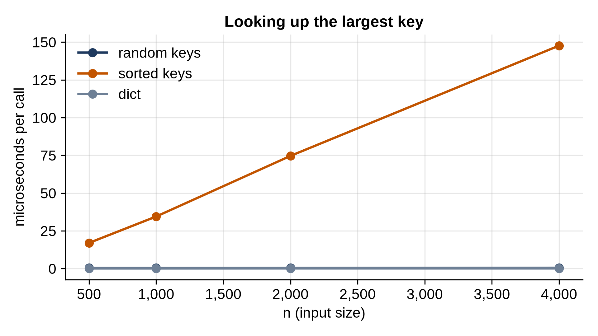

# Chapter 16: Binary Search Trees

A sorted list lets you binary search in O(log n), but inserting keeps costing O(n), because items shift. A hash table inserts and finds in O(1), but knows nothing about order: it can't tell you the smallest key, the keys between two values, or the next key after this one. A **binary search tree** (BST) aims to do everything in O(log n): find, insert, delete, and the ordered questions too. This chapter builds one, and then shows the input that destroys it.

## The Rule

A BST is a binary tree with one rule: for every node, every key in its left subtree is **smaller** than the node's key, and every key in its right subtree is **bigger**. So to find a key, start at the root and compare: smaller, go left; bigger, go right; equal, found. Each step goes one level down, so a search costs O(height).

## Searching and Inserting

```python
@include code/ch16/bst.py#L1-L53
```

Every method is a loop, not recursion. That's deliberate: as you'll see shortly, a BST can be thousands of levels deep, far past Python's recursion limit.

`_find` walks down from the root and returns two things: the node with the key (or `None`), and its parent, the last node visited. `get` and `__contains__` only need the first. `put` uses both: if the key exists, it replaces the value; if not, the search ended at exactly the place where the key belongs, as a child of `parent`, on the side the last comparison chose. A new key always becomes a leaf.

## Deleting

Deleting is the tricky operation, with three cases:

```python
@include code/ch16/bst.py#L55-L75
```

- **A leaf** is simply cut off: its parent's link becomes `None`.
- **A node with one child** is replaced by that child, which takes its place in the parent.
- **A node with two children** can't be cut out so simply. Instead, find its **successor**, the next bigger key, which is the leftmost node of its right subtree. Copy the successor's key and value into the node, then delete the successor, which has no left child, so it's one of the first two cases.

Copying the successor keeps the rule intact: the successor is bigger than everything in the node's left subtree and smaller than everything else in its right subtree.

## Ordered Operations

```python
@include code/ch16/bst.py#L76-L112
```

Iterating gives the keys **in sorted order**: it's the in-order traversal from Chapter 15, written with a stack. `min` follows left links to the bottom. `floor(key)` finds the largest key not bigger than `key`, remembering the best candidate whenever the walk goes right. Neither a dict nor a set can answer that without looking at every key. `height` counts levels with the level-by-level walk from Chapter 15.

```python
@include code/ch16/bst_demo.py
```

```
@include code/ch16/bst_demo.out
```

Deleting the root, 50, which has two children: its successor 60, the leftmost node of the right subtree, takes its place.

## Testing

```python
@include code/ch16/test_bst.py
```

```
@include code/ch16/test_bst.out
```

The delete test removes a leaf, a node with one child, a node whose second child was just removed, and the root with two children. The random test runs 20,000 puts and deletes against a `dict`, then checks that iteration gives exactly the dict's keys in sorted order.

## The Sorted-Input Disaster

Everything costs O(height). How tall does a BST get? It depends entirely on the order in which keys arrive:

```python
@include code/ch16/sorted_disaster.py
```

```
@include code/ch16/sorted_disaster.out
```

Inserted in random order, 10,000 keys make a tree of height 26, about twice log₂ n: random BSTs are reasonably balanced. Inserted in sorted order, every new key is bigger than all before it and goes to the far right: the tree is a single chain, height 9,999. It's a linked list with extra steps, and every operation is O(n). And sorted input is common: IDs that count up, timestamps, names read from a sorted file.

Timed, looking up the largest key:

```python
@include code/ch16/bench_bst.py
```

```
@include code/ch16/bench_bst.out
```



The tree built from random keys answers in about half a microsecond at every size here (O(log n) grows slowly). The tree built from sorted keys doubles its time with n: at 4,000 keys it's hundreds of times slower. The dict is flat and fastest, but can't answer any ordered question.

> **Tip:** If you need a sorted collection in Python and don't want to write a balanced tree, keep a sorted list and use `bisect` (Chapter 10): searches are O(log n), and inserts are O(n) but done by a fast memory copy, which is fine up to hundreds of thousands of items. Or use the third-party `sortedcontainers` package.

## Key Takeaways

- In a BST, smaller keys go left and bigger keys go right, at every node.
- Search, insert and delete cost O(height); deleting a node with two children copies in its successor.
- In-order traversal gives the keys sorted; BSTs answer ordered questions (min, floor, ranges) that hash tables can't.
- Random insertion order gives a height of about 2 log₂ n; sorted order gives a chain of height n - 1.
- Write BST operations as loops: an unbalanced tree can be deeper than the recursion limit.

## Exercises

1. **Is it a BST?** Check whether a binary tree satisfies the BST rule. Careful: comparing each node only with its parent isn't enough; each node must lie between bounds set by all its ancestors.
2. **Range query.** Yield the keys between `low` and `high` in order, visiting only the parts of the tree that can contain them.
3. **k-th smallest.** Find the k-th smallest key with an in-order walk that stops after k keys.
