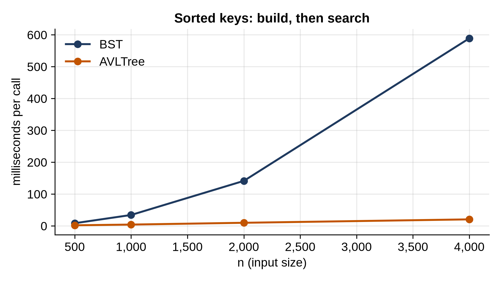

# Chapter 17: Balanced Trees: AVL

The binary search tree of Chapter 16 is fast when it's bushy and useless when it's a chain, and the input decides which. A **self-balancing** tree removes that dependence: after every insertion and deletion, it rearranges itself just enough to stay bushy, guaranteeing O(log n) operations on any input. This chapter builds the oldest one, the **AVL tree**, and verifies its guarantee with tests and timings.

## The Balance Rule

An AVL tree is a BST with one more rule: at every node, the heights of the left and right subtrees differ by **at most one**. That's enough to keep the whole tree's height below about 1.44 log₂ n, as you'll check below.

Each node stores its own height, so the rule can be checked in O(1):

```python
@include code/ch17/avl.py#L1-L29
```

`balance` is positive when the left side is taller, negative when the right side is. After an insertion or deletion, any node whose balance becomes +2 or -2 must be fixed.

## Rotations

The fix is a **rotation**: a small local rearrangement that changes heights while keeping the BST order.

```python
@include code/ch17/avl.py#L31-L54
```

`rotate_right` lifts a node's left child above it. Read the diagram in the docstring: the order a < left < b < node < c is the same before and after, so the BST rule still holds, but the left side has moved up a level and the right side down. Only three links change. `rotate_left` is the mirror image.

```python
@include code/ch17/avl.py#L56-L66
```

`rebalance` handles four cases. If the left side is too tall and its taller part is on the outside (left of the left child), one right rotation fixes it. If its taller part is on the *inside* (right of the left child), one rotation would just move the problem; so first rotate the left child left, turning it into the outside case, then rotate right. The right side is the mirror image.

## Inserting and Deleting

```python
@include code/ch17/avl.py#L69-L139
```

These are the BST operations from Chapter 16, written recursively, with one addition: on the way back up from the change, every node on the path is rebalanced: `return rebalance(node)`. Each call returns the root of its subtree, which may be a different node after a rotation, and the caller stores it.

Recursion is safe here. The height is at most about 1.44 log₂ n, so even a billion keys would need fewer than 45 levels. That guarantee is exactly what the plain BST lacked. Lookups and iteration are loops, the same as in the plain BST.

Watch it stay balanced as sorted keys arrive, the input that turned the plain BST into a chain:

```python
@include code/ch17/rotation_demo.py
```

```
@include code/ch17/rotation_demo.out
```

After 1, 2, 3 the tree rotates to put 2 at the root. By 7 keys it's a perfect tree of height 2.

## Testing the Guarantee

```python
@include code/ch17/test_avl.py
```

```
@include code/ch17/test_avl.out
```

`check` walks the whole tree and asserts everything an AVL tree promises: every node balanced, every stored height correct, and BST order between each node and its children. The first test inserts 1 to 1,023 in sorted order and expects a perfect tree of height 9. The second runs 5,000 random puts and deletes, including deletes of missing keys, against a `dict`, and after every operation runs `check` and verifies the height bound.

While this chapter was being written, that test failed once. The failure was in the test, not the tree: the test assumed a failed delete changed the count and tried to "undo" it, but `delete` raises `KeyError` before touching the count. A test that checks after every single operation catches mistakes on both sides.

## How Tall?

```python
@include code/ch17/heights.py
```

```
@include code/ch17/heights.out
```

For 100,000 sorted keys, the plain BST is 99,999 levels tall; the AVL tree is 16, essentially log₂ n, and nowhere near the 1.44 log₂ n worst case. The worst case needs a carefully built tree with as few nodes as possible for its height, and Exercise 2 counts how few: it grows like the Fibonacci numbers.

## Timing

Build a tree from n sorted keys, then look up every key:

```python
@include code/ch17/bench_avl.py
```

```
@include code/ch17/bench_avl.out
```



The plain BST quadruples with each doubling: n insertions and n lookups, each O(n), make O(n²). The AVL tree roughly doubles: O(n log n). At 4,000 keys it's about 28 times faster, and the gap grows without limit. Balance isn't free: every insertion updates stored heights all the way up the path and sometimes rotates. You pay a constant factor for a guarantee that no input can break.

> **Real-World Use:** Self-balancing trees run inside software you use every day, usually as **red-black trees**, a cousin of AVL trees with a looser balance rule and fewer rotations. Java's `TreeMap` is "a Red-Black tree based NavigableMap implementation" with guaranteed log(n) operations. The Linux kernel uses red-black trees to track I/O requests, high-resolution timers, each process's memory areas and epoll's file descriptors. Databases use **B-trees**, which keep many keys per node so each node fills one disk page: SQLite stores tables and indexes in them, and PostgreSQL's `CREATE INDEX` makes a B-tree unless told otherwise.

> **Interesting Fact:** The AVL tree is named after its inventors, Georgy Adelson-Velsky and Evgenii Landis, who published it in 1962. It was the first self-balancing binary search tree.

## Key Takeaways

- A self-balancing tree restructures itself after each change to guarantee O(log n) height on any input.
- An AVL tree keeps the two subtree heights at every node within one of each other; its height stays below about 1.44 log₂ n.
- Rotations restore balance by changing three links while preserving BST order; the inside cases need two.
- Inserting and deleting rebalance every node on the path back up, O(log n) of them.
- Test structural invariants (balance, stored heights, order) after every operation, not just the results.

## Exercises

1. **Counting rotations.** Count the rotations made while inserting 1,000 keys in sorted order and in random order. Which needs more, and why?
2. **The skinniest AVL tree.** The fewest nodes an AVL tree of height h can have satisfies N(h) = N(h - 1) + N(h - 2) + 1, with N(-1) = 0 and N(0) = 1. Compute N(h) up to h = 30 and compare log₂ N(h) with h.
