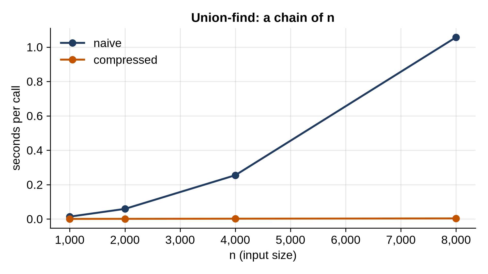

# Chapter 19: Union-Find

Some questions are about groups. Which computers in a network can reach each other? Which people are connected through chains of friendships? Which pixels of an image belong to the same blob? Connections arrive one at a time, and at any moment you need to answer: are these two in the same group?

**Union-find**, also called a **disjoint-set** structure, answers exactly that, with two operations: `union(a, b)` merges the groups of a and b, and `find(a)` names a's group. With two simple tricks, both take nearly constant time, and this chapter measures the difference those tricks make.

## Groups as Trees

Each group is stored as a tree, but an unusual one: every item points to its **parent**, not to its children, and the root of each tree names the group. Initially every item is its own group, its own root. `find(x)` follows parent pointers to the root. `union(a, b)` finds both roots and, if they differ, makes one root point to the other: one assignment merges two whole groups.

The items are numbered 0 to n - 1, so the parents fit in a plain list:

```python
@include code/ch19/union_find.py#L1-L38
```

## The Two Tricks

Without care, the trees can grow into long chains, and `find` becomes O(n). Two tricks prevent that:

- **Union by size.** When merging, hang the *smaller* tree under the root of the larger one. An item's depth only increases when its group at least doubles in size, so no item can be more than log₂ n deep.
- **Path compression.** After `find` reaches the root, go along the path again and point every node on it directly at the root. The next `find` for any of them takes one step.

`find` is written as two loops rather than recursion: the first finds the root, the second compresses. `union` returns `False` when the two items were already in the same group, which turns out to be useful, and keeps a count of the groups, `sets`.

For comparison, the naive version has neither trick:

```python
@include code/ch19/union_find.py#L40-L56
```

## Friend Groups

```python
@include code/ch19/friend_groups.py
```

```
@include code/ch19/friend_groups.out
```

Ana and Dan were never directly connected: Ana knows Ben, Ben knows Cat, Cat knows Dan. Union-find never stores those chains; it just merged the groups as each friendship arrived.

## Testing Against a Search

```python
@include code/ch19/test_union_find.py
```

```
@include code/ch19/test_union_find.out
```

The random test builds 200 random graphs, labels their connected components with an independent method, a depth-first search (which Chapter 21 covers in detail), and checks that both union-find versions agree on every single pair of items.

## Timing the Tricks

The worst case for the naive version: unions that build one long chain, then a `find` on every item.

```python
@include code/ch19/bench_union_find.py
```

```
@include code/ch19/bench_union_find.out
```



The naive version quadruples with each doubling: n finds along a chain of length n are O(n²). With union by size and path compression, the work is linear, and at 8,000 items it's over 300 times faster. In theory, the cost per operation with both tricks is the **inverse Ackermann function** of n, a function that grows so slowly it's below 5 for any n that could fit in the universe. In practice: constant.

> **Interesting Fact:** That astonishing bound, nearly constant time per operation for a sequence of unions and finds, was proved by Robert Tarjan in 1975, along with a matching lower bound: no union-find method of this kind can do better.

> **Interview Tip:** "Number of connected components", "are these connected?", "does adding this edge make a cycle?", "merge accounts that share an email": these are union-find questions. Kruskal's algorithm in Chapter 23 is built on it.

## Key Takeaways

- Union-find keeps groups as trees of parent pointers, with each root naming its group.
- `find` follows parents to the root; `union` links one root under another.
- Union by size keeps trees at most log₂ n deep; path compression flattens them as they're used.
- With both, operations are effectively constant time; without them, a chain makes them O(n).
- `union` returning `False` for items already connected is how you detect cycles.

## Exercises

1. **The redundant cable.** A network was a tree until one extra cable added a loop. Given the cables in the order they were added, find the first one that connected two computers that were already connected.
2. **When did everyone connect?** Friendships form at given times. Find the earliest time when everyone belongs to a single group.
