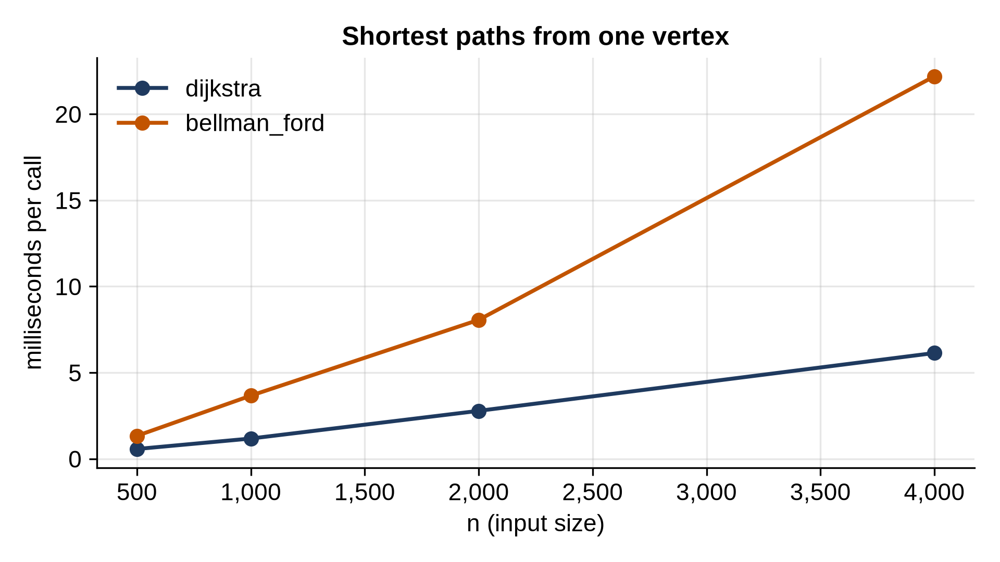

# Chapter 22: Shortest Paths

BFS finds the path with the fewest edges. But on a road map, fewer roads isn't the goal; fewer kilometers is. When edges have weights, the shortest path is the one whose weights add up to the least, and BFS no longer finds it. This chapter builds the two classic algorithms for weighted shortest paths: **Dijkstra's algorithm**, fast but limited to non-negative weights, and **Bellman-Ford**, slower but able to handle negative weights and to detect when no shortest path exists.

Graphs here are dictionaries mapping each vertex to a dictionary of `{neighbor: weight}`.

## Dijkstra's Algorithm

```python
@include code/ch22/shortest.py#L1-L39
```

Dijkstra's algorithm grows a set of vertices whose shortest distance is known for certain, starting from the source. At each step it takes the closest vertex not yet finished, finalizes it, and **relaxes** its edges: for each neighbor, if going through this vertex gives a shorter distance than the best known so far, record it.

Why is the closest unfinished vertex finished? Any other route to it would have to leave the finished set through some other unfinished vertex, which is at least as far away, and then add more edges, whose weights are all zero or positive. So no other route can be shorter. That argument is also exactly why Dijkstra needs non-negative weights.

A heap (Chapter 13) hands out the closest vertex. When a shorter distance to a vertex is found, a new entry is pushed instead of updating the old one, since heaps can't easily change an entry's priority; the old, longer entry is skipped when it's popped later, using the `done` set. This "lazy deletion" is the standard way to write Dijkstra in Python. Each edge can push one entry, so the cost is **O(E log E)**, often written O(E log V).

```python
@include code/ch22/road_demo.py
```

```
@include code/ch22/road_demo.out
```

Ashford to Cliffside directly is 35 km, but via Brookton it's 12 + 18 = 30. Every shortest route here happens to go through Brookton and Cliffside, and `path_to` follows the parents back to show it.

> **Interesting Fact:** Edsger Dijkstra designed this algorithm in 1956, in about twenty minutes, sitting at a café terrace in Amsterdam with his fiancée, and without pencil or paper. He needed a demonstration for a new Dutch computer, the ARMAC, so he chose a problem anyone could understand: the shortest route between two cities on a map of the Netherlands. He published it in 1959, and it has been taught ever since.

## When Weights Go Negative

Negative weights are rarer than positive ones, but they happen: a rebate on a route, a profit on a trade, a time offset. Here's what they do to Dijkstra:

```python
@include code/ch22/negative_demo.py
```

```
@include code/ch22/negative_demo.out
```

Dijkstra finalizes `a` at distance 2 and computes `t` = 3 from it. Later it finds the route s → b → a, which costs 5 - 4 = 1, so it updates `a`, but `a` is already finished, and `t` is never recomputed. The answer for `t`, 3, is wrong: the true distance is 2.

## Bellman-Ford

```python
@include code/ch22/shortest.py#L41-L60
```

Bellman-Ford gives up on finalizing vertices one at a time. Instead it relaxes *every* edge, over and over. After one round, it has the shortest paths that use at most one edge; after k rounds, at most k edges. A shortest path never needs more than V - 1 edges (it would repeat a vertex), so V - 1 rounds are enough: **O(V × E)**. If a round changes nothing, it stops early.

One more round settles a special case. A **negative cycle**, a loop whose weights sum to less than zero, makes "shortest path" meaningless: going around it once more always makes the path shorter. If any edge can still be relaxed after V - 1 rounds, there must be such a cycle, and the function says so.

## Testing Against Floyd-Warshall

```python
@include code/ch22/test_shortest.py
```

```
@include code/ch22/test_shortest.out
```

The reference here is a third algorithm, **Floyd-Warshall**, which computes shortest distances between *all* pairs of vertices with three nested loops: for each vertex k, check whether going through k improves the route between every pair. It's O(V³), fine for the test's small graphs, and short enough to be obviously right. On 200 random graphs, both algorithms must match it, and every reported path must add up to its distance. A second test checks a negative edge and then a negative cycle.

## Timing

```python
@include code/ch22/bench_shortest.py
```

```
@include code/ch22/bench_shortest.out
```



Dijkstra grows a little faster than linearly, as O(E log V) predicts. Bellman-Ford is several times slower, but it doesn't show its O(V × E) worst case here: on random graphs, distances settle after a handful of rounds, and the early stop kicks in. Its worst case needs graphs where shortest paths have many edges, like a long chain listed in the wrong order. Use Dijkstra whenever weights are non-negative.

> **Real-World Use:** Both algorithms route the internet. In **OSPF** (Open Shortest Path First, RFC 2328), the routing protocol used inside many large networks, every router learns the full map of links and their costs, and computes its own shortest-path tree with Dijkstra's algorithm. The older **RIP** (RFC 2453) is a distance-vector protocol from the Bellman-Ford family: each router only learns its neighbors' distance estimates, and the network converges round by round, just like the relaxation rounds above.

## Key Takeaways

- Dijkstra's algorithm finalizes the closest unfinished vertex each step; with a heap and lazy deletion it's O(E log V).
- Dijkstra requires non-negative weights; a negative edge can make it finalize a vertex too early.
- Bellman-Ford relaxes every edge V - 1 times: O(V × E), with negative weights allowed, and one extra round detects negative cycles.
- Keep each vertex's parent to reconstruct paths.
- For unweighted graphs, plain BFS is a shortest-path algorithm, and the fastest.

## Exercises

1. **Network delay.** A signal starts at one server and travels along links with given delays. How long until every server has received it? (The largest shortest distance, or -1 if some server is unreachable.)
2. **Cheapest flight with at most k stops.** Find the cheapest route using at most k + 1 flights. (Hint: Bellman-Ford with exactly k + 1 rounds, where each round only builds on the previous round's prices.)
