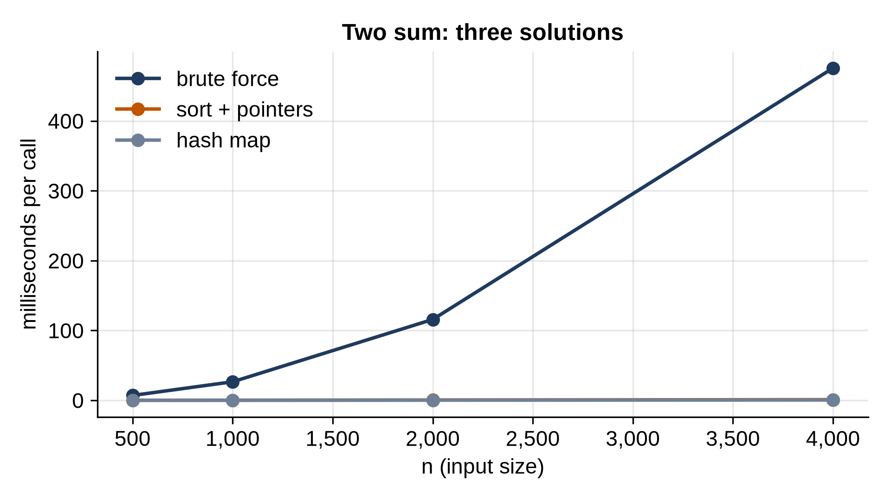

# Part VI: Interview Patterns

# Chapter 24: Solving a Problem in an Interview

Coding interviews test something different from everyday programming: solving an unfamiliar problem, under time pressure, while explaining your thinking. The good news is that most interview problems are built on a small number of **patterns**, and the structures from Parts II to V are their building blocks. This part of the book teaches the patterns one per chapter. This chapter gives you the method that ties them together, and the testing habit that catches your bugs before the interviewer does.

## A Five-Step Method

1. **Clarify.** Restate the problem in your own words. Ask about the input: how big can it be? Can it be empty? Can values be negative, or repeat? Is the input sorted? What should be returned if there's no answer? These questions often reveal the intended solution: "n can be up to 100,000" rules out O(n²).
2. **Work examples by hand.** Make a small example and solve it on paper. Then make an awkward one: empty input, one item, all items equal, the answer at the very end. You'll need these for testing anyway.
3. **Start with brute force.** Say the obvious solution, even if it's slow, and its Big O. It proves you understand the problem, it's a fallback, and it's often the starting point for the better solution: "the brute force checks every pair; can I avoid that?"
4. **Find the pattern.** Look for signals in the problem that point to a known technique (the table below), and say what the improved Big O would be before you write the code.
5. **Code, then test.** Write clean code with good names. Then trace your hand examples through it, line by line, out loud. Check the edge cases. State the final time and memory complexity.

## One Problem, Three Solutions

The classic opener: given a list of numbers and a target, find two positions whose numbers add up to the target.

```python
@include code/ch24/two_sum.py
```

The brute force checks every pair: O(n²) time, O(1) memory. Step 4 asks: what is the brute force *really* searching for? For each number x, it looks for `target - x`. "Have I seen this value before?" is a hash-map question, and remembering each value's position as you go makes the whole thing one pass: O(n) time, O(n) memory. Sorting is the middle road: sort the positions by value, then move two pointers inward from the ends (Chapter 25's pattern). O(n log n) time.

```python
@include code/ch24/bench_two_sum.py
```

```
@include code/ch24/bench_two_sum.out
```



At 4,000 numbers, brute force takes about half a second; the hash map, under half a millisecond, over a thousand times faster. That's the typical payoff of finding the pattern.

## Patterns and Their Signals

Every pattern has telltale signs in the problem statement:

```python
@include code/ch24/signals.py
```

```
@include code/ch24/signals.out
```

The rest of Part VI covers them: two pointers (Chapter 25), sliding window (26), hash maps and prefix sums (27), BFS and DFS on grids and implicit graphs (28), dynamic programming (29 and 30), and greedy algorithms and backtracking (31). Binary search on the answer, heaps, topological sort and monotonic stacks were covered with their structures in Chapters 10, 13, 21 and 8.

## What the Constraints Tell You

The input size is a strong hint about the expected complexity. Python runs on the order of ten million simple steps per second (the loops timed in Chapter 3 manage tens of millions). With a few seconds to spare:

| Largest n | Fast enough | Typical pattern |
| --- | --- | --- |
| about 10 to 20 | O(2ⁿ), O(n!) | Backtracking, trying all subsets |
| about 500 | O(n³) | Triple loops, some DP on intervals |
| about 5,000 | O(n²) | All pairs, DP on two sequences |
| 100,000 to 1,000,000 | O(n log n), O(n) | Sorting, heaps, two pointers, windows, hashing |
| beyond that | O(log n), O(1) | Binary search, math |

## Test Like a Professional: Stress Testing

Every pattern solution in Part VI is checked the same way: against a slow, obviously correct brute force, on thousands of small random inputs. It's called **stress testing**, and it's worth doing whenever you write something clever, including in an interview, where you can describe it even if there's no time to run it.

```python
@include code/ch24/stress_test.py
```

```
@include code/ch24/stress_test.out
```

`valid` checks an answer on its own terms: if the brute force found no pair, there must be none; otherwise the answer must be two different positions, in order, whose numbers add up to the target. (There can be several right pairs, so comparing with brute force's pair directly would give false alarms.)

The third solution looks right. It builds a dictionary from each value to its position, then looks up each number's partner. But on the ninth random input, `[-1, -1, 2, -3]` with target 4, it returns `(2, 2)`: it paired the 2 with itself. Hand-picked tests would very likely have missed it, because the bug only appears when a number is exactly half the target. The stress test also hands you a tiny input to debug by hand, because it uses small lists.

> **Interview Tip:** Interviewers care about how you think as much as what you write. Talk through each step, state complexities without being asked, and when you finish, test your code yourself: "let me trace through the example... and the empty list... and a list where the answer uses the same value twice."

## Key Takeaways

- Most interview problems are built on a few patterns, applied to the structures you already know.
- Clarify, work examples, state the brute force, find the pattern, then code and test.
- Words in the problem signal the pattern; the size of n signals the complexity you need.
- Stress test clever code against a brute force on many small random inputs; it finds bugs that hand-picked tests miss, with small inputs to debug.

## Exercises

1. **Two sum on a stream.** Numbers arrive one at a time. After each one, say whether any two numbers seen so far add up to the target. What does each step cost?
