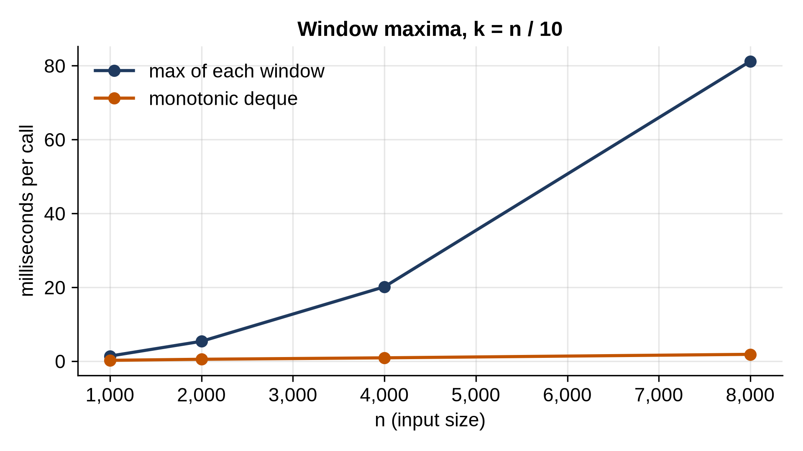

# Chapter 26: Sliding Window

"Find the longest run of...", "the shortest substring that...", "the best sum of k neighboring...": problems about **contiguous** runs of a list or string have an O(n²) brute force that tries every start and every end. The **sliding window** pattern is a special case of same-direction two pointers. A window `[left, right]` moves along the sequence: the right edge takes in one new item per step, and the left edge lets items go when the window breaks the problem's rule. Each item enters the window once and leaves it at most once, so the whole scan is O(n), even when there's a `while` loop inside the `for` loop.

There are two kinds. A **fixed-size** window always holds k items: each step adds one on the right and drops one on the left. A **variable-size** window grows and shrinks as needed.

## A Fixed-Size Window

```python
@include code/ch26/window.py#L8-L15
```

The largest sum of k neighboring numbers. Summing each window from scratch costs O(k) per window, O(n × k) in total. But two neighboring windows share all but two numbers: sliding by one adds the new number on the right and subtracts the one that fell off the left. One addition and one subtraction per step: O(n).

## Variable-Size Windows

### Longest Without Repeats

```python
@include code/ch26/window.py#L18-L26
```

The longest substring with no repeated character. The window holds a substring without repeats. When the new character `ch` already appears inside the window, the window must start after that earlier copy, so `left` jumps straight there; a dictionary of last positions finds it in O(1). The check `>= left` matters: a copy from *before* the window is no longer a repeat.

### Shortest With Enough

```python
@include code/ch26/window.py#L29-L40
```

The shortest run of positive numbers whose sum reaches a target. This is the shape you'll write most often: **grow** on the right until the window is valid, then **shrink** from the left while it stays valid, recording the best window along the way. It depends on the numbers being positive: adding an item can only raise the sum, and dropping one can only lower it. With negative numbers the window loses that guarantee, and you need prefix sums instead (Chapter 27).

### The Minimum Window Substring

```python
@include code/ch26/window.py#L43-L59
```

The shortest piece of `text` that contains every letter of `needed`, repeats included. It's the same grow-then-shrink shape, with smarter bookkeeping. `need` counts how many more of each letter the window needs (negative means extras), and `missing` counts the letters still missing in total, so checking "does the window have everything?" is O(1) instead of comparing two counters.

> **Tip:** Every variable-size window solution answers three questions. What does the window hold? What makes it valid? What do you track so you can update that in O(1) as items enter and leave: a sum, a counter, a dictionary of last positions? Answer them before you write the loop.

## The Maximum of Every Window

```python
@include code/ch26/window.py#L62-L74
```

The maximum of each window of size k needs one more idea, a **monotonic deque**, the cousin of Chapter 8's monotonic stack. The deque holds positions whose values decrease from front to back, so the front is always the window's maximum. When a new number arrives, every smaller number at the back can be thrown away for good: it's both smaller and older than the newcomer, so it can never be a maximum while the newcomer is in the window. The front leaves when it slides out of the window. Each position is added once and removed at most once: O(n), whatever k is.

## Demos and Tests

```python
@include code/ch26/window_demo.py
```

```
@include code/ch26/window_demo.out
```

```python
@include code/ch26/test_window.py
```

```
@include code/ch26/test_window.out
```

Every function is checked against a brute force that looks at every window or every substring, on thousands of small random inputs. Short strings over a three- or four-letter alphabet make repeats common, which is where window logic usually breaks.

## Timing

```python
@include code/ch26/bench_window.py
```

```
@include code/ch26/bench_window.out
```



With k = n / 10, recomputing `max()` over each window does about n × k = n² / 10 comparisons, so the time quadruples with each doubling, even though `max()` runs in C. The monotonic deque doubles: O(n). At 8,000 numbers, it's over 40 times faster.

> **Real-World Use:** The sliding window is how TCP, the protocol under most internet traffic, controls its flow. The receiver advertises a *window*: how many more bytes it has room for. The sender may have at most that many unacknowledged bytes in flight. As acknowledgments arrive, the window's left edge moves forward and the sender can send more; if the receiver's buffer fills up, it advertises a window of zero and the sender pauses. Rate limiters ("at most 100 requests in any 60 seconds") and moving averages on dashboards are sliding windows too.

> **Interview Tip:** The signal words are "contiguous", "substring", "subarray" and "consecutive", together with "longest", "shortest", "at most k" or "exactly k". If the problem says "subsequence" instead (items in order but not necessarily together), it's usually dynamic programming (Chapter 30), not a window.

## Key Takeaways

- A sliding window replaces every start-and-end pair with one pass in which each item enters once and leaves once: O(n).
- A fixed-size window adds one item and drops one per step.
- A variable-size window grows on the right and shrinks on the left while it stays valid (or until it's valid again).
- Keep a running summary of the window (sum, counter, last positions) that updates in O(1).
- Windows on sums need non-negative numbers; with negatives, use prefix sums.
- A monotonic deque gives the maximum (or minimum) of every window in O(n).

## Exercises

1. **An anagram in the text.** Does a text contain some rearrangement of a word's letters as a substring? For example, "eidbaooo" contains "ba", an anagram of "ab".
2. **Two kinds of fruit.** A row of fruit trees is given as a list of fruit kinds. You have two baskets, each able to hold only one kind of fruit, and you must pick from consecutive trees. What's the most fruit you can pick?
3. **Longest run of ones.** In a list of 0s and 1s, what's the longest run of 1s you can make if you may flip at most k zeros to ones?
