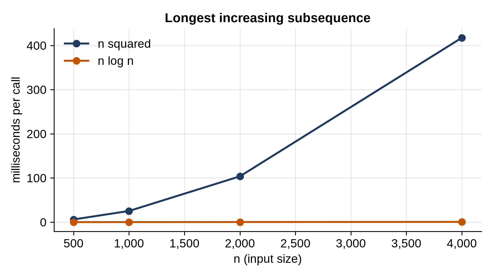

# Chapter 30: Dynamic Programming II: Sequences, Strings and Knapsack

The DP problems of Chapter 29 had one-dimensional states: an amount, a stair, a house. This chapter's problems compare two sequences or choose from a list of items under a limit, and their states are pairs: a position in each string, or an item and a remaining capacity. The tables are two-dimensional, but the five questions from Chapter 29 are the same. Along the way, you'll see the DP that powers every `diff` and the spelling suggestions in your phone, and a DP whose O(n²) table can be replaced by an O(n log n) binary search.

## Longest Common Subsequence

A **subsequence** keeps items in order but may skip some: "ACE" is a subsequence of "ABCDE". The **longest common subsequence** (LCS) of two sequences is the longest sequence that's a subsequence of both.

```python
@include code/ch30/dp_sequences.py#L7-L27
```

The state is a pair of prefixes: `table[i][j]` is the LCS length of the first i items of `a` and the first j items of `b`. Look at the last item of each. If they're equal, it belongs in the LCS, and the rest is the LCS of the two shorter prefixes: `table[i - 1][j - 1] + 1`. If they differ, at least one of them isn't in the LCS, so drop one or the other and take the better: `max(table[i - 1][j], table[i][j - 1])`. Filling the table is O(n × m).

The table only stores lengths. To recover the subsequence itself, walk back from the bottom-right corner, retracing the choices: a diagonal step for a match (record the item), otherwise a step toward the larger neighbor. Keeping enough information to reconstruct the answer, not just its size, is a common follow-up question.

```python
@include code/ch30/dp_sequences_demo.py
```

```
@include code/ch30/dp_sequences_demo.out
```

The second call compares two versions of a file, line by line. The LCS is exactly the lines a diff keeps unchanged; every other line in `before` was deleted, and every other line in `after` was added.

> **Real-World Use:** Finding the smallest diff between two files is the LCS problem on their lines. Git's default diff algorithm is Eugene Myers' 1986 algorithm, which solves it without filling the whole table: its running time depends on the size of the difference, so it's fast for the usual case of two versions that differ in a few lines. Git also offers the "patience" and "histogram" algorithms, which often produce diffs that are easier for people to read.

## Edit Distance

The **edit distance** (or Levenshtein distance) between two strings is the fewest single-letter insertions, deletions and replacements that turn one into the other. "kitten" becomes "sitting" in three: replace k with s, replace e with i, insert g.

```python
@include code/ch30/dp_sequences.py#L30-L42
```

The state is again a pair of prefixes. If the last letters match, they cost nothing: take the distance of the shorter prefixes. Otherwise, the last edit was one of three, and the code tries all three, plus one:

- **replace** the last letter of `a` with the last letter of `b`: `prev[j - 1]`;
- **delete** the last letter of `a`: `prev[j]`;
- **insert** the last letter of `b`: `cur[j - 1]`.

The base cases are the edges of the table: turning a prefix of length i into the empty string takes i deletions, and the empty string into a prefix of length j takes j insertions. Each row only needs the row above it, so the code keeps two rows instead of the whole table: O(n × m) time, O(m) memory. Here's the full table, to see the pattern:

```python
@include code/ch30/edit_table.py
```

```
@include code/ch30/edit_table.out
```

The answer, 3, is in the bottom-right corner. Moving diagonally down through matching letters (the `t t` and `n` stretches) keeps the number the same.

> **Real-World Use:** Spelling suggestions start from edit distance: words a small number of edits away from what you typed are the candidates. DNA and protein alignment in biology uses the same table with scores for each kind of change, an approach published by Needleman and Wunsch in 1970.

## The 0/1 Knapsack

A knapsack can carry a limited weight. Each item has a weight and a value, and each can be taken at most once (that's the "0/1": take it or leave it). What's the most value that fits?

```python
@include code/ch30/dp_sequences.py#L45-L53
```

The full state is (items considered so far, capacity used), and for each item there are two choices: leave it, or take it and add its value to the best for the remaining capacity. The code compresses the table to one row, `best[c]`, and processes each item by updating the row in place. The capacity loop runs *downward* for a subtle reason: `best[c - weight]` must still hold the value from *before* this item, so that the item can't be taken twice. Run the loop upward, and you've solved a different problem, the **unbounded** knapsack, where each item can be taken any number of times, which is exactly Chapter 29's coin problem.

With items (1, 1), (3, 4), (4, 5) and (5, 7) and capacity 7, the best is the items of weight 3 and 4, worth 9. Greedy by value per kilogram would take the 5-kilogram item (7 / 5 = 1.4 per kilogram) first and end with 8.

The cost is O(n × capacity). That's not polynomial in the size of the input, since the capacity is one number that can be huge: the general knapsack problem is NP-hard, and this DP is only fast when the capacity is reasonably small.

## Longest Increasing Subsequence

```python
@include code/ch30/dp_sequences.py#L56-L64
```

The longest strictly increasing subsequence of `[10, 9, 2, 5, 3, 7, 101, 18]` has length 4 (for example 2, 3, 7, 18). The textbook DP: `ends[i]` is the longest increasing subsequence that ends at position i, which is one more than the best `ends[j]` over earlier positions with a smaller number. O(n²).

A cleverer method keeps a different table:

```python
@include code/ch30/dp_sequences.py#L67-L78
```

`tails[k]` holds the smallest number that can end an increasing subsequence of length k + 1 found so far. A small ending is better than a large one, because more future numbers can extend it. The list `tails` is always sorted, so each new number finds its place with a binary search (Chapter 10): if it's larger than every tail, it extends the longest subsequence; otherwise it replaces the first tail that's at least as big, making that length's ending smaller. The length of `tails` is the answer. O(n log n).

(The list `tails` is not itself an increasing subsequence of the input; only its length is meaningful. Recovering an actual subsequence needs extra bookkeeping of parents.)

## Testing

```python
@include code/ch30/test_dp_sequences.py
```

```
@include code/ch30/test_dp_sequences.out
```

LCS is checked against every subsequence of both strings; edit distance against plain recursion that tries all three edits everywhere; knapsack against every subset of items; and both LIS versions against every subsequence. Small alphabets ("ab", "abc") make matches common.

## Timing

```python
@include code/ch30/bench_lis.py
```

```
@include code/ch30/bench_lis.out
```



The O(n²) version quadruples with each doubling; the binary-search version roughly doubles. At 4,000 numbers it's over 800 times faster. Finding a better state is often worth more than optimizing the loops.

> **Interview Tip:** For two strings, the state is almost always (i, j): a prefix of each. Draw the table for a tiny example, fill a few cells by hand, and the recurrence usually becomes clear from asking "what happened to the last letter?"

## Key Takeaways

- DP on two sequences uses a table indexed by a prefix of each: LCS and edit distance are O(n × m).
- Recover the answer, not just its size, by walking back through the table.
- When each row only needs the previous one, keep one or two rows instead of the table.
- In the 0/1 knapsack, the capacity loop runs downward so each item is used at most once; upward gives the unbounded version.
- The longest increasing subsequence drops from O(n²) to O(n log n) with a sorted list of the best tails and binary search.

## Exercises

1. **Maximum run sum.** Find the largest sum of a run of neighboring numbers, which may be negative, in O(n). (Hint: the best run ending at each position either extends the best run ending one step earlier or starts fresh.)
2. **Word break.** Can a string be split into words from a dictionary? "pineapplepenapple" can: "pine apple pen apple" or "pineapple pen apple".
3. **Equal halves.** Can a list of positive numbers be split into two groups with equal sums? (Hint: it's a knapsack question.)
