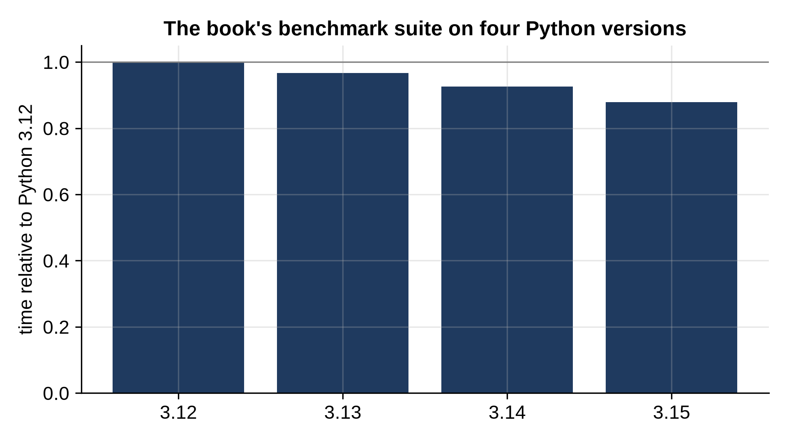

# Chapter 33: Is Python Getting Faster?

Every listing in this book was run on four versions of Python: 3.12, 3.13, 3.14 and 3.15. Since 2021, the CPython core developers have worked steadily on speed, and each release's "What's New" document reports gains. This chapter puts the claims to a small test of its own: a suite of the kinds of work this book does, timed on all four versions on the same computer.

## What Changed

Each recent release made changes aimed at speed. A few highlights, from the official "What's New" documents:

- **Python 3.11** (2022) was the big jump: its notes say "between 10-60% faster than Python 3.10", 1.25 times faster on average on the standard benchmark suite, mostly from a **specializing interpreter** that rewrites instructions to faster versions for the types it actually sees.
- **Python 3.13** (2024) added two experimental options, both off by default: a build without the global interpreter lock (**free-threaded**), so threads can run Python code on several cores at once, and a **just-in-time (JIT) compiler**.
- **Python 3.14** (2025) made the free-threaded build officially supported and added a new **tail-calling interpreter**, reported as 3 to 5% faster on the standard benchmark suite when CPython is built with a recent Clang. The JIT was included in the official Windows and macOS installers, still off by default.
- **Python 3.15**, released on 9 October 2026, reports the JIT as 7 to 8% faster than the standard interpreter on x86-64 Linux (geometric mean over the benchmark suite).

## The Suite

```python
@include code/ch33/suite.py
```

Eight tests, each a kind of work from this book: appending to a list, dictionary inserts and lookups, recursive calls, heap operations, a BFS on a grid, building and walking a linked list of node objects, an insertion sort (pure Python loops and comparisons), and `sorted()` (almost entirely C code). Each test is timed with Chapter 3's `bench.measure`, which keeps the fastest of several rounds.

On its own, the suite prints its times:

```
@include code/ch33/suite.out
```

To compare versions, `tests/record_versions.py` in the book's code runs the suite with each Python in turn, three passes in rotation, and keeps each version's fastest time for each test, so a burst of background activity on the computer can't favor one version. The results are saved in `versions.json`, and this short program compares them:

```python
@include code/ch33/chart_versions.py
```

```
@include code/ch33/chart_versions.out
```



## What the Numbers Say

Each number is a test's time relative to Python 3.12: 0.88 means it took 88% as long, 12% faster. The "overall" row is the **geometric mean** of the ratios, the right way to average ratios: a test that takes half as long and one that takes twice as long average to 1.00, no change, as they should.

- **The trend is real but modest.** Overall, 3.13 is about 3% faster than 3.12, 3.14 about 7%, and 3.15 about 12%. That's without the JIT or free threading, with the default build of each version.
- **Pure Python code gains the most.** The linked list (creating objects and following attributes) takes 32% less time on 3.15, the insertion sort 25% less, and recursion 21% less. This is exactly the code the interpreter improvements target: many small Python-level operations.
- **Code that runs in C gains nothing.** `sorted()` spends nearly all its time in C comparisons, and the heap test mostly calls the C functions in `heapq`, so interpreter improvements can't help them. The heap test is within a few percent of 3.12 on every version, and `sorted()` is even 8 to 12% slower on 3.14 and 3.15 here, more likely an effect of the different builds (see below) than of any change to the sorting code.
- **Not every step is forward.** On 3.13, the insertion sort was 21% *slower* and the BFS 10% slower; both improved well past 3.12 on 3.14 and 3.15. A single test on a single computer can move by several percent for reasons that have nothing to do with the language, such as how the code happens to line up in the processor's caches.

> **Tip:** Treat any single benchmark number with suspicion, including this book's. Ratios under about 5% can come from the build, the computer and the moment as much as from the language. The trends that hold across many tests, such as "pure Python code is getting faster, C code isn't", are the ones to trust.

## How the Pythons Were Built

The comparison is fair only if the builds are comparable, and here they aren't quite the same. Python 3.12.3 is the version that came with the operating system (Ubuntu), compiled with GCC. Python 3.13.5, 3.14.8 and 3.15.0 were installed with `uv`, a Python package and project manager, which downloads prebuilt, optimized builds of CPython, compiled with Clang; the 3.14 and 3.15 builds use the tail-calling interpreter. All four are standard builds with the global interpreter lock, and the JIT, which the 3.14 and 3.15 builds include, was left off, its default. Appendix C has the details of the computer.

So part of the difference between 3.12 and the rest may come from the compiler, not from Python. If you want to know what upgrading will do for *your* program, the honest answer is: measure it. Run the suite, or better, your own program's benchmarks, with each version you're considering, as this chapter did. The JIT can be tried on 3.14 or 3.15 by setting the environment variable `PYTHON_JIT=1` before starting Python, if your build includes it.

## What This Means for You

The improvements in recent versions are welcome, and they're free: upgrade and your pure Python code runs faster. But compare their size with the differences measured throughout this book:

- choosing a set instead of a list for membership tests: thousands of times faster (Chapter 1);
- a hash map instead of a nested loop for two sum: over a thousand times faster at 4,000 numbers (Chapter 24);
- a better algorithm for the longest increasing subsequence: over 800 times faster at 4,000 numbers (Chapter 30).

A new Python version gives you 5 or 10%. A better data structure or algorithm can give you a factor of a hundred or a thousand, and the factor grows with the input. Upgrade Python, by all means. But the choices this book teaches are where speed really comes from.

## Key Takeaways

- On this book's suite, Python 3.15 is about 12% faster than 3.12 overall, with the default build and no JIT.
- Pure Python code (object creation, attribute access, loops, recursion) gained the most; code that runs in C gained nothing.
- Individual results move by several percent between versions and builds; trust trends across many tests, not single numbers.
- Average ratios with the geometric mean.
- Measure your own program on the versions you're considering.
- Version upgrades give percentages; better algorithms and data structures give multiples.
