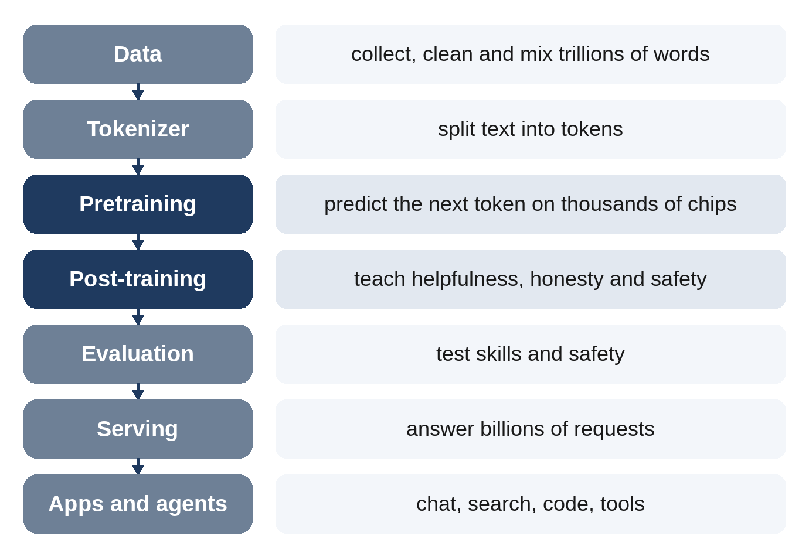

# Introduction

In November 2022, a website appeared that let anyone type a question and get a fluent, thoughtful answer from a computer. Within about two months, by one widely quoted estimate, it had a hundred million users. Today, programs like it write emails, explain medical results, translate conversations, draw pictures, make videos, write software and carry out tasks on their own. They are called **large language models**, or **LLMs**, and they are probably the most talked-about technology of our time.

Yet most people who use them have no idea how they are made. Is there a giant database of answers inside? Does the computer understand what it says? Why does it sometimes make things up? Why does it need whole buildings full of chips, as much electricity as a city, and water for cooling? Who decides how it behaves? And how do the same ideas produce pictures, videos and "agents" that act on their own?

This book answers those questions, from the very beginning to the very end.

## What This Book Covers

The book follows a language model's whole life, in the order it happens:

- **Part I, The Big Idea:** what a language model actually does, where it came from, and how it turns words into numbers.
- **Part II, The Ingredients:** the data it learns from, how neural networks learn at all, the Transformer design behind most modern language models, alternative and hybrid designs, and the "scaling laws" that made companies spend billions.
- **Part III, The Factory:** the chips, the data centers, the electricity and the water, with real numbers, and the months-long training run itself.
- **Part IV, From Autocomplete to Assistant:** how a raw model is taught to be helpful and safe, how "reasoning" models think before they answer, and how a new model is tested and validated before anyone gets to use it.
- **Part V, Using the Model:** what happens in the second between your question and the answer, how models are made smaller, how they look things up, and how they become agents that use tools.
- **Part VI, The Model Zoo:** what "open" really means, a tour of the major open models and the frontier labs, and what makes each one different.
- **Part VII, Beyond Text:** models that see, draw, make videos, listen and speak, and what all of this means for society.

At the back, five appendices collect the essentials: a **timeline** of language AI, a **glossary** of every technical term, **fact sheets** for the major model families, **credits** for who invented what, and a guide that **decodes model names and abbreviations**, from GPT and BERT to "235B-A22B".

## How This Book Is Written

**No mathematics, no programming.** Every idea is explained in everyday language, usually with an analogy. Where a number helps, you'll get the number and what it means.

**Every key fact has a source.** Language AI is surrounded by hype and by myths. Every key figure in this book, whether it's the cost of a training run, the water used per question or the size of a model, comes from the people who did the work or from careful independent studies, and each chapter ends with its sources. When sources disagree, the book says so and explains why.

**Credit where it's due.** The ideas in this book were invented by real people, often years before anyone noticed. You'll meet them: the mathematician who played a guessing game with letters in 1951, the eight authors of a 2017 paper that changed everything, and the teams in many countries who built the models you use.

**Two kinds of boxes** appear throughout:

> **Did You Know?** Surprising facts, like the fact that a single training run of a large model was interrupted 419 times by unexpected problems in 54 days, and still finished.

> **In Plain Words:** One-sentence summaries of the big ideas, for when a section gets dense.

## A Note on Dates

This book describes the world of language AI as of **October 2026**. The field changes every month: new models appear, prices fall and leaderboards reshuffle. The names of the newest models will date quickly, but the ideas won't. A model released next year will still be made of tokens, trained on data with chips, taught with feedback, and served one token at a time. Learn the ideas, and every future announcement will make sense.

Let's begin with the single, surprisingly simple trick at the heart of it all.
