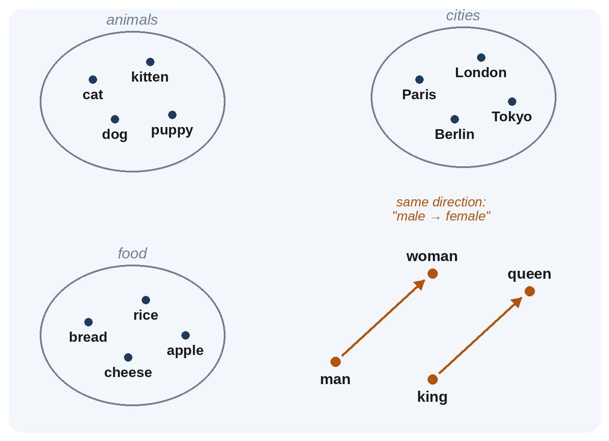

# Chapter 4: Embeddings: Meaning as Numbers

A tokenizer turns text into ID numbers, but an ID number is just a label, like a seat number in a theater. Seat 1102 tells you nothing about the person sitting in it. For a model to work with meaning, each token needs a richer description: a long list of numbers that places it among all the other tokens, so that similar things end up close together. That list is called an **embedding**, and it is one of the most beautiful ideas in modern AI.

## Words as Places on a Map

Imagine a huge map on which every word has a location. Words with similar meanings are placed near each other: *cat* near *dog* and *kitten*; *Paris* near *London* and *Berlin*; *run* near *jog* and *sprint*. Words that have nothing in common are far apart.

On a paper map, a location is two numbers: how far east and how far north. An embedding is the same idea with many more directions, typically thousands. GPT-3 described each token with 12,288 numbers; the largest Llama 3 model uses 16,384. Nobody can picture a map with sixteen thousand directions, but the principle is the same as on paper: nearby means similar, and directions can mean something.

> **In Plain Words:** An embedding is a token's address on a giant map of meaning. Similar words live in the same neighborhood.

## Nobody Draws the Map

Here is the remarkable part: nobody decides where the words go. The embeddings start as random numbers. During training, every time the model makes a prediction, it nudges the embeddings a tiny bit in the direction that would have made the prediction better. Over billions of examples, words that appear in similar situations, such as *cat* and *dog*, which both get fed, petted, taken to the vet and described as cute, drift into the same neighborhood, because treating them similarly helps predict the words around them.

This follows an idea from the linguist **J. R. Firth**, who wrote in 1957: "You shall know a word by the company it keeps." Language models turned that observation into arithmetic.

## King Minus Man Plus Woman

In 2013, **Tomas Mikolov** and colleagues at Google released **word2vec**, a fast way to learn word embeddings from large amounts of text. They noticed something astonishing: *directions* on the map had meaning. The step from *man* to *woman* pointed in roughly the same direction as the step from *king* to *queen*, or *uncle* to *aunt*. So you could do arithmetic with meaning:

*king − man + woman ≈ queen*

Similar patterns appeared for countries and capitals (*Paris − France + Italy ≈ Rome*), verb tenses (*walking − walk + swim ≈ swimming*) and comparisons (*bigger − big + small ≈ smaller*). No one had programmed gender, geography or grammar into the system. It discovered these relationships as a side effect of predicting words.

> **Did You Know?** The same trick revealed something uncomfortable. In 2016, Tolga Bolukbasi and colleagues showed that word embeddings learned from news articles also completed analogies like "man is to computer programmer as woman is to homemaker". Embeddings faithfully absorb the patterns in their training text, including its stereotypes. Measuring and reducing such bias became an important research field (Chapter 16).

## From Fixed Embeddings to Meaning in Context

word2vec gave each word one fixed location. But many words have several meanings. Think of *bank* in "I sat on the river bank" and "I deposited money at the bank". A single address can't capture both.

Modern language models solve this in two stages:

1. **Starting embedding.** Each token first gets its fixed embedding from a lookup table, exactly as above. This table is part of the model's parameters: with a vocabulary of 128,000 tokens and 16,384 numbers each, the table alone holds about two billion numbers.
2. **Contextual meaning.** Then the Transformer's layers (Chapter 7) repeatedly update each token's numbers based on the words around it. After a few layers, the numbers for *bank* in the river sentence have moved toward *shore* and *water*; in the money sentence, toward *account* and *loan*.

So inside a model, a word's representation isn't fixed: it's continuously refined as the model reads, until the numbers for each position capture not just "this word" but "this word, here, meaning this".

## Word Order

There is one more ingredient. If a model only knew which tokens were present, "the dog bit the man" and "the man bit the dog" would look identical. So models also add information about each token's **position** in the text. Early Transformers added a fixed pattern of waves to each embedding; most modern models use a method called **rotary position embedding (RoPE)**, introduced by **Jianlin Su** and colleagues in 2021, which encodes position by rotating the numbers by an amount that depends on where the token sits. The details are mathematical, but the purpose is simple: to tell the model what comes before what.

## Embeddings Everywhere

Embeddings aren't only an internal part of chatbots. They're one of the most useful tools in practical AI:

- **Search by meaning.** Turn every document into an embedding, and a question into an embedding, and you can find documents whose meaning is close to the question, even if they share no words. This is the heart of the "retrieval" systems in Chapter 19.
- **Recommendations.** Products, songs and films can be embedded, so that "people who liked this" becomes "things nearby on the map".
- **Images and text together.** Chapter 24 shows how images and their descriptions can be placed on the same map, which is how a model can find a photo from a description, and a key step toward models that see.

## Key Takeaways

- An **embedding** is a long list of numbers that places a token on a map of meaning; GPT-3 used 12,288 numbers per token, and Llama 3's largest model 16,384.
- Embeddings are learned, not designed: words used in similar contexts drift together during training ("you shall know a word by the company it keeps").
- Directions carry meaning, as word2vec showed with *king − man + woman ≈ queen*, and embeddings also absorb biases in their training text.
- In modern models, each token's numbers are updated by the context around it, so the same word can mean different things in different sentences. Position information tells the model the order of the words.
- Embeddings also power search by meaning, recommendations and models that connect pictures and words.

## Sources and Further Reading

- J. R. Firth, "A Synopsis of Linguistic Theory, 1930-1955," in *Studies in Linguistic Analysis* (1957).
- Tomas Mikolov, Kai Chen, Greg Corrado, Jeffrey Dean, "Efficient Estimation of Word Representations in Vector Space," 2013. arxiv.org/abs/1301.3781
- Tomas Mikolov, Wen-tau Yih, Geoffrey Zweig, "Linguistic Regularities in Continuous Space Word Representations," NAACL 2013.
- Tolga Bolukbasi et al., "Man is to Computer Programmer as Woman is to Homemaker? Debiasing Word Embeddings," NeurIPS 2016. arxiv.org/abs/1607.06520
- Tom B. Brown et al., "Language Models are Few-Shot Learners" (GPT-3: 12,288-dimensional model), 2020. arxiv.org/abs/2005.14165
- Llama Team, Meta, "The Llama 3 Herd of Models" (405B model dimension 16,384), 2024. arxiv.org/abs/2407.21783
- Jianlin Su et al., "RoFormer: Enhanced Transformer with Rotary Position Embedding," 2021. arxiv.org/abs/2104.09864
