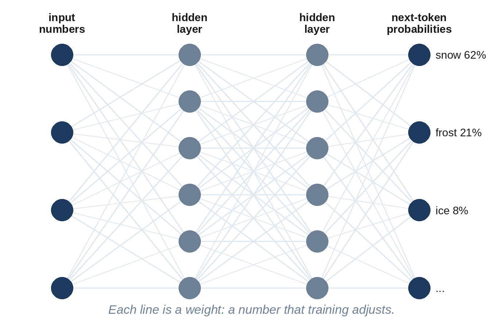

# Chapter 6: How Neural Networks Learn

We've said that a language model is a neural network with billions of adjustable numbers, and that training sets those numbers by showing it text. But how, exactly, does a pile of numbers "learn"? The answer is the engine of all modern AI, and it can be understood without any mathematics: make a guess, measure how wrong it was, and nudge every number slightly in the direction that would have made the guess better. Then do that trillions of times.

## A Very Simple Neuron

In 1943, **Warren McCulloch** and **Walter Pitts** proposed a mathematical model of a brain cell, and in 1958 **Frank Rosenblatt** built the **perceptron**, a machine that could learn. The basic unit, still used today, is the artificial **neuron**:

1. It takes in several numbers.
2. It multiplies each by its own **weight**, a number that says how much that input matters.
3. It adds them up, plus an extra number called a **bias**.
4. It passes the total through a simple function, for example "if it's negative, output zero".

That's all. One neuron is almost useless. But connect millions of them in layers, the outputs of one layer becoming the inputs of the next, and the network can represent extraordinarily complicated patterns. The weights and biases are the **parameters**: the knobs that training turns.

> **In Plain Words:** A neural network is many simple calculators wired together in layers. Each connection has a strength, and learning means adjusting those strengths.

Real brains inspired the idea, but the resemblance is loose. An artificial neuron is a few multiplications and an addition; a biological neuron is a living cell of astonishing complexity.

## Measuring Wrongness: The Loss

To learn, the network needs a score that says how wrong it was. For a language model, this is easy to define. Take a sentence from the training data, hide the next word, and ask the model for its probabilities. Suppose the real next word was "snow", and the model gave "snow" a probability of 0.6. Good, but not perfect. If it had given it 0.01, that would be very bad.

The score used, called the **loss**, is essentially "how surprised was the model by the right answer?" A confident correct prediction gives a loss near zero; a confident wrong prediction gives a large loss. Training aims to make the average loss over all the training text as small as possible. (Technically it's called **cross-entropy**, and it's a direct descendant of the measure Claude Shannon used for his guessing game.)

## Walking Downhill in the Fog

Imagine standing on a hillside in thick fog, trying to reach the bottom of the valley. You can't see the valley, but you can feel the slope under your feet. So you take a small step in the steepest downhill direction, check the slope again, and repeat. Eventually you reach low ground.

That is **gradient descent**, the method used to train essentially every neural network. The "landscape" is the loss: every possible setting of the parameters is a location, and the height is how wrong the model is. The **gradient** is the slope: for every single parameter, it says "turn this knob up a little, and the loss goes down by this much" or "turn it down".

The difference from the hillside is the number of directions. A hiker has two. A large language model has as many directions as it has parameters: hundreds of billions. Yet the rule is the same: measure the slope in every direction, take a small step downhill, repeat.

## Backpropagation: Assigning Blame

How do you find the slope for a hundred billion knobs at once? Testing each knob separately would take forever. The trick is an algorithm called **backpropagation**, made famous in 1986 by **David Rumelhart**, **Geoffrey Hinton** and **Ronald Williams**.

Backpropagation works backwards from the error. The final layer's neurons are told how they contributed to the mistake; they pass blame back to the neurons that fed them, in proportion to how much each one influenced them; and so on, back through every layer to the start. One backward pass gives the slope for every parameter, at roughly the cost of running the model a couple of times. Without backpropagation, training today's models would be impossible.

> **Did You Know?** Geoffrey Hinton, who championed neural networks through decades when most researchers had given up on them, shared the 2024 Nobel Prize in Physics with John Hopfield "for foundational discoveries and inventions that enable machine learning with artificial neural networks". The same year, the Nobel Prize in Chemistry went partly to Demis Hassabis and John Jumper of Google DeepMind for AlphaFold, an AI system that predicts protein structures.

## The Training Loop

Put together, training is a simple loop, repeated an enormous number of times:

1. Take a **batch** of text from the training data, for example a few million tokens.
2. Run it through the model to get predictions (the **forward pass**).
3. Compute the loss: how surprised was the model by the real next tokens?
4. Use backpropagation to find the slope for every parameter (the **backward pass**).
5. Nudge every parameter a tiny step downhill.
6. Go back to step 1 with the next batch.

The size of each step is set by the **learning rate**. Too large, and the model overshoots and becomes unstable, like a hiker taking giant leaps who ends up on the opposite hillside. Too small, and training takes forever. Modern training starts with a short "warm-up", uses the largest safe step for most of the run, then gradually shrinks the step size near the end to settle into a good spot. The recipe for adjusting steps, called the **optimizer**, matters too: most models use **Adam**, published by **Diederik Kingma** and **Jimmy Ba** in 2014, or newer variants of it, which give each parameter its own adaptive step size.

## Learning, Not Memorizing

There is a danger in all this. A model could get a low loss on its training text simply by memorizing it, like a student who memorizes past exam papers without understanding the subject. This is called **overfitting**, and such a model does badly on anything new.

To check, labs keep some text aside, never used for training, and measure the loss on that too. As long as the loss on unseen text keeps falling, the model is learning general patterns, not just memorizing. Large language models are typically trained on so much data, often seeing most of it only once, that classic overfitting is less of a problem than in smaller systems. They do still memorize some text, especially text that appears many times, such as famous quotes, licenses and popular passages, which is one reason removing duplicates matters (Chapter 5).

## How Many Numbers? How Much Arithmetic?

Some rough figures help make this concrete:

- Each parameter is usually stored as a 16-bit number (2 bytes) when the model is used. A 70-billion-parameter model is therefore about 140 gigabytes: more than a laptop's memory, but just a few high-end chips.
- Training needs much more memory than using a model, because the optimizer keeps extra numbers for every parameter, and the backward pass needs to remember intermediate results. A common rule of thumb is about 16 bytes per parameter during training, so a 70-billion-parameter model needs over a terabyte of fast memory, spread across many chips.
- Training a model takes roughly **six arithmetic operations per parameter per training token**: about two for the forward pass and four for the backward pass. For a 405-billion-parameter model trained on 15 trillion tokens, that's 6 × 405 billion × 15 trillion, or about 4 × 10²⁵ operations: four followed by twenty-five zeros. Meta's report on Llama 3 gives exactly this order of magnitude: 3.8 × 10²⁵.

That last number is why the next three chapters are about chips, data centers and electricity. But first, we need to look inside the network itself, at the design that made all of this possible.

## Key Takeaways

- A neural network is layers of simple artificial neurons; the strengths of their connections (**parameters**) are what training adjusts.
- The **loss** measures how surprised the model was by the right answer; training tries to make it small.
- **Gradient descent** takes small steps downhill on the loss; **backpropagation** efficiently works out which way to turn every parameter.
- Training repeats: batch, forward pass, loss, backward pass, update, with a carefully scheduled learning rate and an optimizer such as Adam.
- Training a frontier model takes around 10²⁵ operations or more: roughly six per parameter per token.

## Sources and Further Reading

- Warren S. McCulloch and Walter Pitts, "A Logical Calculus of the Ideas Immanent in Nervous Activity," *Bulletin of Mathematical Biophysics* 5 (1943).
- Frank Rosenblatt, "The Perceptron: A Probabilistic Model for Information Storage and Organization in the Brain," *Psychological Review* 65 (1958).
- David E. Rumelhart, Geoffrey E. Hinton, Ronald J. Williams, "Learning representations by back-propagating errors," *Nature* 323 (1986): 533-536.
- Diederik P. Kingma and Jimmy Ba, "Adam: A Method for Stochastic Optimization," 2014. arxiv.org/abs/1412.6980
- The Nobel Prize in Physics 2024, NobelPrize.org; The Nobel Prize in Chemistry 2024, NobelPrize.org.
- Jared Kaplan et al., "Scaling Laws for Neural Language Models," 2020 (the 6 × parameters × tokens rule). arxiv.org/abs/2001.08361
- Llama Team, Meta, "The Llama 3 Herd of Models," 2024 (3.8 × 10²⁵ FLOPs for the 405B model). arxiv.org/abs/2407.21783
