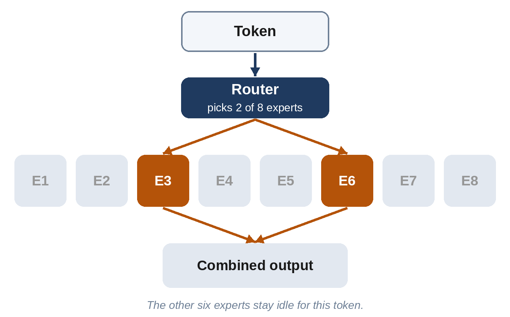

# Chapter 7: The Transformer: Attention Is All You Need

Most of today's leading general-purpose language models, including the GPT, Claude, Gemini, Llama, Qwen and DeepSeek families, are built on the same basic design, or on a close hybrid of it: the **Transformer**, introduced by eight Google researchers in 2017. Other approaches exist, such as the state-space models described at the end of this chapter, and some systems combine both. This chapter explains how it works, in plain language. The central idea, **attention**, is surprisingly intuitive: when you read a word, you know which other words in the sentence it relates to. A Transformer learns to do the same.

## The Problem: Reading One Word at a Time

Before the Transformer, the best language networks were **recurrent neural networks (RNNs)**. They read a sentence the way you might listen to someone speak: one word at a time, carrying a running summary in memory. That had two big weaknesses.

First, the running summary was a bottleneck. By the end of a long paragraph, details from the beginning had faded, like trying to remember the first sentence of a long speech. Second, because each step depended on the previous one, the work couldn't be split up: word 100 had to wait for word 99. That made training slow, no matter how many chips you had.

The Transformer solved both problems at once. It looks at all the words together, and lets every word directly consult every other word, in parallel.

## Attention: Every Word Asks a Question

Consider this sentence:

*"The trophy didn't fit in the suitcase because **it** was too big."*

What does *it* refer to? The trophy, obviously, because a big trophy wouldn't fit. Change one word, "because it was too *small*", and *it* now means the suitcase. To understand *it*, you have to look at the right other words.

Attention lets the model do exactly this. For each token, the model asks: **which other tokens are relevant to me, and what should I take from them?** It works like a library search:

- Each token produces a **query**: what it's looking for. (*It* is looking for "a thing that could be big or small".)
- Each token also produces a **key**: a label saying what it offers. (*Trophy* says "a physical object, could be big".)
- And each token produces a **value**: the information it will hand over if chosen.

The model compares each query with every key to score how relevant each token is, turns the scores into percentages, and then gives each token a blend of the other tokens' values, weighted by those percentages. After this step, the numbers for *it* contain a large share of the information from *trophy*.

The queries, keys and values aren't programmed: they're produced by parameters that are learned during training, just like everything else.

> **In Plain Words:** Attention lets every word look at every other word, decide which ones matter to it, and absorb information from them.

## Many Heads, Many Layers

One attention step can only look for one kind of relationship at a time. So Transformers run many attention calculations side by side, called **attention heads**. One head might track which noun a pronoun refers to; another, which verb goes with which subject; another, the previous occurrence of the same name; another, matching brackets in code. The largest Llama 3 model has 128 heads in every layer. Nobody assigns these jobs: they emerge during training.

After attention, each token's numbers pass through a **feed-forward network**, a block of ordinary neurons that processes each token on its own. If attention is where tokens share information, the feed-forward block is where each token "thinks" about what it has gathered. Research suggests that much of a model's factual knowledge is stored in these feed-forward blocks.

Attention plus feed-forward makes one **layer** (also called a **block**). A Transformer stacks many layers on top of each other: GPT-3 had 96; the largest Llama 3 has 126. As information flows up through the layers, the representations become steadily more abstract: early layers handle spelling and grammar, middle layers meaning and relationships, and later layers what to say next.

Two small engineering tricks make deep stacks trainable. **Residual connections** let each layer *add* its contribution to a running total rather than replace it, so information can flow straight through, and **normalization** keeps the numbers in a sensible range. You can think of the running total as a stream flowing up through the model, which each layer reads from and writes to.

## Writing Without Peeking

A language model generates text from left to right, so during training it mustn't be allowed to cheat by looking at the words it's supposed to predict. Transformers for generating text use **causal masking**: each token may attend only to the tokens before it, never after. This is why these models are sometimes called **decoder-only** Transformers. The original 2017 Transformer, built for translation, had two halves: an **encoder** that read the whole source sentence and a **decoder** that wrote the translation. Google's BERT used just the encoder; OpenAI's GPT used just the decoder, and the decoder design won for chatbots.

Thanks to the mask, a single pass over a training passage gives the model thousands of predictions to learn from at once: one for every position. That parallelism is the reason the Transformer could be scaled up so far.

## The Price of Attention

Attention has a cost. If every token looks at every other token, doubling the length of the text quadruples the work: 1,000 tokens means a million comparisons; 100,000 tokens means ten billion. That is why long context windows were so hard to achieve, and why a great deal of engineering goes into making attention cheaper:

- **FlashAttention**, by **Tri Dao** and colleagues (2022), reorganized the calculation to use the chip's fastest memory efficiently, giving large speed-ups without changing the result.
- **Grouped-query attention** shares keys and values among several heads, shrinking the memory needed while generating. Llama 3 uses 8 key-value groups for its 128 heads.
- **Multi-head latent attention**, introduced by DeepSeek, compresses the keys and values even further.
- **Sliding-window** and other sparse patterns let some layers look only at nearby tokens.

## Mixture of Experts: A Bigger Brain That Uses Less of Itself

In a standard Transformer, every token goes through every parameter. A **mixture of experts (MoE)** design changes the feed-forward part of each layer: instead of one big block, there are many smaller "expert" blocks, plus a small **router** that sends each token to just a few of them.

The result is a model that *contains* a huge number of parameters but *uses* only a fraction for any one token. Mistral's Mixtral 8x7B (2023) had about 47 billion parameters but used about 13 billion per token. DeepSeek-V3 has 671 billion, with 37 billion active. Kimi K2 has a trillion parameters, of which 32 billion work on any one token, chosen from 384 experts. MoE lets a model store far more knowledge for roughly the same running cost. Despite the name, the experts don't neatly specialize in subjects like "history" or "chemistry"; the specialization that emerges is usually much harder for people to label.

The idea is older than the Transformer: **Noam Shazeer** and colleagues at Google described a sparsely-gated mixture-of-experts layer in 2017, and Google's Switch Transformer (2021) scaled it up. By 2026, most of the largest open models used MoE.

## Beyond Attention?

Researchers keep looking for designs that avoid attention's quadratic cost. The most successful family so far is **state-space models**, notably **Mamba**, by **Albert Gu** and **Tri Dao** (2023), which process text in a single pass with a fixed-size memory, so the cost grows only in proportion to the length. Pure state-space models haven't replaced Transformers, but **hybrids** that mix a few attention layers with many Mamba-style layers, such as AI21's Jamba (2024) and NVIDIA's Nemotron-H (2025), run long texts considerably faster. Attention, it turns out, isn't *all* you need, but it remains the core of nearly every frontier model.

## Peeking Inside

Because a Transformer's knowledge is spread across billions of numbers, understanding *why* it says what it says is hard. A field called **interpretability** tries to reverse-engineer it.

> **Did You Know?** In May 2024, Anthropic researchers published "Scaling Monosemanticity", which identified millions of internal "features" inside the Claude 3 Sonnet model: patterns of activity corresponding to concepts like cities, famous people, code errors and even deception. One feature fired for the Golden Gate Bridge. When the researchers artificially turned it up, the model became obsessed, describing itself as the bridge and steering every conversation back to it. For a short time, Anthropic let the public chat with this "Golden Gate Claude", a memorable demonstration that concepts inside a model can be found and adjusted.

## Key Takeaways

- The **Transformer** (2017) reads all tokens at once, which makes training highly parallel and scalable.
- **Attention** lets each token ask which other tokens are relevant (queries and keys) and blend in their information (values). Many **heads** track different relationships.
- A model is a stack of identical layers, each with attention and a feed-forward network; Llama 3's largest has 126 layers and 128 heads per layer.
- **Causal masking** stops tokens from seeing the future, so a text model can learn from every position at once.
- Attention's cost grows with the square of the text length, driving innovations such as FlashAttention and grouped-query attention.
- **Mixture of experts** routes each token to a few expert blocks, so a model can hold a trillion parameters while using a few percent per token.

## Sources and Further Reading

- Ashish Vaswani et al., "Attention Is All You Need," NeurIPS 2017. arxiv.org/abs/1706.03762
- Hector Levesque, Ernest Davis, Leora Morgenstern, "The Winograd Schema Challenge," KR 2012. The trophy-and-suitcase sentence is a classic example of these "Winograd schemas", named after Terry Winograd.
- Tri Dao et al., "FlashAttention: Fast and Memory-Efficient Exact Attention with IO-Awareness," 2022. arxiv.org/abs/2205.14135
- Joshua Ainslie et al., "GQA: Training Generalized Multi-Query Transformer Models from Multi-Head Checkpoints," 2023. arxiv.org/abs/2305.13245
- Llama Team, Meta, "The Llama 3 Herd of Models" (126 layers, 128 heads, 8 key-value heads), 2024. arxiv.org/abs/2407.21783
- DeepSeek-AI, "DeepSeek-V2" (multi-head latent attention), 2024. arxiv.org/abs/2405.04434; "DeepSeek-V3 Technical Report," 2024. arxiv.org/abs/2412.19437
- Noam Shazeer et al., "Outrageously Large Neural Networks: The Sparsely-Gated Mixture-of-Experts Layer," 2017. arxiv.org/abs/1701.06538
- William Fedus, Barret Zoph, Noam Shazeer, "Switch Transformers," 2021. arxiv.org/abs/2101.03961
- Albert Q. Jiang et al., "Mixtral of Experts," 2024. arxiv.org/abs/2401.04088
- Albert Gu and Tri Dao, "Mamba: Linear-Time Sequence Modeling with Selective State Spaces," 2023. arxiv.org/abs/2312.00752
- NVIDIA, "Nemotron-H: A Family of Accurate and Efficient Hybrid Mamba-Transformer Models," 2025. arxiv.org/abs/2504.03624
- Adly Templeton et al., "Scaling Monosemanticity: Extracting Interpretable Features from Claude 3 Sonnet," Anthropic, May 2024. transformer-circuits.pub/2024/scaling-monosemanticity
