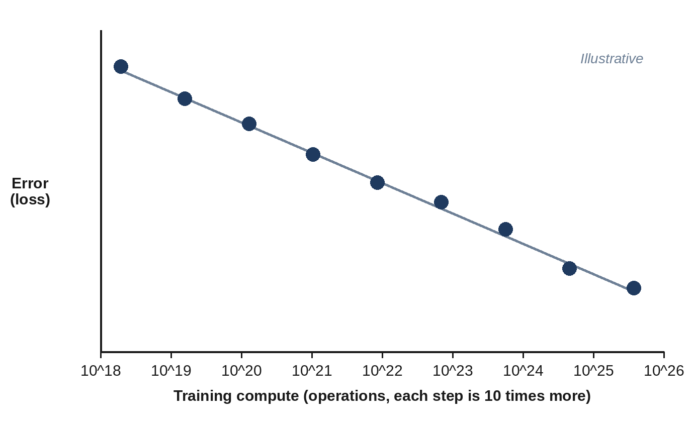

# Chapter 8: Bigger Is Better? Scaling Laws

Why are companies spending billions of dollars on chips and building data centers the size of towns? Because of one of the most consequential discoveries in the history of computing: language models get better **predictably** as you give them more parameters, more data and more computing power. This chapter explains these **scaling laws**, how they changed the way models are built, and where their limits may lie.

## The Bitter Lesson

In March 2019, **Richard Sutton**, one of the founders of reinforcement learning, wrote a short essay called "The Bitter Lesson". Looking back over seventy years of AI research, he observed that clever methods built on human knowledge, such as hand-written rules about language or chess, kept losing in the long run to simple, general methods that could make use of more computation. As computers got cheaper, the general methods kept getting better, and the clever ones didn't. The lesson was "bitter" because it suggested that researchers' insights mattered less than they'd like to believe.

Language models turned out to be the most dramatic example yet.

## Straight Lines on a Chart

In January 2020, **Jared Kaplan**, **Sam McCandlish** and colleagues at OpenAI published "Scaling Laws for Neural Language Models". They trained many models of different sizes, on different amounts of data, with different amounts of computation, and measured the loss (how well each predicted the next token). The results were astonishingly regular: plotted on the right kind of chart, the loss fell in a nearly straight line as model size, data or compute increased, across a range of more than a millionfold.

This meant something profound: **you could predict how good a model would be before you built it.** Train a series of small, cheap models, draw the line, and extend it. A company could forecast what a model ten or a hundred times larger would achieve, and decide whether it was worth the money. GPT-3, released a few months later, was in part a bet on that line.

> **In Plain Words:** Scaling laws say that if you multiply the model size, data and computing power, the model improves by a predictable amount. That predictability is why billions are invested in ever-larger training runs.

## Chinchilla: More Data, Not Just More Parameters

The first scaling laws suggested that the best way to spend extra computing power was mostly on bigger models. In 2022, **Jordan Hoffmann** and colleagues at DeepMind revisited the question with more than 400 trained models and reached a different answer: model size and training data should grow **together**, in equal proportion.

They tested it directly. DeepMind's earlier model **Gopher** had 280 billion parameters but was trained on only 300 billion tokens, about one token per parameter. Using the same amount of computation, they trained **Chinchilla**, with just 70 billion parameters, on 1.4 trillion tokens: four times smaller, with four times more data. Chinchilla beat Gopher, and also GPT-3 and other much larger models, on almost every test.

The Chinchilla result gave the field a famous rule of thumb: about **20 training tokens per parameter** is the most efficient use of a fixed training budget. It also revealed that many earlier models had been "undertrained": far too big for the amount of text they'd seen.

## Why Train "Too Long"?

Then the industry did something that seems to contradict Chinchilla: it started training small models on *far more* than 20 tokens per parameter. Meta trained the 8-billion-parameter Llama 3 on about 15 trillion tokens, almost 2,000 tokens per parameter, a hundred times beyond the Chinchilla rule.

There's no contradiction. Chinchilla answered the question "what's the best model I can train with a fixed budget?" But a model is trained once and then used billions of times, and a smaller model is much cheaper to run. So it's worth spending extra training compute to squeeze as much quality as possible into a small model. This is called **overtraining**, and it's why today's small models are so much better than older large ones.

## Do New Abilities Suddenly Appear?

Scaling laws describe the smooth improvement in the loss. But people care about abilities: doing arithmetic, translating, writing code. In 2022, **Jason Wei** and colleagues described **emergent abilities**: skills that seemed absent in smaller models and then appeared suddenly at a certain size, as if a switch had flipped.

In 2023, **Rylan Schaeffer**, **Brando Miranda** and **Sanmi Koyejo** at Stanford argued that much of this "suddenness" was an illusion created by how abilities were scored. If you only award points for an exactly correct answer, a model that is gradually getting closer looks like it's failing, failing, failing and then suddenly succeeding. Measured with smoother scores, many abilities improved gradually. The debate continues, but both sides agree on the practical point: bigger, better-trained models can do things that smaller ones can't, and it's hard to predict exactly which new skills will appear.

## The Three Ingredients, Growing Fast

Scaling depends on three things growing together: **compute**, **data** and **parameters**. All three have grown at an extraordinary pace.

- **Compute.** The research group Epoch AI tracks the training compute of notable AI models. It found that the compute used to train frontier models grew about **four to five times every year** from 2010 to 2024. Over a decade, that's a factor of around a million.
- **Cost.** Epoch estimates that the cost of the largest training runs has been doubling roughly every nine months, and that the most advanced models now cost hundreds of millions of dollars to train, counting the hardware and electricity used. Sam Altman said in 2023 that GPT-4 cost "more than $100 million" to train; frontier runs since then are larger still.
- **Data.** From about 300 billion tokens for GPT-3 in 2020 to tens of trillions for leading models in 2025 and 2026, which, as Chapter 5 described, is approaching the limits of human-written text.

> **Did You Know?** If the trend continues, Epoch AI projects that training runs using around 2 × 10²⁹ operations will be technically feasible by 2030, thousands of times more than GPT-4's training run. The main limits are expected to be electricity, chip manufacturing, data and money, roughly in that order.

## A New Kind of Scaling: Thinking Time

Since 2024, a second scaling law has joined the first. Researchers found that letting a model **think longer** before answering, generating a long chain of reasoning, checking its work and trying alternatives, also improves results predictably. OpenAI reported in 2024 that its o1 model got better both with more reinforcement-learning training and with more time spent thinking when answering.

This is called **test-time compute** or **inference-time scaling**: spending more computation when the model is used, not just when it's trained. It's why modern assistants often have a setting for "effort" or "thinking", and why a hard question can take a minute to answer while an easy one takes a second. Chapter 14 explains how reasoning models are trained.

## Is Scaling Running Out?

Every few months, someone declares that scaling has "hit a wall". The honest answer is more nuanced:

- **Pretraining on public text** is getting harder to scale, because of the data limits in Chapter 5, and each tenfold increase in compute buys a smaller visible improvement than it used to.
- **Other kinds of scaling** are now carrying more of the progress: reinforcement learning on reasoning tasks, synthetic data, multimodal data such as video, and test-time compute.
- **Physical limits** are real: electricity, chip supply and cooling (Chapters 9 to 11) now constrain how fast the largest companies can grow.

What's clear is that the scaling laws reshaped the industry. They turned AI research from a craft of clever ideas into an engineering discipline of predictable investment, and they're the reason the rest of this part of the book is about factories, chips and power stations.

## Key Takeaways

- **Scaling laws** (Kaplan et al., 2020) showed that a language model's loss improves smoothly and predictably with more parameters, data and compute, so performance can be forecast before building a model.
- **Chinchilla** (2022) showed that parameters and data should grow together, about 20 tokens per parameter for the most efficient use of a training budget.
- Models meant to be used heavily are deliberately **overtrained** on far more data, because smaller models are cheaper to run.
- Training compute for frontier models has grown four to five times a year; the largest runs now cost hundreds of millions of dollars.
- A newer scaling law concerns **thinking time**: models improve when they reason longer before answering.

## Sources and Further Reading

- Richard Sutton, "The Bitter Lesson," 13 March 2019. incompleteideas.net/IncIdeas/BitterLesson.html
- Jared Kaplan et al., "Scaling Laws for Neural Language Models," 2020. arxiv.org/abs/2001.08361
- Jordan Hoffmann et al., "Training Compute-Optimal Large Language Models" (Chinchilla), 2022. arxiv.org/abs/2203.15556
- Jason Wei et al., "Emergent Abilities of Large Language Models," 2022. arxiv.org/abs/2206.07682
- Rylan Schaeffer, Brando Miranda, Sanmi Koyejo, "Are Emergent Abilities of Large Language Models a Mirage?," NeurIPS 2023. arxiv.org/abs/2304.15004
- Epoch AI, "Machine Learning Trends" and data insights on training compute and cost. epoch.ai/trends
- Epoch AI, "Can AI scaling continue through 2030?," 2024. epoch.ai/blog/can-ai-scaling-continue-through-2030
- Llama Team, Meta, "The Llama 3 Herd of Models," 2024 (8B model trained on about 15T tokens). arxiv.org/abs/2407.21783
- OpenAI, "Learning to Reason with LLMs," 12 September 2024. openai.com/index/learning-to-reason-with-llms
- Will Knight, "OpenAI's CEO Says the Age of Giant AI Models Is Already Over," *Wired*, April 2023 (GPT-4 "more than $100 million").
