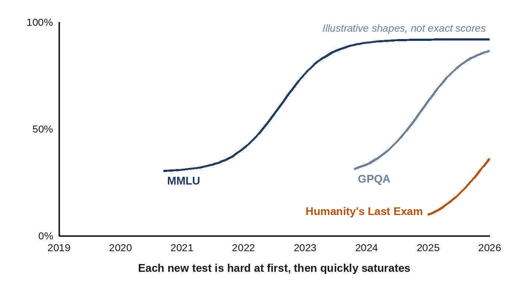

# Chapter 15: Measuring Intelligence: Benchmarks and Validation

Every new model is launched with a table of numbers: scores on tests with names like MMLU, GPQA, SWE-bench and Humanity's Last Exam, each a little higher than the competition's. What do these tests actually measure? How are they made? And why do experts treat them with a healthy dose of suspicion? This chapter explains how AI is measured, how a lab validates a new model step by step before releasing it, and why measuring it is so hard.

## Why Tests Matter

During pretraining, the loss tells you how well a model predicts text. But nobody uses a model to predict text; they use it to answer questions, write code and solve problems. So researchers build **benchmarks**: fixed sets of tasks with known answers, scored automatically, which let different models be compared fairly.

Benchmarks have driven AI progress for decades. The ImageNet challenge, with its 1.2 million labeled photos, was where AlexNet made its breakthrough in 2012 (Chapter 2). A good benchmark gives a whole field a shared target.

## The Benchmark Treadmill

Language model benchmarks follow a familiar life cycle: a test is created; it seems very hard; models improve rapidly; within a few years, top models score near the maximum and the test stops being useful. This is called **saturation**.

- **MMLU** (Massive Multitask Language Understanding), created by **Dan Hendrycks** and colleagues in 2020, has about 16,000 multiple-choice questions across 57 subjects, from law and medicine to history and physics. GPT-3 scored about 44% when it was published, well above guessing (25%) but far from experts. By 2024, top models scored around 90%, and it was effectively saturated.
- **GPQA** (2023) was designed to be "Google-proof": 448 very hard science questions written by PhD experts. Experts in the field answered about 65% correctly; skilled non-experts, with unlimited web access and over 30 minutes per question, managed only about 34%. Within two years, reasoning models were scoring above the experts.
- **Humanity's Last Exam** (2025), organized by the Center for AI Safety and Scale AI, gathered about 2,500 questions from nearly a thousand experts around the world, each chosen because frontier models of the time got it wrong. Early models scored in single digits; scores have risen quickly since.

> **Did You Know?** Some benchmark questions turn out to be wrong. When researchers re-checked MMLU, they found errors in a noticeable share of questions, including some subjects where a large fraction of the "correct" answers were mistaken. Near the top of a test, models may be "losing points" for disagreeing with a faulty answer key.

## Testing Real Work

As models became useful for real tasks, benchmarks followed:

- **SWE-bench** (2023), by **Carlos Jimenez**, **John Yang** and colleagues at Princeton, gives the model real bug reports from popular open-source Python projects on GitHub and asks it to fix the code, checking the result with the project's own tests. When it was published, the best model solved under 2% of the problems. A human-checked subset, **SWE-bench Verified** (2024), became the standard measure of AI coding agents, and top systems now solve the large majority.
- **Agent benchmarks** test whether a model can complete multistep tasks on a computer, such as booking a trip on a website, using a spreadsheet or researching a question on the web.
- **METR**, a research nonprofit, measures the length of tasks, timed by how long they take skilled humans, that AI agents can complete. In 2025, it reported that this "time horizon" had been doubling roughly every seven months for six years: from tasks of a few seconds to tasks of about an hour.

## A Map of the Main Benchmarks

There are hundreds of benchmarks. Most fall into a handful of families, each checking a different skill:

| Skill | Well-known benchmarks | What they check |
| --- | --- | --- |
| Knowledge | MMLU, MMLU-Pro, GPQA | Expert questions across many subjects |
| Math | GSM8K, MATH, AIME | From school word problems to competition math |
| Coding | HumanEval, SWE-bench, Terminal-Bench | Writing functions, fixing real bugs, working in a terminal |
| Agents | OSWorld, τ-bench, BrowseComp | Using a computer, serving customers, finding hard-to-find facts on the web |
| Long context | Needle in a haystack, RULER | Finding and combining facts in very long inputs |
| Vision | MMMU, ChartQA | College-level questions with images, reading charts |
| Factuality | TruthfulQA, SimpleQA | Avoiding popular myths and made-up answers |
| Hardest problems | Humanity's Last Exam, ARC-AGI, FrontierMath | Questions current models usually get wrong |
| Safety | HarmBench, WMDP, refusal tests | Resisting misuse, dangerous knowledge, over-refusal |

A few of these became famous. **GSM8K** (OpenAI, 2021) has about 8,500 grade-school math word problems; early GPT-3 models solved few of them, and today's models solve almost all. **HumanEval** (OpenAI, 2021) has 164 handwritten programming problems, each checked by running unit tests. **AIME**, the American Invitational Mathematics Examination, a real competition for top high-school students, became a favorite test of reasoning models because fresh problems are written every year, so they can't have been in the training data.

## Arena: Let the Public Decide

Fixed tests can't capture whether people actually *like* a model's answers. In 2023, researchers at UC Berkeley launched **Chatbot Arena** (later **LMArena**). Anyone can visit, type a prompt and see answers from two anonymous models side by side, then vote for the better one. Millions of votes are combined into a ranking using the **Elo** rating system, originally invented to rank chess players.

The Arena became one of the most watched leaderboards in AI. It has its own limits: votes reward style as well as substance, such as longer answers, friendly formatting and confident tone, and companies can test many private versions before release. In April 2025, Meta drew criticism after it emerged that the Llama 4 version ranked highly on the Arena was an "experimental chat version" tuned for conversation, not the one released to the public.

## Inside a Benchmark Run

What actually happens when a lab "runs MMLU" or "runs SWE-bench"? Every benchmark run follows the same basic recipe, carried out by a program called an **evaluation harness**:

1. **Load the test set.** A fixed list of questions with their correct answers, or tasks with automatic checks.
2. **Build the prompt.** Each question is wrapped in a standard template: instructions, sometimes a few solved examples, then the question.
3. **Run the model with fixed settings.** Temperature, whether it may think first and for how long, whether it may use tools, and how many attempts it gets are all set in advance and kept the same for every model being compared.
4. **Extract the answer.** The harness finds the final answer in the model's reply: a letter, a number, a block of code, a change to a file.
5. **Score it.** The answer is compared with the key, or checked by running tests, or graded by a judge model.
6. **Add it up.** The scores are averaged into one number, ideally reported with an **error bar** showing how much it might vary by chance.

Widely used open-source harnesses include EleutherAI's **lm-evaluation-harness**, Stanford's **HELM** (Holistic Evaluation of Language Models), and **Inspect**, released by the UK AI Security Institute in 2024 and used by many safety testers. Labs also run large private harnesses of their own.

### The Settings That Change a Score

The same model can get very different scores on the same test depending on how it is run. That's why serious reports state their settings, and why comparing two companies' numbers is risky unless the settings match.

- **Zero-shot or few-shot.** "Zero-shot" means the question is asked cold. "Five-shot" means five solved examples are shown first, to demonstrate the format. MMLU is traditionally reported five-shot.
- **Thinking or not.** Letting a model reason step by step, or giving a reasoning model a larger thinking budget, can raise math and science scores by tens of points.
- **Tools.** A model allowed to run code or search the web can do far better on some tests. Humanity's Last Exam, for example, is reported both with and without tools.
- **Number of attempts.** Is the score from one try, the best of several, or a majority vote? These are reported with different names, explained below.
- **Answer extraction.** If a model writes "The answer is probably (B), although (C) is tempting", a sloppy harness might mark it wrong. Small differences in extraction rules can move scores by several points.

### Ways of Scoring

- **Exact match.** The extracted answer must equal the key: right for multiple-choice letters and for math answers that are a single number.
- **Accuracy.** The share of questions answered correctly: the usual headline number.
- **pass@k.** For coding tests, the model writes *k* attempts at each problem; a problem counts as solved if at least one attempt passes all the tests. **pass@1**, one attempt, is the strictest and most common figure. The measure was introduced with OpenAI's HumanEval benchmark in 2021.
- **Majority vote (maj@k or cons@k).** The model answers each question *k* times and its most common answer is scored. This rewards consistent reasoning and usually raises scores a little.
- **pass^k.** For agents, the opposite question: does the agent succeed on *all* of *k* tries at the same task? This measures **reliability**, which matters for a customer-service agent that handles the same request thousands of times. It was introduced with the τ-bench agent benchmark in 2024.
- **Judge scores.** For open-ended answers, a judge model scores each answer against a rubric, or picks the better of two (see "Models Grading Models" below).
- **Ratings from comparisons.** Arena-style leaderboards turn many head-to-head votes into a rating for each model, with a confidence range.

## How Each Kind of Benchmark Is Run

Here is how a model is actually tested on each of the main benchmark families.

### Knowledge: MMLU-Style Multiple Choice

The model sees a question and four options, such as:

*Which gas makes up most of the Earth's atmosphere? (A) Oxygen (B) Carbon dioxide (C) Nitrogen (D) Argon*

In the classic setup, five solved questions from the same subject come first, and the model must reply with a single letter. (An older method doesn't let the model write at all: it checks which of the four letters the model considers most probable.) Each correct letter scores one point; MMLU's test set has about 14,000 questions over 57 subjects, so the final score is an average across all of them. Random guessing would score 25%, which gives a useful floor: a score of 30% means the model knows very little.

### Math: From Word Problems to Olympiads

For **GSM8K**, the model reads a grade-school word problem, works through it step by step, and writes a final number, which is compared with the key. For competition math such as **AIME**, the answer is always a whole number from 0 to 999, so a lucky guess is almost impossible.

AIME has a statistical catch: each year's exam has only 15 problems (30 across its two versions). One problem is worth more than three percentage points, so a single lucky or unlucky answer moves the score a lot. Labs therefore run each problem many times, often 8 to 64 attempts, and report the average, to get a stable number. Because new AIME problems are written every year, they are also a good check against contamination: a model released before an exam can't have seen its questions.

### Coding: Tests Decide

For **HumanEval**, the model is given the start of a Python function: its name and a description of what it should do, in plain English. It writes the body of the function. The harness then runs a set of hidden **unit tests**, small programs that call the function with different inputs and check the outputs. If every test passes, the problem is solved. The code is run in a **sandbox**, an isolated environment, because model-written code could do something harmful by accident.

**SWE-bench** is far more realistic, and its harness is more elaborate:

1. For each task, the harness builds a container, a sealed mini-computer, with a real open-source project exactly as it was when a real bug was reported.
2. The model, usually working as an agent, reads the bug report, explores the code, runs commands and finally produces a **patch**: a set of changes to the files.
3. The harness applies the patch and runs two groups of tests: tests that failed before the real human fix and must now pass, proving the bug is fixed; and tests that passed before and must still pass, proving nothing else was broken.
4. The task counts as solved only if both groups pass.

> **Did You Know?** When OpenAI worked with professional software developers in 2024 to create SWE-bench Verified, they had every original task reviewed by human engineers and filtered out the many that were unfair: bug reports too vague to act on, or tests that checked details the bug report never mentioned. The result was a set of 500 tasks that a capable engineer could reasonably solve. Even good benchmarks can contain impossible questions, and cleaning them up is part of validation.

### Agents: Checking the End Result

Agent benchmarks put the model in a working environment and check what it achieved, not what it said.

- **OSWorld** (2024) gives the agent a real computer, with an operating system, a browser and office apps, and tasks such as "change the spreadsheet's chart to a bar chart". After the agent finishes, a checking script inspects the files and settings to see whether the job was really done. In the original study, people completed about 72% of the tasks; the best AI agent of the time, about 12%.
- **τ-bench** (2024), from the company Sierra, simulates customer service: another language model plays a customer with a goal, such as changing a flight booking, and the agent must follow the airline's or shop's policy using its tools. At the end, the harness compares the database with the correct final state, and it reruns each task several times to measure reliability with pass^k.
- **BrowseComp** (OpenAI, 2025) asks hard-to-find questions whose answers are buried deep on the web but easy to check once found.

### Long Context: Needles and Beyond

A long document, such as hundreds of pages of text, is generated, and facts are planted at chosen positions. The model is asked to find them, combine them, count them or track how a value changes. Repeating this at different lengths and positions draws a map of where the model's attention fails. **RULER** (NVIDIA, 2024) extended the simple needle test with harder variations, showing that many models' "effective" context was much shorter than the length they claimed.

### The Hardest Questions: Humanity's Last Exam

Each question has one short, unambiguous answer, and some are multiple choice. Because a correct answer can be written in different ways, such as "1/2" or "0.5", a judge model checks whether the model's answer means the same as the key. The model must also state how confident it is, and the benchmark measures **calibration**: whether a model that says "90% sure" is right about 90% of the time. Early models were badly overconfident, giving high confidence to wrong answers.

### Safety Benchmarks

- **Refusal tests** use two sets of prompts: harmful requests the model should decline, and harmless requests that merely *sound* dangerous, such as "How do I kill a Python process?". A good model scores high on the first set and low on refusals in the second.
- **Jailbreak tests** measure the **attack success rate**: how often known or automatically generated attacks make the model comply with a harmful request. HarmBench (2024) standardized this.
- **Hazardous-knowledge tests** such as **WMDP** (2024) use multiple-choice questions that act as a proxy for dangerous knowledge in biology, chemistry and cybersecurity, without publishing anything dangerous themselves. Results feed into the safety levels described in Chapter 16.

### Human Preference: Arena Ratings

As described earlier in this chapter, each vote in LMArena is a single comparison: model A beat model B on one prompt. Millions of such votes are combined with a statistical method (since late 2023, the Bradley-Terry model, a close cousin of Elo) into a rating for each model, with a confidence range. Two models whose ranges overlap are effectively tied. The Arena also offers "style control", which adjusts for answer length and formatting, so that models aren't rewarded just for writing longer answers with more bullet points.

## How Sure Is a Score?

A benchmark score is an estimate, not an exact measurement, because each test contains a limited sample of questions. Suppose a model scores 80% on a 500-question test. By the ordinary statistics of sampling, a fresh set of similar questions could easily have given anywhere from about 76% to 84%. So if a new model scores 81% and the old one 80%, the difference may be pure chance.

In 2024, Anthropic researcher **Evan Miller** published "Adding Error Bars to Evals", urging the field to report a margin of error with every score, to compare models on the same questions, and to use enough questions to make differences meaningful. More model reports now include error bars or averages over several runs.

> **In Plain Words:** When you read a launch table, check the footnotes: how many attempts, how much thinking, which tools, which version of the test. A one- or two-point lead on a small test often means nothing.

## Teaching to the Test

The economist Charles Goodhart gave his name to a principle that haunts AI evaluation: **when a measure becomes a target, it ceases to be a good measure.**

- **Contamination.** Benchmark questions and answers leak onto the web and into training data. A model that has seen the answers isn't showing intelligence, just memory. Labs try to remove test questions from training data (Chapter 5), but it's hard to be sure, and some studies have found models scoring much lower on freshly written versions of the same kind of question.
- **Over-optimization.** Labs naturally tune their models on the tests everyone watches, which can inflate scores without making models better at what people need.
- **Prompting differences.** Scores can change by several points depending on exactly how questions are phrased, how many examples are given and how answers are extracted, so comparisons between companies' self-reported numbers need care.

The response has been **held-out** and **private** tests, kept secret from the labs; benchmarks continually refreshed with new questions, such as LiveBench; and independent evaluators who test models themselves.

> **In Plain Words:** A benchmark score is like an exam grade. It tells you something real, but a student who has seen the exam paper, or crammed only for that exam, may not be as capable as the grade suggests.

## Models Grading Models

Many useful tasks, such as writing an essay, summarizing a meeting or giving advice, have no single correct answer to check automatically. Asking people to grade thousands of answers is slow and expensive. So evaluators increasingly use a strong model as a **judge**: it reads the question, the answer and a grading guide, and gives a score or picks the better of two answers.

In 2023, **Lianmin Zheng** and colleagues at UC Berkeley tested this idea and found that GPT-4, acting as a judge, agreed with human preferences more than 80% of the time, about as often as two people agree with each other. They also found its biases: judges tend to prefer the first answer shown, longer answers, and answers written in their own style. Good evaluations swap the order of answers, use detailed grading guides, and regularly check the judge against human graders.

## How a Model Is Validated, Start to Finish

A public benchmark score is the tip of an iceberg. Before a frontier model is released, it goes through months of testing, in stages, each designed to catch different problems. The details differ between labs, but the overall process looks like this:

1. **During training.** Teams watch the loss on **held-out** text that the model never trains on, to make sure it's learning general patterns rather than memorizing (Chapter 6). At regular checkpoints, they run a quick set of benchmarks, to spot problems early and to check that the model is improving as the scaling laws predicted (Chapter 12). A run that drifts off course can be stopped or fixed before more money is spent.
2. **After post-training: the skills suite.** The finished model runs through a large internal evaluation suite, often hundreds of tests covering knowledge, reasoning, math, coding, languages, long documents, images and tool use. It is compared with the lab's previous models and with competitors, using exactly the same prompts and scoring, so differences are real rather than artifacts of the setup. Teams also check for **regressions**: things the old model did well that the new one does worse.
3. **Behavior checks.** Does the model follow instructions and format answers correctly? Does it admit uncertainty instead of making things up? Is it sycophantic? Does it refuse harmful requests, without refusing harmless ones? Is it consistent across languages? Many of these are measured with judge models and specially written test conversations.
4. **Safety and dangerous-capability testing.** Specialist red teams and outside experts probe the model for risks such as helping with biological weapons or cyberattacks, test its resistance to jailbreaks and prompt injection, and look for signs of misalignment, such as deception, in agentic scenarios (Chapter 16). The results decide which safety level and safeguards the model needs under the lab's published framework. Government institutes also test some models before release: in November 2024, the US and UK AI safety institutes published the results of their joint pre-deployment testing of Anthropic's upgraded Claude 3.5 Sonnet.
5. **Human evaluation.** Expert graders, such as doctors, lawyers, programmers and writers, compare the new model's answers with older models' answers, often without knowing which is which, on realistic tasks from their own fields.
6. **Limited release.** The model is often first given to a small group of trusted testers or customers, or quietly tried out on a share of users in an **A/B test**, where some people get the new model and some the old, and the company compares satisfaction, errors and complaints. Some frontier models in 2026 were released first to vetted cybersecurity defenders.
7. **Launch and monitoring.** On release, the lab publishes a **model card** or **system card** describing the model's abilities, test results, safety findings and limits; for frontier models these can run to well over a hundred pages. After launch, it keeps monitoring for misuse, unexpected failures and changes in behavior, and can roll back an update if something goes wrong, as OpenAI did with its overly flattering GPT-4o update in April 2025 (Chapter 13).

Independent testers then add their own view. Groups such as Epoch AI, METR, Apollo Research and LMArena, and many academic researchers, run their own evaluations, often finding strengths and weaknesses the makers didn't report.

> **In Plain Words:** Validating a model is like certifying a new aircraft: lots of measurements during construction, a long series of tests on the finished product, specialist safety checks, test flights with a few passengers, and continued monitoring once it is in service.

## The Search for Harder Tests

As models pass test after test, researchers keep looking for questions that measure something new. One benchmark deserves special mention for asking a different question. **ARC-AGI**, created by the French researcher **François Chollet** in 2019, presents simple visual puzzles that most people can solve but that require adapting to something genuinely new, rather than recalling knowledge. For years, AI systems scored very poorly. In December 2024, OpenAI's o3 reasoning model made a leap, scoring 75.7% on its semi-private test under the cost limits, and 87.5% with far more computation. Chollet responded by building harder versions, a reminder that each time AI conquers a test, we learn something about what the test was really measuring.

## Key Takeaways

- **Benchmarks** are fixed sets of tasks with checkable answers that let models be compared.
- Tests quickly **saturate**: MMLU, GPQA and others went from hard to near-solved in a few years; Humanity's Last Exam was built to be harder.
- Real-work benchmarks such as **SWE-bench** measure practical skills like fixing code; METR measures how long a task an agent can complete.
- **LMArena** ranks models by public votes using Elo ratings, but rewards style as well as substance.
- **Contamination** and over-optimization (Goodhart's law) mean scores should be read with caution.
- Strong models are often used as **judges** to grade open-ended answers; they agree with people about as often as people agree with each other, but have biases.
- Every benchmark run follows the same recipe: test set, prompt template, fixed settings, answer extraction, scoring and averaging. Settings such as examples, thinking time, tools and number of attempts can change scores a lot.
- Scoring methods include exact match, **pass@k** for code, **majority vote**, **pass^k** for agent reliability, judge models and Arena ratings; scores should come with **error bars**.
- **Validation** happens in stages: held-out loss and quick benchmarks during training, a large skills suite and behavior checks after post-training, safety red-teaming and outside testing, human evaluation, limited release and A/B tests, then a system card and monitoring after launch.

## Sources and Further Reading

- Dan Hendrycks et al., "Measuring Massive Multitask Language Understanding," 2020. arxiv.org/abs/2009.03300
- David Rein et al., "GPQA: A Graduate-Level Google-Proof Q&A Benchmark," 2023. arxiv.org/abs/2311.12022
- Long Phan et al., "Humanity's Last Exam," Center for AI Safety and Scale AI, 2025. arxiv.org/abs/2501.14249; lastexam.ai
- Aryo Pradipta Gema et al., "Are We Done with MMLU?," 2024 (errors in MMLU questions). arxiv.org/abs/2406.04127
- Carlos E. Jimenez et al., "SWE-bench: Can Language Models Resolve Real-World GitHub Issues?," ICLR 2024. arxiv.org/abs/2310.06770; OpenAI, "Introducing SWE-bench Verified," August 2024.
- Thomas Kwa et al., "Measuring AI Ability to Complete Long Tasks," METR, March 2025. arxiv.org/abs/2503.14499
- Wei-Lin Chiang et al., "Chatbot Arena: An Open Platform for Evaluating LLMs by Human Preference," 2024. arxiv.org/abs/2403.04132; lmarena.ai
- Reporting by *TechCrunch* and *The Verge* on the Llama 4 Arena version, April 2025.
- François Chollet, "On the Measure of Intelligence," 2019. arxiv.org/abs/1911.01547; ARC Prize, "OpenAI o3 Breakthrough High Score on ARC-AGI-Pub," December 2024. arcprize.org
- Karl Cobbe et al., "Training Verifiers to Solve Math Word Problems" (GSM8K), OpenAI, 2021. arxiv.org/abs/2110.14168
- Mark Chen et al., "Evaluating Large Language Models Trained on Code" (HumanEval), OpenAI, 2021. arxiv.org/abs/2107.03374
- Xiang Yue et al., "MMMU: A Massive Multi-discipline Multimodal Understanding and Reasoning Benchmark," 2023. arxiv.org/abs/2311.16502
- Tianbao Xie et al., "OSWorld: Benchmarking Multimodal Agents for Open-Ended Tasks in Real Computer Environments," 2024. arxiv.org/abs/2404.07972
- Stephanie Lin, Jacob Hilton, Owain Evans, "TruthfulQA: Measuring How Models Mimic Human Falsehoods," 2021. arxiv.org/abs/2109.07958; OpenAI, "Introducing SimpleQA," October 2024.
- EleutherAI, lm-evaluation-harness. github.com/EleutherAI/lm-evaluation-harness; Percy Liang et al., "Holistic Evaluation of Language Models" (HELM), 2022. arxiv.org/abs/2211.09110; UK AI Security Institute, Inspect. inspect.aisi.org.uk
- Aitor Lewkowycz et al., "Solving Quantitative Reasoning Problems with Language Models" (Minerva; majority voting), 2022. arxiv.org/abs/2206.14858
- Shunyu Yao et al., "τ-bench: A Benchmark for Tool-Agent-User Interaction in Real-World Domains," Sierra, 2024. arxiv.org/abs/2406.12045
- Jason Wei et al., "BrowseComp: A Simple Yet Challenging Benchmark for Browsing Agents," OpenAI, 2025. arxiv.org/abs/2504.12516
- Cheng-Ping Hsieh et al., "RULER: What's the Real Context Size of Your Long-Context Language Models?," NVIDIA, 2024. arxiv.org/abs/2404.06654
- Mantas Mazeika et al., "HarmBench," 2024. arxiv.org/abs/2402.04249; Nathaniel Li et al., "The WMDP Benchmark," 2024. arxiv.org/abs/2403.03218
- Evan Miller, "Adding Error Bars to Evals: A Statistical Approach to Language Model Evaluations," Anthropic, November 2024. arxiv.org/abs/2411.00640
- Lianmin Zheng et al., "Judging LLM-as-a-Judge with MT-Bench and Chatbot Arena," NeurIPS 2023. arxiv.org/abs/2306.05685
- US AI Safety Institute and UK AI Safety Institute, "Pre-Deployment Evaluation of Anthropic's Upgraded Claude 3.5 Sonnet," 19 November 2024. nist.gov; aisi.gov.uk
- Margaret Mitchell et al., "Model Cards for Model Reporting," FAT* 2019. arxiv.org/abs/1810.03993
- Colin White et al., "LiveBench: A Challenging, Contamination-Free LLM Benchmark," 2024. arxiv.org/abs/2406.19314
