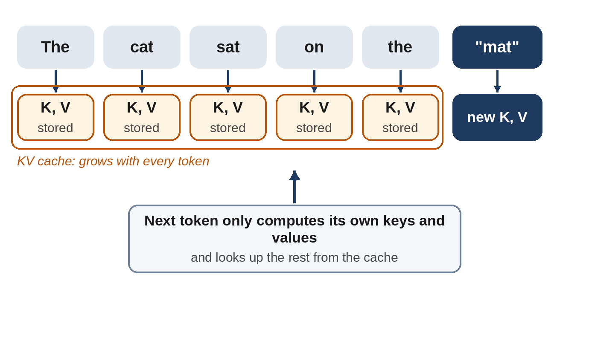

# Part V: Using the Model

# Chapter 17: Inference: What Happens When You Press Enter

Training happens once. **Inference**, using the trained model to generate answers, happens billions of times a day. For a popular model, inference soon costs more in total than training did, so making it fast and cheap is one of the biggest engineering efforts in AI. This chapter follows a single message from the moment you press Enter until the answer appears, and explains the tricks that make it affordable.

## The Journey of a Message

1. **Your message is packaged.** The app combines your message with the system prompt, the earlier conversation, any attached documents, and instructions about available tools, into one structured input: mostly text, plus any images, audio or files, in a format the model was trained on.
2. **Tokenization.** The text is split into tokens (Chapter 3).
3. **It travels to a data center**, where a **load balancer** sends it to a group of chips that hold a copy of the model.
4. **Prefill.** The model reads the whole input at once, in parallel, building up its internal understanding of every token.
5. **Decode.** The model generates the answer one token at a time. Each new token is chosen (Chapter 1), added to the text, and fed back in to produce the next.
6. **Streaming.** Each token is sent back to your screen as soon as it's ready, which is why answers appear word by word.

Two numbers describe the experience: **time to first token**, how long you wait before anything appears, mostly spent on prefill; and **output speed**, typically tens to hundreds of tokens per second, determined by the decode phase.

## Why Writing Is Slower Than Reading

Prefill is fast because all the input tokens can be processed at once, keeping the chips' arithmetic units busy. Decode is slow because each token depends on the one before. To produce *one* token, the chips must read a large share of the model's parameters from memory, and then do comparatively little arithmetic with them. This is the memory wall of Chapter 9 in action: during decoding, chips spend most of their time waiting for data.

That's also why, when you pay for an AI service by the token, **output tokens usually cost several times more than input tokens**.

## The KV Cache: Not Repeating Work

Here's a problem. In a standard Transformer with full attention, generating token number 1,001 means attending to all 1,000 tokens before it (Chapter 7). (Some designs limit which earlier tokens are attended to, for example with sliding windows, but the problem is similar.) Recomputing everything about those 1,000 tokens for every new token would be hugely wasteful.

Instead, the model saves the **keys and values** it computed for each earlier token, in a store called the **KV cache**. Each new token only needs its own calculation, plus a look-up of the cached keys and values.

The catch is memory. The KV cache grows with every token of the conversation, and for long documents it can become larger than the model itself. Much of the engineering of Chapter 7's grouped-query and latent attention is really about shrinking this cache. Many services also keep the cache for a common prefix, such as a long system prompt or a document you ask several questions about, so it doesn't have to be recomputed. This is offered to developers as **prompt caching**, usually at a large discount.

## Serving Many People at Once

A single conversation uses an expensive chip very inefficiently, because decoding leaves its arithmetic units mostly idle. The solution is **batching**: processing many users' requests together, so that each read of the parameters from memory is shared by dozens of conversations.

In 2023, **Woosuk Kwon** and colleagues at UC Berkeley released **vLLM**, a serving system built around **PagedAttention**, which manages the KV cache the way an operating system manages memory, in small pages, so that many more conversations fit on the same chips. Together with **continuous batching**, which slots new requests in as soon as others finish, techniques like this increased the number of users a chip could serve several times over. vLLM and similar systems, such as SGLang and NVIDIA's TensorRT-LLM, are widely used to serve both open and commercial language models.

## Clever Shortcuts

- **Speculative decoding.** A small, fast "draft" model guesses the next several tokens; the big model then checks all of them at once, in a single pass, using a procedure that accepts some of the guesses and, where it rejects one, supplies its own replacement token instead. Because checking in parallel is cheap, when the draft model's guesses are accepted often enough this can substantially increase speed, often two or three times in published tests, while producing the same distribution of outputs the big model would have produced on its own. It was introduced in 2022 and 2023 by **Yaniv Leviathan** and colleagues at Google and, independently, by researchers at DeepMind.
- **Quantization.** Storing the parameters as 8-bit or 4-bit numbers instead of 16-bit shrinks the model and speeds up memory reads, with a small loss of quality if done carefully (Chapter 18).
- **Splitting prefill and decode.** Because prefill needs arithmetic and decode needs memory bandwidth, large services increasingly run them on different groups of chips, each tuned for its job.
- **Specialized chips.** Companies such as Groq and Cerebras have designed chips that keep the model in very fast on-chip memory, generating hundreds or even thousands of tokens per second.

> **In Plain Words:** Inference engineering is about keeping very expensive chips busy: sharing them among many users, remembering work already done, and guessing ahead.

## The Price of Intelligence Keeps Falling

All this engineering, along with smaller and better models, has made AI dramatically cheaper. The investment firm Andreessen Horowitz estimated in 2024 that, for the models and benchmarks it tracked, the price of a given level of capability had been falling about **ten times every year** since 2021, a trend it called "LLMflation". It's an estimate for a particular period, not a law, but other analyses, such as Epoch AI's, found similarly steep declines. Capabilities that cost tens of dollars per million tokens in 2023 cost cents a couple of years later.

> **Did You Know?** When GPT-4 was launched in March 2023, using it through OpenAI's API cost $30 per million input tokens and $60 per million output tokens. By 2025, small models that beat the original GPT-4 on most benchmarks were available for well under a dollar per million tokens, a drop of about a hundred times in two years.

At the same time, people use far more tokens than before: reasoning models think at length, agents run for hours, and whole codebases are read in one go. So total spending on inference keeps rising even as the price of each token falls, the same rebound effect seen in Chapter 11.

## Key Takeaways

- Inference has two phases: **prefill**, reading the input in parallel, and **decode**, generating one token at a time.
- Decoding is limited by memory bandwidth, which is why output tokens cost more than input tokens.
- The **KV cache** saves earlier work; it grows with conversation length, and prefix caching reuses it.
- **Batching**, **PagedAttention** (vLLM), **speculative decoding** and **quantization** make serving far cheaper.
- The price for a given level of capability has fallen roughly tenfold per year, but total usage is rising even faster.

## Sources and Further Reading

- Woosuk Kwon et al., "Efficient Memory Management for Large Language Model Serving with PagedAttention," SOSP 2023. arxiv.org/abs/2309.06180; vllm.ai
- Yaniv Leviathan, Matan Kalman, Yossi Matias, "Fast Inference from Transformers via Speculative Decoding," 2022. arxiv.org/abs/2211.17192
- Charlie Chen et al., "Accelerating Large Language Model Decoding with Speculative Sampling," DeepMind, 2023. arxiv.org/abs/2302.01318
- Reiner Pope et al., "Efficiently Scaling Transformer Inference," Google, 2022. arxiv.org/abs/2211.05102
- Yinmin Zhong et al., "DistServe: Disaggregating Prefill and Decoding for Goodput-optimized Large Language Model Serving," 2024. arxiv.org/abs/2401.09670
- Guido Appenzeller, "Welcome to LLMflation: LLM inference cost is going down fast," Andreessen Horowitz, November 2024. a16z.com
- Epoch AI, "LLM inference prices have fallen rapidly but unequally across tasks," March 2025. epoch.ai/data-insights/llm-inference-price-trends
- OpenAI, GPT-4 API pricing at launch, March 2023.
