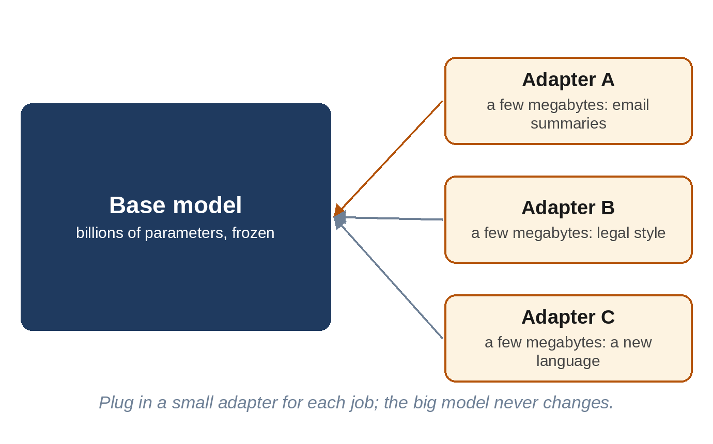

# Chapter 18: Smaller, Faster, Specialized

The biggest models make headlines, but most AI in daily use runs on much smaller ones: in phones, laptops, cars and the background of countless apps. A small model is cheaper, faster and more private, and it can work without an internet connection. This chapter explains three ways to make models small and useful: **distillation**, **quantization** and **fine-tuning**, and how they brought capable AI onto ordinary devices.

## Distillation: The Student and the Teacher

In 2015, **Geoffrey Hinton**, **Oriol Vinyals** and **Jeff Dean** at Google described a way to transfer what a large model knows into a smaller one, which they called **knowledge distillation**.

The insight is that a big model's output contains more information than just its top answer. When it predicts the next word, it gives probabilities for every option: "cat 60%, kitten 25%, dog 5%..." Those probabilities reveal what the teacher model considers similar or plausible. A small "student" model trained to match the teacher's full probabilities learns much faster than one trained only on the raw text.

Distillation is now everywhere:

- Meta's **Llama 4** Scout and Maverick (2025) were trained with help from a much larger unreleased teacher model, Llama 4 Behemoth.
- Google's small **Gemma** models were trained with distillation from larger Gemini-family models.
- **DeepSeek** released six small models in January 2025, built on Alibaba's Qwen and Meta's Llama, fine-tuned on 800,000 examples of reasoning written by DeepSeek-R1. Even a 1.5-billion-parameter student learned to reason surprisingly well.

A simpler form of distillation is to have a big model *write* training examples, as in Chapter 5's synthetic data. This is cheap and effective, and controversial: the terms of several major providers, including OpenAI and Anthropic, forbid using their models' outputs to develop competing models, though the rules differ between providers and services.

> **Did You Know?** In March 2023, Stanford researchers released **Alpaca**, a 7-billion-parameter model made by fine-tuning Meta's first LLaMA model on 52,000 instructions and answers generated by an OpenAI model. It behaved remarkably like the far larger ChatGPT of the time on many simple tasks, and the researchers reported spending less than $600. The experiment showed how easily capabilities could be copied, and helped launch the open-model boom.

## Quantization: Rounding the Numbers

Chapter 9 explained that AI doesn't need very precise numbers. **Quantization** takes a trained model and stores its parameters with fewer bits. A 70-billion-parameter model is about 140 GB at 16 bits, 70 GB at 8 bits and about 35 GB at 4 bits: small enough for a powerful desktop computer.

Done naively, rounding damages the model. Clever methods, such as **GPTQ** (2022) and **AWQ** (2023), round in ways that preserve the most important parameters, and in the studies that introduced them, 4-bit models often scored only slightly lower than the originals on standard tests. How much quality is kept depends on the model, the method and the task. Some models are now trained from the start to work at low precision.

> **In Plain Words:** Quantization is like saving a photo as a smaller file. You lose a little detail, but it still looks almost the same, and it takes a quarter of the space.

In March 2023, a Bulgarian programmer, **Georgi Gerganov**, released **llama.cpp**, a lean program that ran quantized LLaMA models on an ordinary MacBook, written in his spare time. It sparked a movement of people running AI on their own computers. Tools built on similar foundations, such as **Ollama** and **LM Studio**, now let anyone download and run open models with a single command or click.

## Fine-Tuning: Teaching New Tricks

A general model knows a little about everything. **Fine-tuning** continues training on a specific dataset to specialize it: medical notes, legal contracts, a company's support tickets, a particular writing style, a less common language.

Full fine-tuning updates every parameter, which needs as much memory as training. In 2021, **Edward Hu** and colleagues at Microsoft introduced **LoRA** (Low-Rank Adaptation). Instead of changing the huge original parameter tables, LoRA freezes them and trains small "adapter" tables alongside, which add a correction. For GPT-3, LoRA cut the number of trainable parameters by about 10,000 times, while performing about as well as full fine-tuning.

In 2023, **Tim Dettmers** and colleagues combined LoRA with 4-bit quantization in **QLoRA**, making it possible to fine-tune a 65-billion-parameter model on a single 48 GB graphics card. Fine-tuning went from a data-center job to something a student could do.

Adapters are small, a few megabytes, so one base model can carry many of them and swap them in and out for different tasks: one for summarizing email, one for proofreading, one for a particular customer.

## When Is Fine-Tuning Worth It?

Fine-tuning is powerful, but often unnecessary. Many tasks are better solved by:

- **Prompting**: clear instructions and a few examples in the prompt;
- **Retrieval**: giving the model the right documents at the time of the question (Chapter 19).

A good rule of thumb: use retrieval to give a model **knowledge**, such as facts, documents or recent information, and fine-tuning to change its **behavior**: format, style, tone, or a specialized skill. Fine-tuning a model on a company's documents doesn't reliably make it remember facts from them, and it can't easily be updated when the documents change.

## AI in Your Pocket

Small models made AI personal:

- **Apple Intelligence** (2024) runs a model of about 3 billion parameters directly on iPhones, iPads and Macs, for tasks such as summarizing notifications and rewriting text, sending harder requests to larger models in Apple's own data centers.
- Google's **Gemini Nano** runs on Pixel and other Android phones.
- Open families such as **Gemma 4** (with "effective" 2- and 4-billion-parameter versions), **Qwen**, **Llama** and **Phi** include small models designed for phones and laptops.

On-device AI has real advantages: when a task runs entirely on the device, its inputs can stay on that device, answers come without network delay, and it can work offline. Some features still send requests to cloud services, depending on the product and the task, as Apple Intelligence does for harder requests. Its limits are memory, battery life and heat, so the most demanding tasks still go to the cloud.

## Key Takeaways

- **Distillation** trains a small student model to imitate a large teacher's outputs; it's how many small models get their skills.
- **Quantization** stores parameters with fewer bits; a 4-bit model is about a quarter of the size, with little loss when done well. llama.cpp and Ollama brought open models to ordinary computers.
- **Fine-tuning** specializes a model; **LoRA** and **QLoRA** made it cheap by training small adapters.
- Use retrieval for knowledge and fine-tuning for behavior.
- Small models now run on phones and laptops, offering privacy, speed and offline use.

## Sources and Further Reading

- Geoffrey Hinton, Oriol Vinyals, Jeff Dean, "Distilling the Knowledge in a Neural Network," 2015. arxiv.org/abs/1503.02531
- Meta AI, "The Llama 4 herd," 5 April 2025. ai.meta.com/blog/llama-4-multimodal-intelligence
- DeepSeek-AI, "DeepSeek-R1," 2025 (distilled models, 800K samples). arxiv.org/abs/2501.12948
- Rohan Taori et al., "Alpaca: A Strong, Replicable Instruction-Following Model," Stanford CRFM, March 2023. crfm.stanford.edu/2023/03/13/alpaca.html
- OpenAI, Terms of Use (restriction on using output to develop competing models), openai.com/policies/terms-of-use; Anthropic, Commercial Terms of Service, anthropic.com/legal/commercial-terms.
- Elias Frantar et al., "GPTQ: Accurate Post-Training Quantization for Generative Pre-trained Transformers," 2022. arxiv.org/abs/2210.17323
- Ji Lin et al., "AWQ: Activation-aware Weight Quantization," 2023. arxiv.org/abs/2306.00978
- Georgi Gerganov, llama.cpp. github.com/ggml-org/llama.cpp; Ollama. ollama.com
- Edward J. Hu et al., "LoRA: Low-Rank Adaptation of Large Language Models," 2021. arxiv.org/abs/2106.09685
- Tim Dettmers et al., "QLoRA: Efficient Finetuning of Quantized LLMs," 2023. arxiv.org/abs/2305.14314
- Apple, "Introducing Apple's On-Device and Server Foundation Models," June 2024. machinelearning.apple.com
- Google DeepMind, Gemma 4 model card, 2026. ai.google.dev/gemma
