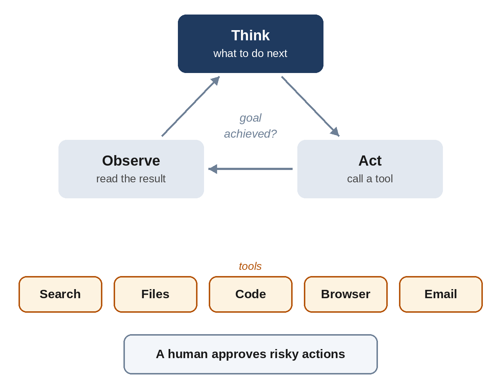

# Chapter 20: Agents: Models That Take Action

A chatbot answers. An **agent** acts. Give an agent a goal, such as "fix this bug", "find me the three cheapest flights and put them in a spreadsheet", or "research this topic and write a report", and it decides on its own what steps to take, uses tools to take them, checks the results and keeps going until the job is done. Agents are the biggest change in how AI was used in 2025 and 2026. This chapter explains how they work, how they're connected to the world and where they still stumble.

## The Agent Loop

Every agent, however sophisticated, runs the same basic loop:

1. **Think.** The model looks at the goal and everything that has happened so far, and decides what to do next.
2. **Act.** It calls a **tool**: runs a search, reads a file, runs a piece of code, clicks a button on a web page, sends a message.
3. **Observe.** The tool's result is added to the model's context.
4. **Repeat** until the goal is achieved, or the agent decides to stop and ask for help.

In 2022, **Shunyu Yao** and colleagues at Princeton and Google described this pattern of interleaving reasoning and actions as **ReAct** ("reason + act"). The same year, Meta's **Toolformer** showed that models could learn to decide for themselves when to call tools such as a calculator or a search engine.

> **In Plain Words:** An agent is a language model in a loop, with tools. The model is the brain; the tools are its hands and eyes.

## How a Model Uses a Tool

A language model can only produce text. So tool use works by convention. The developer describes the available tools to the model, with a name, a description and the inputs each tool needs, for example *get_weather(city)*. When the model decides to use one, it writes a specially formatted request, such as *get_weather("Lisbon")*. The surrounding software, not the model, actually runs the tool, and pastes the result back into the conversation. The model then continues.

OpenAI added this "function calling" to its API in June 2023, and every major provider followed. Models are now trained extensively to use tools well: choosing the right one, filling in inputs correctly, and recovering when a tool returns an error.

## Early Hype, Then Real Progress

In March 2023, a project called **AutoGPT** went viral. It wrapped GPT-4 in a loop and let it pursue goals autonomously, and it quickly became one of the fastest-growing projects in GitHub's history. It was also mostly unreliable: agents got stuck in loops, forgot what they were doing, or confidently declared success after doing nothing useful. The models weren't yet good enough at long chains of steps.

Three things changed. Models became much better at reasoning and at recovering from mistakes (Chapter 14); they were trained specifically on long, multi-step tasks with tools; and context windows grew, letting agents keep track of long jobs. METR's measurement of the length of task agents could complete, doubling about every seven months (Chapter 15), captures the progress.

## Kinds of Agents

- **Coding agents.** Software was the first area where agents became truly useful, because code can be tested automatically. Cognition's **Devin** (March 2024) was marketed as an "AI software engineer"; tools such as Anthropic's **Claude Code**, OpenAI's **Codex**, GitHub Copilot's agent mode and **Cursor** now read whole codebases, write and run code and tests, and make changes across many files. Many programmers now delegate large parts of their work to them.
- **Computer-use agents.** In October 2024, Anthropic released a "computer use" capability, letting Claude see screenshots and control a mouse and keyboard; OpenAI's **Operator** (January 2025) did the same in a web browser. They can use any software designed for people, but are slower and more error-prone than tools built for machines.
- **Research agents.** Deep-research features (Chapter 19) search, read and synthesize for many minutes, producing reports with citations.
- **Business and personal agents** that work across email, calendars, documents and company systems, increasingly running in the background for hours.

> **Did You Know?** In February 2025, Anthropic started a livestream called "Claude Plays Pokémon", in which Claude 3.7 Sonnet played the 1996 Game Boy game Pokémon Red, using only screenshots and button presses. Thousands of viewers watched it make real progress, earning badges that earlier models never reached, and also get stuck for days wandering a single cave. It was an entertaining, very public demonstration of both how far agents had come and how far they still had to go.

## MCP: A Universal Plug

Every agent needs connections to tools and data: files, databases, calendars, company software. In November 2024, Anthropic introduced the **Model Context Protocol (MCP)**, an open standard for connecting AI applications to tools and data sources. It's often described as "USB-C for AI": a tool provider builds an MCP server once, and any AI application that speaks MCP can use it.

MCP spread quickly. OpenAI, Google, Microsoft and many others adopted it, and by late 2025 there were more than 10,000 public MCP servers. In December 2025, Anthropic donated MCP to the newly formed **Agentic AI Foundation**, under the Linux Foundation, co-founded with Block and OpenAI, so that no single company controls it. Google's **Agent2Agent (A2A)** protocol, announced in April 2025, addresses a related problem: how agents from different companies can talk to each other.

## Teams of Agents

Some tasks are best split up. In **multi-agent** systems, a lead agent breaks a job into parts and hands them to sub-agents, which work in parallel, each with its own context, and report back. Anthropic described in 2025 how its research feature used this design, with a lead agent coordinating several searchers, and found it did much better than a single agent on broad research questions, at the cost of using many more tokens.

## Risks and Guardrails

An agent that can act can also do damage: delete files, send the wrong email, spend money or leak data. And agents read a great deal of outside content, which may contain **prompt injection** attacks (Chapter 16).

Good agent design therefore includes:

- **Least privilege**: give the agent only the permissions the task needs.
- **Human approval** for risky or irreversible actions, such as payments, deletions or sending messages.
- **Sandboxes**: isolated environments where an agent's code can't touch anything important.
- **Logs** of everything the agent did, so humans can review it.

## Key Takeaways

- An **agent** is a model in a loop: think, act with a tool, observe the result, repeat.
- Tool use works by the model writing a structured request that the surrounding software executes; ReAct and Toolformer (2022) laid the groundwork.
- Early agents such as AutoGPT (2023) were unreliable; better reasoning, training on long tasks and longer context made agents useful by 2025.
- Coding agents were the first big success; computer-use, research and business agents followed.
- **MCP** is an open standard for connecting AI to tools and data, now governed by the Agentic AI Foundation.
- Agents need permissions, approvals, sandboxes and logs, because they can cause real harm and are vulnerable to prompt injection.

## Sources and Further Reading

- Shunyu Yao et al., "ReAct: Synergizing Reasoning and Acting in Language Models," 2022. arxiv.org/abs/2210.03629
- Timo Schick et al., "Toolformer: Language Models Can Teach Themselves to Use Tools," 2023. arxiv.org/abs/2302.04761
- OpenAI, "Function calling and other API updates," 13 June 2023. openai.com
- Significant Gravitas, AutoGPT. github.com/Significant-Gravitas/AutoGPT
- Anthropic, "Introducing computer use, a new Claude 3.5 Sonnet, and Claude 3.5 Haiku," 22 October 2024; OpenAI, "Introducing Operator," 23 January 2025.
- Anthropic, "Introducing the Model Context Protocol," 25 November 2024; "Donating the Model Context Protocol and establishing the Agentic AI Foundation," 9 December 2025. anthropic.com/news; modelcontextprotocol.io
- Google, "Announcing the Agent2Agent Protocol (A2A)," April 2025. developers.googleblog.com
- Anthropic, "How we built our multi-agent research system," June 2025. anthropic.com/engineering
- Anthropic, "Claude Plays Pokémon" livestream, February 2025. twitch.tv/claudeplayspokemon
- Thomas Kwa et al., "Measuring AI Ability to Complete Long Tasks," METR, 2025. arxiv.org/abs/2503.14499
