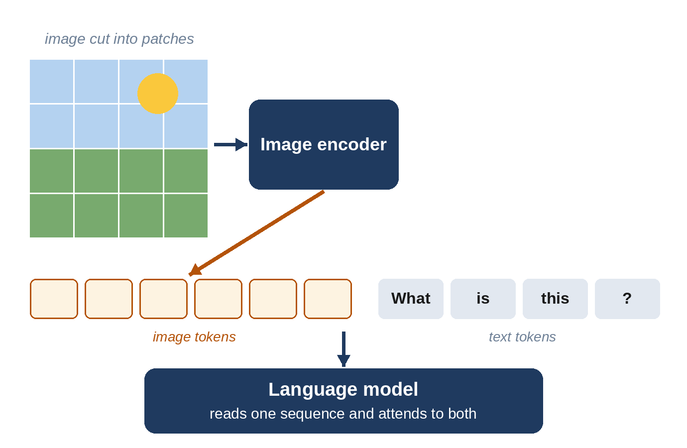

# Part VII: Beyond Text

# Chapter 24: Models That See: Vision-Language Models

Language models were born reading text, but the world isn't made only of words. Photos, charts, handwriting, screenshots, diagrams and videos all carry information. Since 2023, the leading models have learned to **see**: you can show them a photo of your fridge and ask for a recipe, a chart and ask what it means, or a screenshot of an error and ask how to fix it. This chapter explains how a model built for words learned to understand pictures.

## Turning Pictures Into Tokens

A language model works with tokens. So the first question is: how do you turn an image into tokens?

In 2020, **Alexey Dosovitskiy** and colleagues at Google showed a surprisingly simple answer in a paper titled "An Image is Worth 16x16 Words". Cut the image into a grid of small square **patches**, for example 16 by 16 pixels each, turn each patch into a list of numbers, and feed the sequence of patches into a Transformer, just like a sequence of words. Their **Vision Transformer (ViT)** matched the best image-recognition systems of the time, and showed that the Transformer wasn't only for language.

> **In Plain Words:** To a vision-language model, a picture is a sequence of small tiles, each turned into a token, sitting in the same line as the words of your question.

## Connecting Pictures and Words: CLIP

Seeing patches isn't enough; the model must connect what it sees to language. In 2021, **Alec Radford** and colleagues at OpenAI released **CLIP**, trained on 400 million images paired with their captions from the web. CLIP learned two encoders, one for images and one for text, so that a photo and its correct caption ended up close together on the same map of meaning (Chapter 4), and mismatched pairs far apart.

The result was remarkable: without being trained on any particular categories, CLIP could recognize thousands of kinds of objects, simply by comparing an image with text descriptions such as "a photo of a dog" or "a photo of a banana". CLIP-style encoders became a building block of nearly every vision-language model, and of image generators too (Chapter 25).

## Giving a Language Model Eyes

The next step was to plug a vision encoder into a large language model. The recipe, used by DeepMind's **Flamingo** (2022) and the open **LLaVA** (2023), by **Haotian Liu** and colleagues at the University of Wisconsin-Madison and Microsoft, is:

1. A vision encoder, often CLIP-like, turns the image into patch embeddings.
2. A small **connector** network translates these into the language model's "language", producing image tokens.
3. The language model reads the image tokens alongside the text, and is fine-tuned on examples of images with questions and answers.

LLaVA showed that this could be done cheaply: much of its training data was written by GPT-4, which described images from their captions. Open vision-language models multiplied.

> **Did You Know?** At GPT-4's launch livestream in March 2023, OpenAI's Greg Brockman photographed a rough hand-drawn sketch of a joke website from his notebook and showed it to the model, which wrote working code for the site. The image features weren't publicly available until months later, but the demo became one of the most memorable moments of the AI boom.

## Natively Multimodal Models

Bolting an image encoder onto a finished text model works, but it's a graft. The next generation was trained **natively multimodal** from the start: text, images, and sometimes audio and video, mixed together throughout pretraining.

Google's **Gemini** (December 2023) was designed this way from the beginning. OpenAI's **GPT-4o** (May 2024; the "o" stands for "omni") processed text, images and audio in one model, which let it hold spoken conversations with natural timing, laughter and changes of tone, rather than converting speech to text and back. Meta's research model **Chameleon** (2024) went further, representing images and text as tokens of a single vocabulary, so it could both read and generate images. Today, most frontier models and many open ones, such as Llama 4, Gemma, Qwen and Kimi K2.5, are multimodal.

## What Vision Models Are Good At

- **Documents.** Reading scanned pages, receipts, forms, handwriting and tables, often better than traditional text-recognition software.
- **Charts and diagrams.** Explaining graphs, extracting numbers, reading slides.
- **Screenshots.** Understanding user interfaces, which is what lets computer-use agents operate software (Chapter 20).
- **Everyday photos.** Identifying plants, describing scenes for blind and low-vision users, troubleshooting a machine from a photo.
- **Video.** Models with long context can watch long videos and answer questions about specific moments.

## Where They Still Struggle

Vision-language models can be strangely bad at things a child finds easy: counting objects precisely, judging exact spatial positions ("is the cup to the left of the plate?"), reading analog clocks, or noticing small details in a busy picture. Researchers have shown that some models answer questions about images confidently from their expectations rather than from what's actually shown: told to count the legs on an unusual animal, a model may answer with the usual number. They can also "hallucinate" objects that aren't there. These weaknesses are improving, but they mean that what a model says about an image should be checked when it matters.

## From Seeing to Acting: Robots

The newest step connects vision and language to physical action. **Vision-language-action** models take camera images and a spoken instruction, such as "put the apple in the bowl", and output robot movements. Google DeepMind's **RT-2** (2023) showed that knowledge learned from the web, such as what an "extinct animal" is, could transfer to a robot picking up a toy dinosaur. Since then, Google DeepMind's **Gemini Robotics** (2025), the startup **Physical Intelligence** and others have built general-purpose robot "brains" on the same foundations. Robotics remains much harder than chat, because the physical world is unforgiving and robot training data is scarce, but it is one of the most active frontiers.

## Key Takeaways

- Images are turned into tokens by cutting them into **patches** (Vision Transformer, 2020).
- **CLIP** (2021) learned to place images and captions on the same map of meaning from 400 million pairs.
- Early vision-language models (Flamingo, LLaVA) connected an image encoder to a language model; newer ones (Gemini, GPT-4o) are **natively multimodal** from the start.
- They excel at documents, charts, screenshots and photos, but can struggle with counting, spatial details and seeing what they expect.
- **Vision-language-action** models extend the same ideas to robots.

## Sources and Further Reading

- Alexey Dosovitskiy et al., "An Image is Worth 16x16 Words: Transformers for Image Recognition at Scale," 2020. arxiv.org/abs/2010.11929
- Alec Radford et al., "Learning Transferable Visual Models From Natural Language Supervision" (CLIP), 2021. arxiv.org/abs/2103.00020
- Jean-Baptiste Alayrac et al., "Flamingo: a Visual Language Model for Few-Shot Learning," DeepMind, 2022. arxiv.org/abs/2204.14198
- Haotian Liu, Chunyuan Li, Qingyang Wu, Yong Jae Lee, "Visual Instruction Tuning" (LLaVA), 2023. arxiv.org/abs/2304.08485
- OpenAI, "GPT-4 Technical Report," 2023; GPT-4 developer livestream, 14 March 2023; "Hello GPT-4o," 13 May 2024. openai.com
- Chameleon Team, Meta, "Chameleon: Mixed-Modal Early-Fusion Foundation Models," 2024. arxiv.org/abs/2405.09818
- An Vo, Khai-Nguyen Nguyen et al., "Vision Language Models are Biased," 2025 (models answering from expectations, such as counting legs). arxiv.org/abs/2505.23941
- Anthony Brohan et al., "RT-2: Vision-Language-Action Models Transfer Web Knowledge to Robotic Control," Google DeepMind, 2023. arxiv.org/abs/2307.15818
- Gemini Robotics Team, "Gemini Robotics: Bringing AI into the Physical World," 2025. arxiv.org/abs/2503.20020
