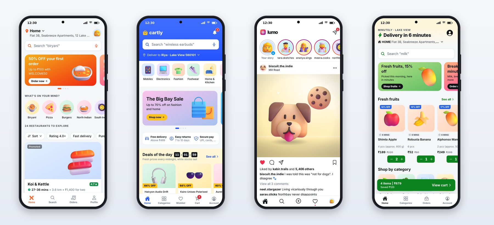

# Introduction

Open the food delivery app on your phone and order dinner. In under a minute you search a city's restaurants, customize a dish, apply a coupon, pay, and watch a rider move toward your door on a live map. Open a shopping app and you see a deal counting down, a product page with a gallery, variants and reviews, and a delivery date for your exact pincode. Open a social app and the stories, the double-tap heart and the feed all feel effortless.

None of that is effortless to build. Behind every polished screen are dozens of decisions about layout, loading states, errors, accessibility, animation, data and trust. Teams of engineers and designers spend years on them. This book shows you how to build apps of that standard yourself, by directing an AI coding agent, Claude Code, the way a lead engineer directs a team.

## What You'll Build

Four complete Android and iOS apps, one shared design system, one backend, and a bonus Android TV app:

| App | Category | Highlights |
| --- | --- | --- |
| **Platter** | Food delivery | Restaurants and menus, customization sheets, coupons, tips, live order tracking with a moving rider |
| **Cartly** | E-commerce | Deals with countdowns, search, filters and sort, product galleries, variants, delivery estimates, orders and returns |
| **Lumo** | Social photos | Stories, a feed with double-tap likes, comments, create with filters, explore, profiles, messages |
| **Minutely** | 10-minute grocery | Category rails, instant ADD steppers, savings, a countdown-ring tracking screen |
| **Reelhouse** (bonus) | Android TV streaming | Profiles, a hero billboard, Top 10 and live sports rows, seasons and episodes, a player, a TV guide, all driven by a remote |

All five are original. Their names, brands, restaurants, products, people, shows and teams are fictional, and they don't copy any real company's design. They are built to the standard you know from the biggest apps in each category, and the book points to those apps by name only to explain the patterns they made familiar.

## How This Book Was Made

**Every app was built by Claude Code, for real.** The prompts printed in the project chapters were run in Claude Code while this book was written, one recorded session per milestone. Each chapter tells you how long the session ran, what it cost, what Claude reported, and what went wrong. Two sessions were cut off, one by a time limit and one by a usage limit, and you'll see how they were finished.

**Every screen is a real capture.** The phone images are screenshots of the apps running on a 393-by-852-point phone screen at three times the pixel density, and the TV images are full 1920-by-1080 captures with the remote's focus visible. The phones and TVs around them are drawn frames.

**Everything was checked.** By the end, the workspace held more than 300 automated tests across the four apps, the design system, the API client and the server, plus 80 for the TV app. Typecheck, lint and tests had to pass before any app was called done.

> **Note:** The screenshots were captured from the apps' web builds, rendered by React Native for Web in a browser, because the cloud computer this book was written on can't run phone emulators. The same code runs on Android and iOS; Chapter 2 shows you how to run it on your own phone and emulator, and Chapter 22 how to test it there.

## Who This Book Is For

- **Builders with app ideas** who want to ship something that looks and behaves like a top-chart app, not a demo.
- **Developers new to mobile** who know some JavaScript or TypeScript and want a fast, modern route to Android and iOS.
- **Experienced engineers** who want to see how far an AI agent can go on a real, multi-app codebase, and how to keep it on track.
- **Designers and product managers** who want to turn their designs and specs into working apps.

Some programming experience helps, but you don't need to be an expert. You need to be able to read code well enough to review it, run commands in a terminal, and judge a screen with a critical eye. The book teaches the rest.

## How the Book Is Organized

**Part I, Foundations**, sets up your tools, shows you how to direct Claude Code on a mobile project, covers just enough React Native and Expo to review what Claude writes, and builds the shared design system and backend.

**Parts II to V** build the four apps, one part each: the plan, the prompt, the session, the screens, and the code worth understanding.

**Part VI, Production**, covers what separates a demo from a product: performance, accessibility, testing, real payments, notifications, security, builds, and shipping to Google Play and the App Store.

**Part VII, the bonus**, builds Reelhouse for Android TV.

The appendices collect every prompt in the book, release checklists for Android, iOS and Android TV, troubleshooting, a glossary and the sources for every fact.

## Get the Code

All the code is in the book's repository: the four apps, the design system, the API client, the server, the TV app, and the prompts and records of every Claude Code session. Chapter 2 shows how to download and run it. You can follow along by giving Claude Code the same prompts in an empty folder, or start from the finished code and change it.

> **Note:** Claude's replies vary from run to run, even with the same prompt. Your code will differ from the code printed here, and that's expected. What carries over is the method: a clear spec, small sessions, real checks, and a critical look at every screen.
