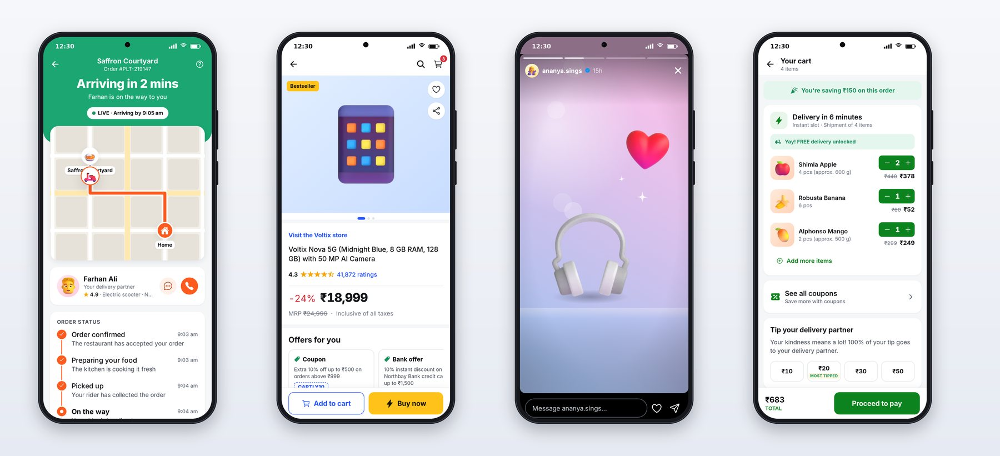
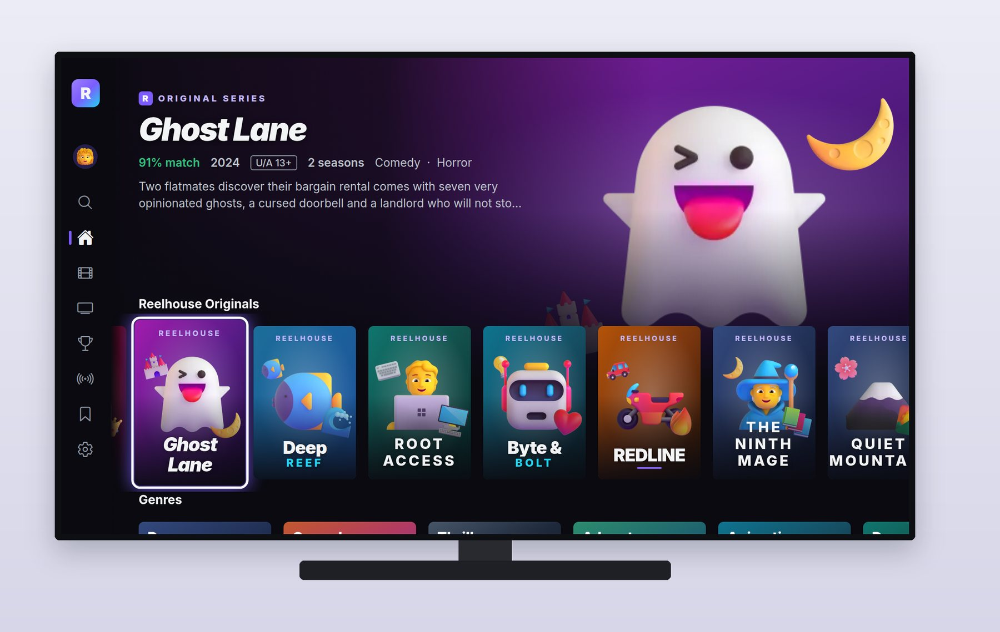

# Part I: Foundations

# Chapter 1: Professional Apps, Vibe Coded

Anyone can get an AI to produce an app that works in a demo. The question this book answers is how to get apps that hold up the way the best consumer apps do: on a slow network, on a small phone, with a screen reader on, after the hundredth change. That requires knowing what "professional" means in concrete terms, and then turning that knowledge into specs, prompts and checks that an AI coding agent can follow.

## What Makes an App Feel Professional

When people say a food delivery or shopping app feels polished, they're reacting to a long list of details, most of which they never notice consciously. Here are the ones that matter most, and that you'll see in every app in this book.

**Every state is designed.** A screen isn't one picture; it's at least five: loading, empty, error, partial and full. Professional apps show skeleton placeholders shaped like the content while it loads, a friendly message and an action when there's nothing to show, and a clear way to retry when something fails. Amateur apps show a spinner, a blank screen, or a crash.

**Density without clutter.** A restaurant card in a top delivery app packs an image, a name, a rating, a delivery time, a price for two, a distance and an offer into a few square centimeters, and it still reads calmly. That comes from a strict type scale, consistent spacing, and a small set of colors used with intent.

**The next action is always one tap away.** The cart bar that appears the moment you add an item. The "Buy now" button that stays pinned while you scroll. The "Track order" button on an active order. Professional apps never make you hunt for the thing you're about to do.

**Instant feedback.** Buttons spring slightly when pressed. A quantity stepper changes the moment you tap, before the server answers, and quietly corrects itself if the server disagrees. A heart bursts when you double-tap a photo. Speed is a feeling as much as a measurement.

**Trust signals.** A bill that lists every fee, with waived fees struck through. A delivery date for your exact pincode. "Inclusive of all taxes." A live status that keeps updating. Users hand these apps their money and their address; every screen should earn it.

**Accessibility and inclusion.** Text that grows with the system font size, labels for screen readers on every button, touch targets at least 44 points square, and motion that calms down when the user asks for reduced motion.

**Consistency.** The same button, sheet, price and rating look identical everywhere, because they come from one design system. Users learn an app once.

## The Five Apps

The four phone apps cover the four biggest categories of consumer apps, and each one teaches a different side of mobile development.

**Platter (food delivery)** teaches discovery, complex menus with customization rules, a bill with many fees, and real-time tracking over a live connection to the server.

**Cartly (e-commerce)** teaches information-dense commerce screens, search with suggestions, filter and sort sheets, product galleries, variants, and the long tail of orders, shipments and returns.

**Lumo (social photos)** teaches content-first design, gestures and animation: stories with progress bars, tap and hold, double-tap likes, a create flow with filters, and messaging.

**Minutely (10-minute grocery)** teaches speed as a product feature: optimistic updates everywhere, a category rail, savings called out on every screen, and a countdown tracking screen.

**Reelhouse (Android TV)** is the bonus. It teaches a completely different interaction model, the 10-foot screen and the D-pad remote, where focus is everything.

The four phone apps share one design system, one API client and one backend. That's how real companies build families of apps, and it's also how you keep an AI agent consistent: when there's exactly one `Price` component, every price in every app looks right.

## Vibe Coding at a Professional Standard

**Vibe coding** means building software by describing what you want to an AI and steering by the results. At its loosest, you type a wish, accept whatever comes back and keep going. That's fine for a weekend toy. For apps people will pay through, it fails in predictable ways: inconsistent screens, untested logic, hard-coded data, missing states, and code nobody understands.

The method in this book keeps the speed and fixes the failures. It has five habits:

1. **Write the spec before the prompt.** Each app starts with a product requirements document (PRD) and a design document that Claude reads before writing a line of code. Chapter 3 shows them.
2. **Give the project rules.** A `CLAUDE.md` file at the root of the repository tells Claude the layout, the commands and the non-negotiables, such as "never hard-code a color" and "every touchable has an accessibility label."
3. **Work in sessions sized to one milestone.** Foundation, then each app, then fixes. A session that tries to do everything runs out of time or context.
4. **Make Claude check its own work, visually and with tests.** Every session ends with typecheck, lint and tests passing, and Claude captures every screen in a headless browser at phone size and fixes what looks wrong.
5. **Review like a lead.** You read the summary, look at every screenshot, run the checks yourself, and send back what isn't right. In this book, that review caught a card sliding under the TV app's side menu, placeholder text in its TV guide, and a test that failed only when everything ran at once.

## Key Takeaways

- "Professional" is concrete: designed states, calm density, one-tap next actions, instant feedback, trust signals, accessibility and consistency.
- The four apps cover food delivery, e-commerce, social and quick commerce, and share one design system and backend; the bonus app targets Android TV.
- Professional vibe coding is a method: spec first, project rules, milestone-sized sessions, self-checks with screenshots and tests, and your review.
