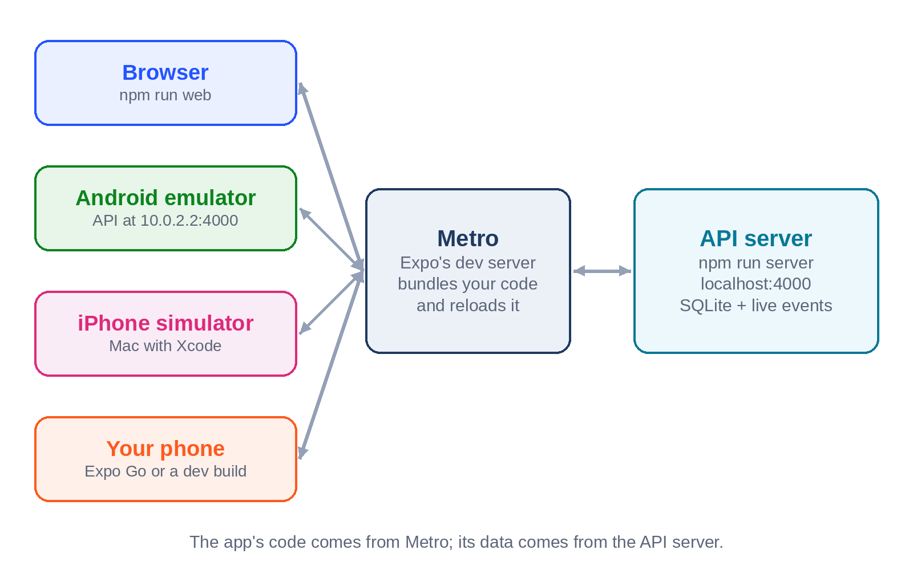
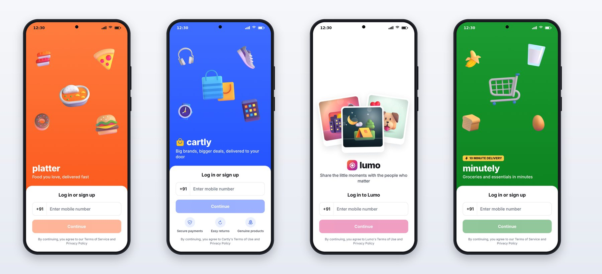

# Chapter 2: Your Mobile Workshop

This chapter sets up everything you need: Node.js, Claude Code, the book's code, the backend, and three ways to see the apps running, in a browser, on an Android emulator or iPhone simulator, and on your own phone.

## What You Need

| Tool | Why | Notes |
| --- | --- | --- |
| A computer | Everything | macOS, Windows or Linux. Building for iPhone locally needs a Mac; Chapter 26 shows how to build in the cloud without one |
| Node.js LTS | Runs Expo, the tooling and the server | Node 22.13 or newer (Expo SDK 58 and React Native 0.88 need it); Node 24 works too |
| Git | Version control, downloading the code | |
| Claude Code | Your AI engineer | A Claude subscription or an Anthropic API account |
| A code editor | Reading what Claude writes | Any editor; VS Code is a popular choice |
| Android Studio | Android emulator and Android TV emulator | Free, all three operating systems |
| Xcode | iPhone simulator and iOS builds | Mac only, from the Mac App Store |
| A phone | The real test | Android or iPhone |

You don't need everything on day one. A computer, Node.js, Git and Claude Code are enough to build and run all four apps in a browser. Add Android Studio or Xcode when you want to see them on a device.

## Install Claude Code

Claude Code runs in your terminal. Install it by following the current instructions in Anthropic's Claude Code documentation; it's also published on npm as `@anthropic-ai/claude-code`. Then start it in any folder and sign in:

```
$ claude
```

The first run walks you through signing in with your Claude account or an API key. This book was written with Claude Code version 2.1.316.

> **Tip:** Run `claude --version` now and then. Claude Code updates often, and new versions add features that make mobile work easier.

## Get the Book's Code

```
$ git clone \
    https://github.com/aadhavanshines/vibe-coding-professional-mobile-apps
$ cd vibe-coding-professional-mobile-apps
$ npm install
```

The backslash continues the first command on the next line, which works in macOS and Linux terminals and in Git Bash. In Windows PowerShell, type it as one line without the backslash.

The repository is a **monorepo**: one repository holding several projects that share code. Its layout is the one Claude was given in `CLAUDE.md`:

| Folder | What's in it |
| --- | --- |
| `apps/platter` | Food delivery app |
| `apps/cartly` | E-commerce app |
| `apps/lumo` | Social photo app |
| `apps/minutely` | 10-minute grocery app |
| `packages/ui` | The design system: tokens, components, the 3D illustrations |
| `packages/api` | The typed API client and data hooks |
| `server` | The backend all four apps use |
| `tv` | Reelhouse, the Android TV app, with its own dependencies |
| `docs` | The product and design specs Claude worked from |
| `sessions` | The prompt and result of every Claude Code session in this book |

`npm install` at the root installs all four apps and the shared packages together, using **npm workspaces**. The TV app is separate because it needs a different build of React Native (Chapter 30 explains why); install it with `npm install` inside `tv/` when you get there.

## Start the Backend

All four phone apps talk to one local server. Start it in its own terminal and leave it running:

```
$ npm run server
```



The first start creates a SQLite database file and fills it with the fictional city of Northbay: 24 restaurants with 870 menu items, 60 products with 416 reviews, 20 people with 112 posts and 40 stories, and 120 grocery items. To sign in to any app, use the demo phone number 9876543210 and the one-time code 123456; the server prints codes to its terminal instead of sending text messages.

## See an App in Your Browser

The quickest way to see an app is the browser:

```
$ npm run web -w apps/platter
```



Expo starts a development server and opens the app in a browser tab. Use the browser's device toolbar (in Chrome, press F12 and choose a phone size) so the app gets a phone-shaped screen. Replace `platter` with `cartly`, `lumo` or `minutely` for the other apps.

The browser is a convenience, not the real target. It runs your React Native code through React Native for Web, which is how this book's screenshots were made, but phones differ in gestures, fonts, keyboards, safe areas and performance. Check on a device before you trust anything.

## Run on an Emulator or Simulator

**Android:** Install Android Studio, open the Device Manager, create a phone device with a recent system image, and start it. Then:

```
$ EXPO_PUBLIC_API_URL=http://10.0.2.2:4000 npm run android -w apps/platter
```

The address `10.0.2.2` is how the Android emulator reaches your computer; inside the emulator, `localhost` means the emulator itself.

**iPhone (Mac only):** Install Xcode, open it once to finish setup, then:

```
$ npm run ios -w apps/platter
```

The iPhone simulator shares your Mac's network, so `localhost` works.

## Run on Your Own Phone

There are two ways to run your app on a real phone during development.

**Expo Go** is an app from the App Store and Google Play that can load your project over the network by scanning a QR code from `npx expo start`. It's the fastest way to start, but it only supports the newest Expo SDK and only the native libraries that ship inside Expo Go.

**A development build** is your own app, built once with all its native libraries, that then loads your JavaScript from your computer just like Expo Go does. It's what professional teams use, and it's what you need as soon as your app uses a native library that Expo Go doesn't include. Chapter 26 shows how to make one with EAS Build.

Either way, your phone needs to reach the server on your computer. Find your computer's address on the local network (for example `192.168.1.20`) and start the app with:

```
$ EXPO_PUBLIC_API_URL=http://192.168.1.20:4000 npx expo start
```

## Check That Everything Works

Run the same checks Claude ran before calling each app done:

```
$ npm run check
```

This runs TypeScript's type checker, ESLint and every test in every package. On the finished code, it reports more than 300 passing tests across the apps, the design system, the API client and the server.

> **Try It:** Start the server and Platter in your browser, sign in with the demo number, add two dishes to the cart, place the order, and watch the tracking screen. The order goes from "Confirmed" to "Delivered" in about two minutes, because the server compresses a real delivery's timeline for demos.

## Key Takeaways

- You can build and run all four apps with only Node.js, Git and Claude Code; add Android Studio and Xcode to see them on emulators and devices.
- The code is a monorepo with npm workspaces: four apps, two shared packages and a server, plus a separate TV app.
- The server seeds a fictional city of data; sign in with 9876543210 and code 123456.
- Point the apps at the server with `EXPO_PUBLIC_API_URL`: `10.0.2.2` on the Android emulator, your computer's network address on a real phone.
