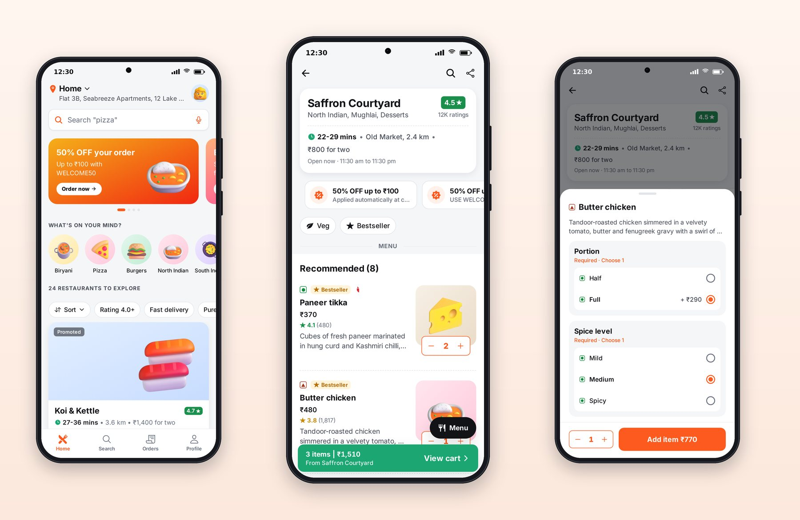

# Chapter 4: React Native and Expo in One Chapter

You don't have to write the apps in this book by hand, but you do have to review them. This chapter gives you enough React Native and Expo to read what Claude writes, spot what's wrong, and ask for the right fix.

## The Stack

| Piece | What it does | Version in this book |
| --- | --- | --- |
| **React Native** | Builds real native apps for Android and iOS from JavaScript or TypeScript, using native UI components | 0.88 |
| **React** | The component model: UI as functions of state | 19.3 |
| **Expo** | A toolkit and set of libraries around React Native: project setup, a large standard library (camera, notifications, images and more), builds and updates | SDK 58 |
| **Expo Router** | File-based navigation: a file in `src/app` becomes a screen | 58 |
| **TypeScript** | JavaScript with types, so mistakes show up before you run the app | 6.0 |
| **React Native for Web** | Renders the same components in a browser | 0.21 |

Expo SDK 58, released on 29 September 2026, pairs with React Native 0.88.1 and React 19.3.0. Each Expo SDK version is tied to one React Native version, so upgrading Expo upgrades React Native with it, and `npx expo install` picks the library versions that match your SDK.

## Components and Styles

A React Native screen is a function that returns components. Instead of HTML's `div`, `span` and `img`, you use `View`, `Text` and `Image`, and the framework turns them into native views on Android and iOS and DOM elements on the web.

```tsx
import { Text, View } from 'react-native';

export function Badge({ label }: { label: string }) {
  return (
    <View style={{ paddingHorizontal: 8, borderRadius: 999, backgroundColor: '#E3F6EE' }}>
      <Text style={{ fontSize: 12, fontWeight: '600', color: '#1BA672' }}>{label}</Text>
    </View>
  );
}
```

Styles look like CSS written as JavaScript objects, with camel-case names and numbers in **points** (density-independent units) instead of pixels. Layout uses Flexbox, with one important difference from the web: the default direction is a column, so children stack vertically unless you set `flexDirection: 'row'`.

In the apps, you'll rarely see raw colors or font sizes like the example above, because the project rule is to use the design system. Chapter 5 shows what that looks like instead.

## Touch

There's no `button` element. Anything tappable is wrapped in a **Pressable**, which reports presses and lets you style the pressed state. Every touchable in the apps goes through one shared component, `PressableScale`, which springs to 97% of its size while pressed. You'll meet it in Chapter 5.

Gestures beyond a tap, such as swipes, drags and double taps, come from **React Native Gesture Handler**, and smooth animations from **Reanimated**, which runs animation logic on the UI thread so it stays fluid even when JavaScript is busy.

## Lists

Mobile screens are mostly lists, and lists are where performance problems hide. A `ScrollView` renders all its children at once, which is fine for a short screen and terrible for 870 menu items. `FlatList` and Shopify's **FlashList** render only the rows near the screen and recycle them as you scroll. Chapter 20 covers when to use which.

## Navigation with Expo Router

In Expo Router, the files under `src/app` are the app's screens, and the folders give them structure. Here is Platter's:

| File | Screen |
| --- | --- |
| `src/app/_layout.tsx` | The root layout: providers and the main stack |
| `src/app/(tabs)/_layout.tsx` | The tab bar |
| `src/app/(tabs)/index.tsx` | Home tab |
| `src/app/(tabs)/search.tsx` | Search tab |
| `src/app/(tabs)/orders.tsx` | Orders tab |
| `src/app/(tabs)/profile.tsx` | Profile tab |
| `src/app/restaurant/[id].tsx` | A restaurant page; `[id]` is a parameter in the address |
| `src/app/cart.tsx` | Cart and checkout |
| `src/app/order/[id].tsx` | Order tracking |
| `src/app/rate/[id].tsx` | Rate an order, shown as a modal |
| `src/app/login.tsx` | Sign in |

A folder name in parentheses, like `(tabs)`, groups screens without adding to the address. Square brackets mark a parameter, so `/restaurant/r-12` opens the restaurant page with `id` set to `r-12`.

![Platter's routes as files: each file in src/app is a screen, folders group screens, and [id] files take a parameter from the URL.](images/router-tree.png)

The root layout wires everything together:

```tsx
@include code/apps/platter/src/app/_layout.tsx
```

Read it from the bottom up. The providers wrap the whole app: gesture handling, safe areas (the notch and home indicator), the theme with Platter's brand, the signed-in session stored on the device, and toasts. `RootStack` keeps the splash screen up until the fonts and session are ready, then shows a **stack**: screens that slide in on top of each other. `Stack.Protected` is the clean way to do authentication: the tabs and order screens exist only when `signedIn` is true, and the login screen only when it's false, so a signed-out user can't reach a signed-in screen even through a deep link.

And the tab bar:

```tsx
@include code/apps/platter/src/app/(tabs)/_layout.tsx
```

Notice that every color comes from `useTheme()`, the icon changes between outline and filled when the tab is active, and the tab bar's height adds the bottom safe-area inset so it clears the home indicator on modern phones. Session 2's screenshots caught an earlier version of this tab bar clipping its labels; the fixed height is the result.



## Platform Differences

The same code runs everywhere, but the platforms aren't identical, and good apps respect the differences:

- **Shadows:** iOS uses shadow properties, Android uses `elevation`, and the web uses CSS `boxShadow`. The design system handles all three (Chapter 5).
- **Keyboard:** on iOS, a form near the bottom of the screen must move up when the keyboard opens; Android usually resizes the window itself.
- **Back:** Android has a system back gesture and button; iOS uses a swipe from the left edge. Expo Router's stacks support both.
- **Fonts and text rendering** differ slightly, so text that just fits on one platform can wrap on another. Leave room.
- **Filters:** Lumo's photo filters use a CSS filter on Android and web that iOS doesn't support, so on iOS the "Vivid" filter looks like "Normal". Claude reported this itself in session 4, which is a good example of the honesty you want from it.

When you need platform-specific code, `Platform.OS` tells you where you're running, and `Platform.select` picks a value per platform.

## Key Takeaways

- React Native renders native components from TypeScript; Expo adds tooling, libraries and builds; Expo SDK 58 pairs with React Native 0.88.1.
- Screens are components; styles are objects in points with Flexbox, columns by default.
- Expo Router turns files in `src/app` into screens; `(group)` folders organize, `[param]` files take parameters, and `Stack.Protected` guards signed-in screens.
- Respect platform differences in shadows, keyboard, back navigation, text and filters.
