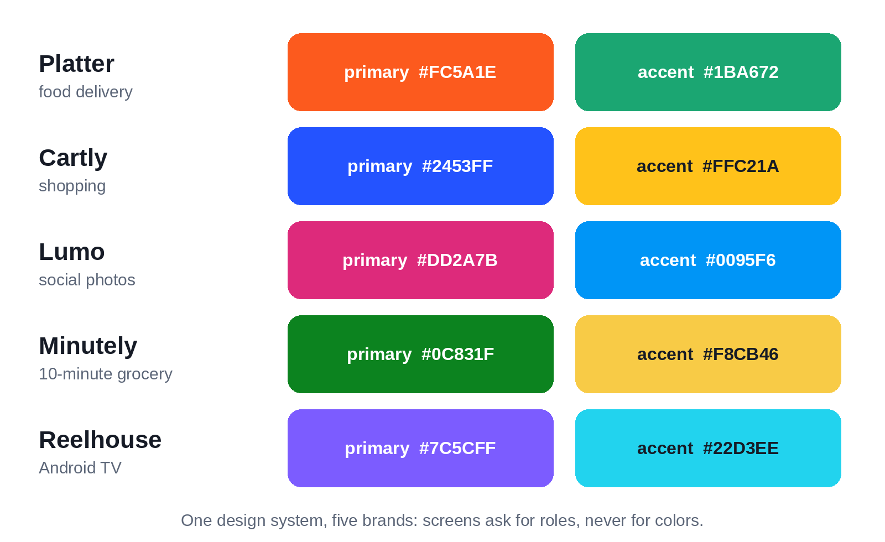
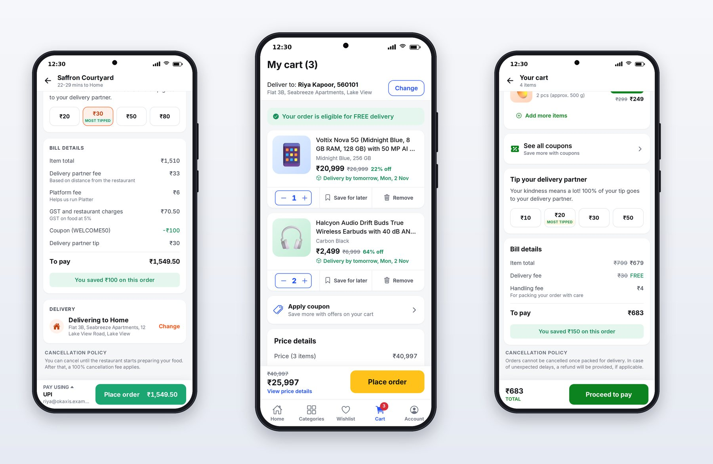

# Chapter 5: A Design System Like the Big Apps

Big consumer apps look consistent because every screen is assembled from the same small set of parts: one button, one price, one rating pill, one bottom sheet, each with exactly one look. That set of parts, plus the rules for color, type, spacing and motion behind them, is a **design system**. In this book it lives in `packages/ui`, and all four phone apps are built from it.

A design system matters even more when an AI writes the code. Without one, Claude invents a slightly different button on every screen. With one, and a rule in `CLAUDE.md` that says "use only components and tokens from `@pro/ui`", every screen it builds comes out consistent.

## Tokens: the Design Decisions as Code

A **token** is a named design decision: `spacing.lg` is 16 points, `radii.pill` is 999, the `title2` text style is 22 points, bold. Screens use the names, never the raw values, so a decision can change in one place.

Here are the spacing, radius and type tokens from session 1, taken straight from `docs/DESIGN.md`:

```ts
@include code/packages/ui/src/tokens/scale.ts#L1-L59
```

The type scale is small on purpose: seven sizes from 12 to 34 points and named roles such as `headline`, `subhead`, `caption` and `overline`. Professional apps use far fewer text styles than you'd expect; a restaurant card uses four.

## Four Brands, One System

Each app has its own brand color on a shared neutral base, in light and dark versions. Here is Platter's:

```ts
@include code/packages/ui/src/tokens/colors.ts#L169-L193
```

Every brand defines the same set of roles: `primary` for the main action, `primaryPressed` for its pressed state, `onPrimary` for text on top of it, a soft tint for backgrounds, an accent, and a gradient for banners. Screens ask for roles, not colors: a button uses `colors.primary`, never `#FC5A1E`. That's how the same `Button` is tangerine in Platter, cobalt in Cartly and basil green in Minutely, and how dark mode works with no extra code in any screen.

| App | Primary | Accent |
| --- | --- | --- |
| Platter | Tangerine `#FC5A1E` | Fresh green `#1BA672` |
| Cartly | Cobalt `#2453FF` | Deal yellow `#FFC21A` |
| Lumo | Gradient, orange to magenta to purple | Blue `#0095F6` |
| Minutely | Basil green `#0C831F` | Butter `#F8CB46` |
| Reelhouse TV | Violet `#7C5CFF` | Cyan `#22D3EE` |



The theme is selected once, at the top of each app, with `<ThemeProvider brand="platter">`, and any component reads it with `useTheme()`:

```tsx
@include code/packages/ui/src/theme/ThemeProvider.tsx
```

## Elevation That Looks Right Everywhere

Shadows are a classic cross-platform trap: iOS, Android and the web each do them differently. Session 1 solved it once, in a token function every card and sheet uses:

```ts
@include code/packages/ui/src/tokens/scale.ts#L82-L102
```

The shadows are soft and low in opacity, between 6% and 12%, which is a big part of why the apps look calm rather than heavy.

## Motion

```ts
@include code/packages/ui/src/tokens/scale.ts#L104-L116
```

Three springs cover almost all motion in the apps: `press` for the quick squeeze of a button, `sheet` for bottom sheets sliding up, and `pop` for playful moments such as Lumo's heart burst. `MIN_TOUCH` encodes the accessibility rule that every touch target is at least 44 points.

Every touchable in every app goes through `PressableScale`:

```tsx
@include code/packages/ui/src/components/PressableScale.tsx
```

It's 52 lines, and it gives four apps a consistent, physical press feel, the right accessibility role by default, and motion that respects the system's reduce-motion setting.

## The Component Library

By the end of the book, `packages/ui` held about fifty components. The ones you'll see on almost every screen:

| Component | What it does |
| --- | --- |
| `Text` | Every piece of text, with a `variant` from the type scale |
| `Button`, `IconButton` | Primary, secondary and ghost buttons in three sizes |
| `Price` | A price with an optional MRP strike-through and discount percentage, formatted in rupees |
| `QuantityStepper` | The ADD button that turns into a minus, count and plus |
| `RatingPill`, `Stars` | Ratings in the category's familiar shapes |
| `CartBar` | The floating "3 items, View cart" bar |
| `BottomSheet` | Sheets for customization, coupons, payment, filters and sort |
| `BillDetails` | Every line of a bill, with waived fees struck through |
| `Skeleton` | Shimmering placeholders shaped like the content |
| `MapView` | The tracking map, drawn with SVG so it works on every platform |
| `Art`, `ArtTile` | The 3D illustrations, by name, on soft gradients |
| `PhotoScene` | Lumo's illustrated "photos", composed from a post's seed |
| `HeartBurst`, `StoryProgress` | Lumo's like animation and story progress bars |



Several of these were added by the app sessions rather than the foundation session, because the app prompts said: "add missing pieces to the shared packages (with tests) rather than inside the app." Platter's session added `CartBar`, `BillDetails`, `TipSelector`, `OtpInput` and others; when Cartly needed the same address, coupon and payment sheets, its session moved them out of Platter into the shared package so both apps use one copy.

> **Tip:** Watch for duplication between apps when you review. If two apps each have their own `PaymentSheet`, ask Claude to move it into the shared package and make both apps use it. Duplicated components drift apart, and an AI will happily keep both.

## The Illustrations

Photographs of food, products and people are the hardest part of a demo app: you can't use other companies' photos, stock photos have licensing terms, and AI-generated images need care. The apps in this book use something cleaner: **Microsoft's Fluent Emoji 3D** illustrations, released under the MIT license, which allows commercial use. The book's design system includes 187 of them, from biryani and burgers to phones, sneakers, mountains and astronauts, named by what they show:

```tsx
<ArtTile name="curry-and-rice" tint="primarySoft" size={72} />
```

On soft gradient tiles, they give the apps the bright, friendly look of modern category illustrations, and Lumo composes them into layered scenes to stand in for users' photos. In your own app, you'll replace them with real restaurant, product and user photos; Chapter 20 covers loading images fast.

## Key Takeaways

- A design system is tokens (named decisions) plus a component library; with an AI writing the code, it's what keeps every screen consistent.
- Screens ask for color roles, never hex values, so brands and dark mode come for free.
- Solve platform differences, such as shadows, once in the system.
- A few springs and one `PressableScale` give every app a consistent, accessible feel.
- Tell Claude to add missing pieces to the shared package with tests, and watch for duplication in review.
