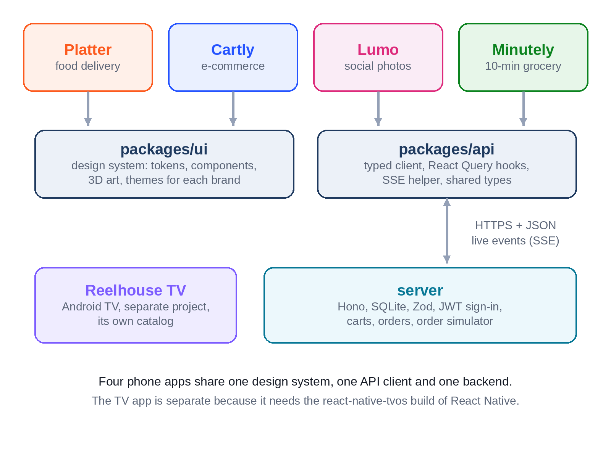
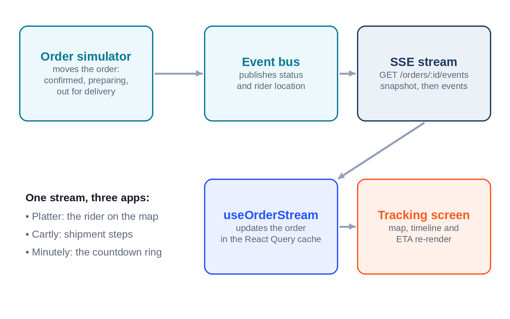
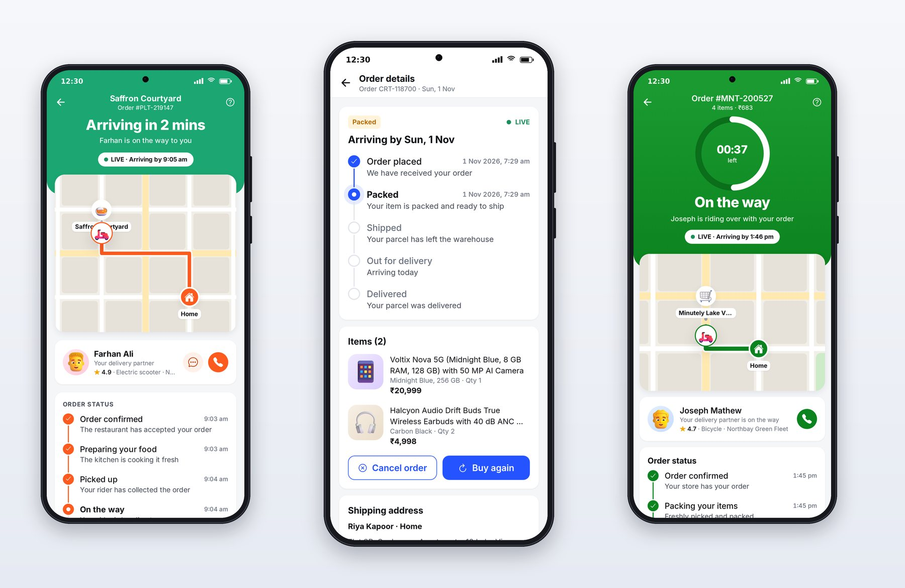

# Chapter 6: One Backend for Four Apps

A professional app is only as good as the data behind it. A food delivery home screen needs restaurants with menus, ratings and offers; a product page needs reviews and stock; a tracking screen needs an order that actually moves. This chapter covers the backend all four phone apps share, the typed client the apps use to reach it, and the live connection that makes order tracking feel alive.



## The Server

Session 1 built the server in `server/`, using:

- **Node.js and TypeScript**, so the server and the apps share types.
- **Hono**, a small, fast web framework.
- **SQLite** through `better-sqlite3`: a whole database in one file, perfect for development and demos.
- **Zod** to validate every request's input.
- **JWT** (JSON Web Tokens) for signed-in sessions.

It exposes a REST API, grouped by app: `/platter/...` for restaurants and menus, `/cartly/...` for products, reviews and returns, `/lumo/...` for posts, stories, comments and messages, `/minutely/...` for the grocery catalog, plus shared routes for sign-in, the user, addresses, notifications, carts, coupons and orders.

## Seed Data: a Fictional City

Demo apps die on bad data: three restaurants called "Restaurant 1", products with no reviews, a feed with one post. The foundation prompt asked for "rich, believable fictional data for all four apps" with minimum counts, and Claude delivered the city of Northbay:

| Data | Count |
| --- | --- |
| Restaurants | 24, with 870 menu items |
| Products | 60, with 416 reviews |
| People | 20, with 112 posts, 40 stories and 392 comments |
| Grocery items | 120, in 12 categories |
| Coupons | 12 |

Claude wrote the seed data with parallel subagents, each working against typed input shapes, and then wrote a test that checks the counts, that every illustration name exists, that every email and website uses the reserved `.example` domain, and that pure-vegetarian restaurants serve no non-vegetarian dishes. That last check is a nice example of a domain rule turned into a test.

## Signing In

The apps sign in with a phone number and a one-time code, like most consumer apps in India. The server has no SMS provider, so it accepts the code 123456 and prints codes to its console. It answers a correct code with a JWT, which the app stores on the device and sends with every request.

> **Warning:** The fixed code and console logging are for development only. Chapter 25 covers what a real sign-in needs: an SMS or WhatsApp provider, rate limits, code expiry, and secure token storage.

## One Bill, Computed on the Server

Money must be calculated in exactly one place, and that place is the server. Each app's cart has its own rules: Platter has a delivery partner fee, a platform fee and GST on food; Minutely has a handling fee and a small-cart fee under ₹99; Cartly has free delivery above ₹499. The server returns a `Bill` object with every amount, and the apps only display it.

Displaying a bill well is a design problem of its own, so the shared API package turns a bill into display rows:

```ts
@include code/packages/api/src/bill.ts#L33-L75
```

A waived delivery fee isn't hidden; it stays visible, struck through, so the customer sees the saving. Zero-value fees disappear. A coupon shows its code. These are the small trust signals Chapter 1 talked about, and they're written once for three apps.

## Making Orders Move

A tracking screen is only convincing if the order moves. The server has an **order simulator** that advances every active order on a clock:

```ts
@include code/server/src/sim/schedule.ts#L14-L39
```

A real food delivery takes 30 minutes; the demo takes two, so you can watch an order from "Confirmed" to "Delivered" in one sitting. `SIM_SPEED` speeds it up or slows it down. Every second, the simulator checks active orders and publishes events:

```ts
@include code/server/src/sim/simulator.ts#L8-L52
```

The comment at the top of the class records the important design decision: status is "a pure function of time since the order was placed", so if the server restarts, every order picks up exactly where it should be.

## Live Updates with Server-Sent Events

How does the app hear about those events? Three options are common:

- **Polling:** ask the server every few seconds. Simple, but slow to update and wasteful.
- **WebSockets:** a two-way connection. Powerful, but more machinery than tracking needs.
- **Server-Sent Events (SSE):** a one-way stream of events from server to app over an ordinary HTTP response. Exactly right for "tell me when my order changes".



Here is the server side:

```ts
@include code/server/src/routes/commerce.ts#L104-L146
```

It sends a `snapshot` of the order first, then `status` and `location` events as the simulator publishes them, and closes after delivery. It subscribes before sending the snapshot, so no change can slip through the gap. It sends a comment every 15 seconds so proxies don't close an idle connection. And it chains its writes so events always arrive in order. Claude found and fixed a race in session 1 where the final status could be dropped; the chained queue is the fix.

React Native doesn't ship a browser `EventSource`, so `packages/api/src/sse.ts` includes a small SSE parser that works on Android, iOS and the web, and a hook wraps it for screens:

```tsx
@include code/packages/api/src/hooks.tsx#L798-L842
```

If the connection drops, the client reconnects by itself, waiting a little longer after each failure, and the server starts every connection with a fresh snapshot, so nothing missed while offline is lost.

> **Warning:** A browser's `EventSource` can't send an `Authorization` header, so the demo passes the login token as `?token=` in the stream's address. Addresses end up in server logs, proxy logs and monitoring tools; the demo server hides the token in its own log, but that isn't enough for production. In a real app, give the stream a short-lived token that only allows reading that one order, or use a stream client that can send headers (the native client here could), and never put a long-lived token in a URL.

`useOrderStream` writes every event into the React Query cache, so any screen showing that order updates by itself: the tracking screen, the orders list, the active order card on the home screen. Location events update only the rider's position and the estimated arrival time, which is what the map animates.



## The Typed Client and React Query

The apps never call `fetch` directly. `packages/api` has a typed client method for every route, and **React Query** hooks on top: `useRestaurants`, `useProduct`, `useCart`, `useOrderStream` and dozens more. React Query handles caching, background refresh, retries and loading and error states, which makes "every state is designed" much easier: each screen just reads `isLoading`, `error` and `data`.

Changes that should feel instant, such as adding to the cart, liking a post or toggling the wishlist, use **optimistic updates**: the hook updates the cache immediately, sends the request, and rolls back if the server refuses. Minutely's session described the effect: "ADD steppers and the green cart bar change on the tap itself, before the server answers."

Finally, a **contract test** runs the real client against the real server. If someone changes a route's shape on one side only, the test fails, so the four apps and the server can't silently drift apart.

## Key Takeaways

- One server (Hono, SQLite, Zod, JWT) serves all four apps, with rich seeded fictional data checked by tests.
- Money is computed on the server; the apps display bills through one shared function that keeps waived fees visible.
- A clock-driven simulator makes orders move; status as a function of time survives restarts.
- Server-Sent Events push status and rider locations; a cross-platform SSE helper and `useOrderStream` keep every screen's data live.
- A typed client with React Query, optimistic updates and a contract test keeps apps and server in step.
