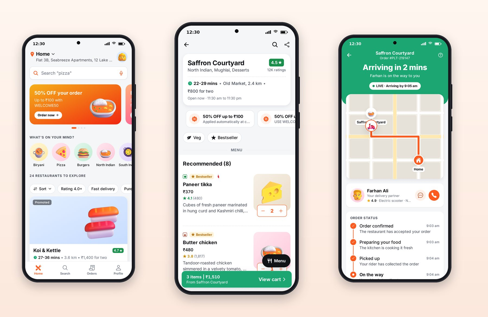
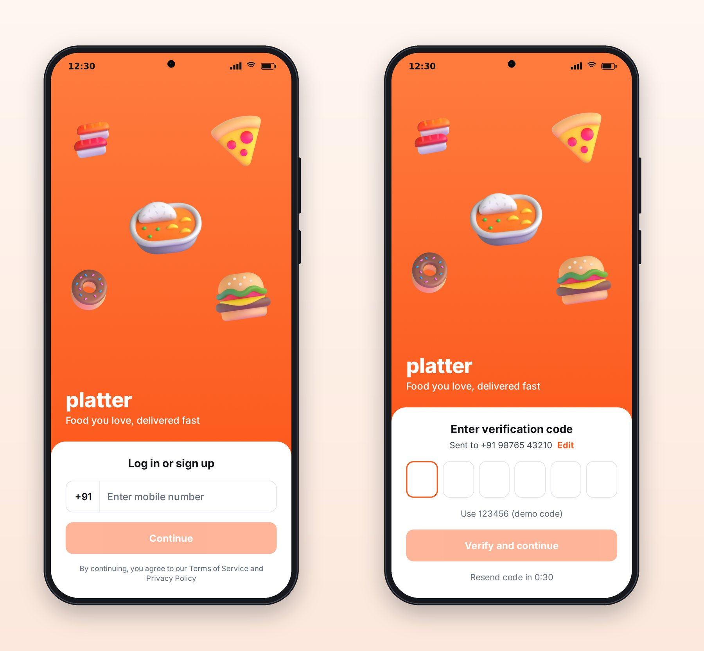

# Part II: Platter, Food Delivery

# Chapter 7: Planning a Food Delivery App

Food delivery apps are among the most refined consumer apps ever built. They have to help hungry people choose quickly from thousands of dishes, handle menus with sizes, add-ons and dietary marks, add up a bill with half a dozen fees honestly, take payment, and then turn a 30-minute wait into something reassuring to watch. This part builds Platter, an original app in that category, and this chapter covers the plan and the prompt behind it.



## Study the Category Before You Prompt

Before writing a spec for a category, spend twenty minutes in the leading apps and write down the patterns users have learned to expect. For food delivery in India, that list looks like this:

- **A location-first header**: "Deliver to Home" with the full address, because everything (restaurants, delivery times, fees) depends on it.
- **A search bar with rotating hints**: "Search 'biryani'", then "Search 'pizza'", teaching users what they can search for.
- **"What's on your mind?"**: a row of round cuisine tiles, the fastest path from craving to restaurant.
- **Filter chips**: Rating 4.0+, Fast delivery, Pure veg, Offers, plus a sort menu.
- **Dense restaurant cards**: banner image, name, rating pill in green, delivery time, distance, cost for two, an offer strip.
- **Veg and non-veg marks**: a green dot in a square for vegetarian, a red triangle for non-vegetarian, on every dish. In India these are a legal labelling convention, not decoration.
- **ADD buttons that turn into steppers** (minus, count, plus) the moment you tap.
- **A customization sheet** for dishes with sizes and add-ons, with "Required" and "Choose up to" rules.
- **A floating cart bar**: "3 items, ₹1,510, View cart".
- **A transparent bill**: item total, delivery partner fee, platform fee, GST, coupon discount, tip, to pay.
- **Live tracking**: status steps, a map with a moving rider, an ETA that counts down, and the rider's name with call and chat buttons.

That list became section 1 of `docs/PRD.md`. Notice that it's written in the category's own vocabulary. "ADD buttons that turn into steppers" gives Claude a precise, familiar target; "a way to add items" would not.

## Plan the States, Not Just the Screens

For each screen, the PRD and the prompt asked for designed states. The home screen alone needs:

| State | What the user sees |
| --- | --- |
| Loading | Skeleton cards shaped like restaurant cards, shimmering |
| Full | Header, search, carousel, cuisines, chips, restaurant cards |
| Filtered to nothing | "No restaurants match these filters" with a Clear filters button |
| Error | "Couldn't load restaurants" with Retry |
| Restaurant closed | The card grayed out with its opening time |
| Cart has items | The floating cart bar over the list |

Writing these down before prompting does two things: it tells Claude what to build, and it tells you what to check.

## The Prompt

Session 2 built the whole app from this prompt:

```text
@include sessions/02-platter.prompt.md
```

The prompt doesn't repeat the PRD; it points to it. What it adds is the standard ("as polished as the best food delivery apps"), the list of screens and tabs, and a way of working: plan first, add missing pieces to the shared packages, build screen by screen, check each screen visually at phone size, test the logic, save screenshots, and finish with all checks passing.

## What the Session Did

Claude started, as asked, by writing a plan to `apps/platter/PLAN.md`: the routes, the components and data each screen needed, and what was missing from the shared packages. Then it built screen by screen.

Its report summarized the result in its own words: "Every screenshot comes from a Playwright run that drives the real UI against the live server: log in with OTP, search, add dishes, apply a coupon, tip, place the order, then watch tracking." Playwright is a browser automation tool; Claude wrote a script that used the app like a real user and photographed each screen along the way.

It also listed the problems it hit and fixed:

- The search screen crashed on the web build when switching between its Restaurants and Dishes lists; each list needed its own key.
- Tab labels were clipped because the tab bar was too short, and toasts covered the cart and pay bars.
- Lint caught a state update inside an effect, and the API client being used before it was declared.
- A tracking test passed alone and failed when the whole suite ran.
- Jest hung after the screen tests, because React Query keeps cleanup timers running for five minutes; tests now use a query client with those timers off.

And one honest note: "`docs/PRD.md` has changes I didn't make: the Reelhouse TV section was rewritten, probably by you or another session. I left them as they are." That was true; the TV section of the PRD had been expanded while the session was running. Claude noticed, didn't touch it, and said so.

The session added nine components to the shared design system (`CartBar`, `BillDetails`, `TipSelector`, `OtpInput`, `OptionRow`, `StarRatingInput`, `Carousel`, `ScreenHeader` and `TextField`) and two bill and order helpers to the API package, all reused later by Cartly and Minutely.

## Signing In

The first screens a user sees are the sign-in screens: a phone number, then a six-box one-time code that verifies itself when the last digit is typed, with a resend timer.



## Key Takeaways

- Before prompting, list the category's familiar patterns in its own vocabulary; that list is the core of the PRD.
- Plan every screen's states (loading, empty, error, partial, full) before prompting, so Claude builds them and you can check them.
- A good app prompt points to the spec and adds the standard, the screens, and a way of working with visual checks.
- Read the session's report for the problems it hit and anything it noticed but didn't change.
