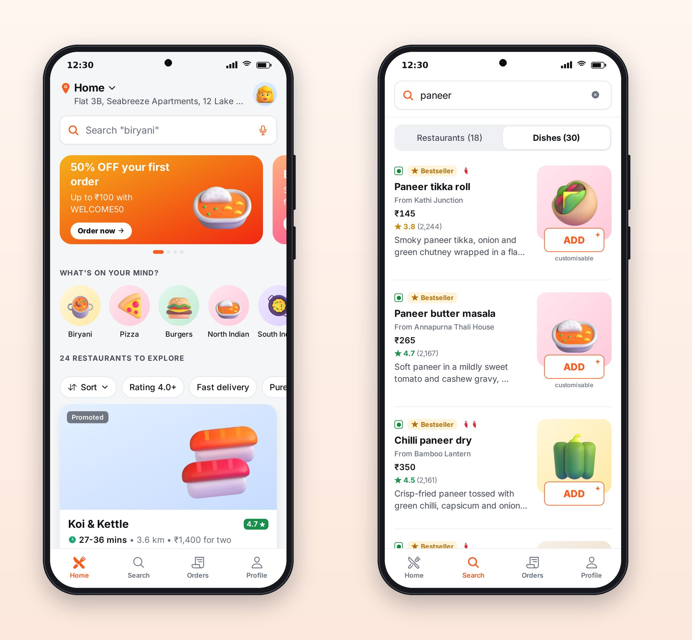
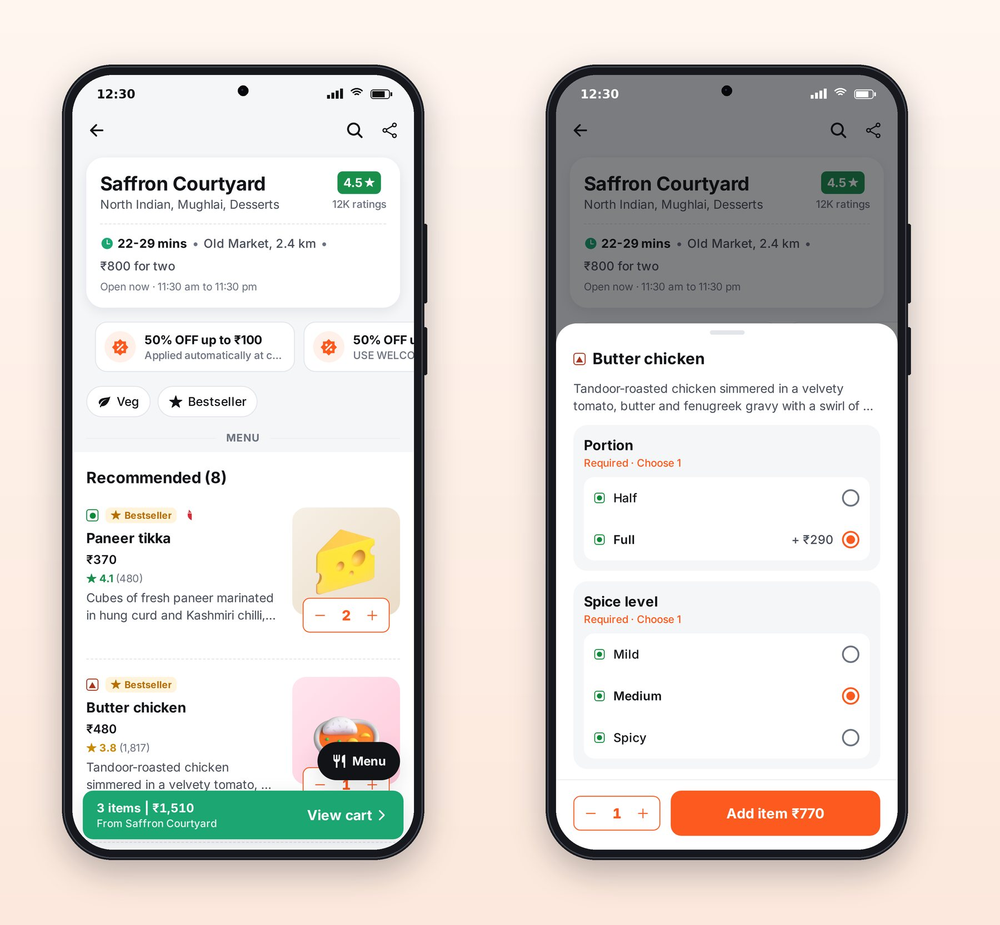

# Chapter 8: Home, Discovery and Restaurant Pages

This chapter walks through Platter's discovery screens, the home page, search and the restaurant page, and the pieces of code that make them work. Use it as a guide to what to look for when you review screens like these.

## The Home Screen



Read the home screen from top to bottom and notice how every element earns its place:

1. **Address header.** "Home" with the full address, and a chevron that opens an address sheet. Delivery times and fees depend on it, so it comes first.
2. **Search bar** with a rotating hint and a microphone icon.
3. **Promo carousel** with a dot indicator, advancing on its own. Each banner is a deep link: "/offers", "/cuisine/biryani" or a specific restaurant.
4. **"What's on your mind?"** cuisine tiles, using the 3D illustrations on soft circles.
5. **Filter chips** that stay pinned under the header while you scroll.
6. **Restaurant cards**, with "Promoted" tags where appropriate.
7. **The tab bar**, with the current tab in the brand color.

## Filters as Pure Functions

The chips and the sort menu look like UI, but the logic behind them is plain data, kept out of the screen in `lib/filters.ts`:

```ts
@include code/apps/platter/src/lib/filters.ts#L1-L44
```

`toRestaurantQuery` turns the chips into the API query. Because it's a pure function (same input, same output, no side effects), it's trivial to test, and the screen stays focused on layout. When you review an AI's screens, look for this separation; logic buried in a screen component is harder to test and easier to break.

The same file shows a professional detail: banner links are web-style paths, so the marketing team can point a banner anywhere without an app release.

```ts
@include code/apps/platter/src/lib/filters.ts#L52-L71
```

Unknown links fall back to search rather than crashing or doing nothing.

## The Restaurant Page



The restaurant page has a lot to do: an info card with rating, cuisines, delivery time, distance and cost for two; an offers strip you can swipe; Veg and Bestseller filters; a search box for the menu; the menu grouped by category; a floating "Menu" button that jumps between categories; and the cart bar.

Each dish row shows the veg or non-veg mark, a Bestseller tag, the name, price, rating and description, and an illustration with the ADD stepper overlapping its bottom edge, a layout users of every big food app will recognize.

## Customization: Rules Users Never Think About

Tapping ADD on a dish with options opens the customization sheet. Butter chicken, for example, has a required portion (Half or Full, choose one) and an optional spice level. The rules are subtle:

- A required single-choice group always has something selected; tapping the selected option again does nothing.
- An optional single-choice group can be cleared by tapping its selected option.
- A multiple-choice group stops accepting options at its maximum.
- The Add button is disabled until every required group has a choice.
- The same dish with different options is a different cart line: "Butter chicken, Full, Medium" and "Butter chicken, Half, Mild" are two lines.

Here is that logic, again as pure functions:

```ts
@include code/apps/platter/src/lib/customize.ts#L21-L72
```

And part of its test:

```ts
@include code/apps/platter/src/lib/customize.test.ts#L18-L40
```

`optionKey` sorts the chosen options before joining them, so the same selection made in a different order still matches the same cart line. That's the kind of detail an AI gets right when the tests describe the behavior, and gets subtly wrong when nobody checks.

## One Cart, One Restaurant

Food delivery carts hold dishes from one restaurant at a time. When you add a dish from a second restaurant, Platter shows a "Replace cart item?" sheet instead of mixing kitchens or silently emptying the cart. The rule lives on the server; the app shows the sheet when the server reports the conflict.

> **Try It:** Ask Claude to add a "Repeat last order" card to Platter's home screen for the signed-in user. Point it at `useOrders` in `packages/api`, ask it to handle the case where a dish is no longer on the menu, and to add a screen test. Then review the screenshot it captures.

## Key Takeaways

- Every element of a professional home screen earns its place: address, search, offers, cuisines, pinned filters, dense cards.
- Keep logic such as filters and customization rules in pure functions next to the screens, with tests; screens should mostly be layout.
- Customization has subtle rules (required, maximum, separate cart lines per selection); write them as tests.
- Small professional touches, such as banner deep links with safe fallbacks and a replace-cart sheet, are cheap to ask for and expensive to forget.
