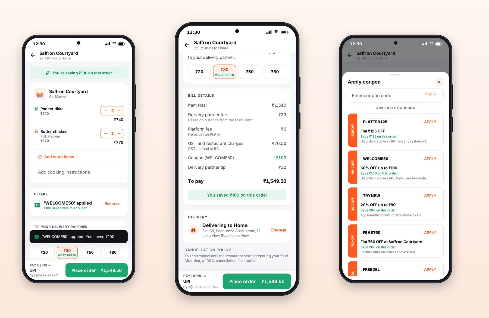
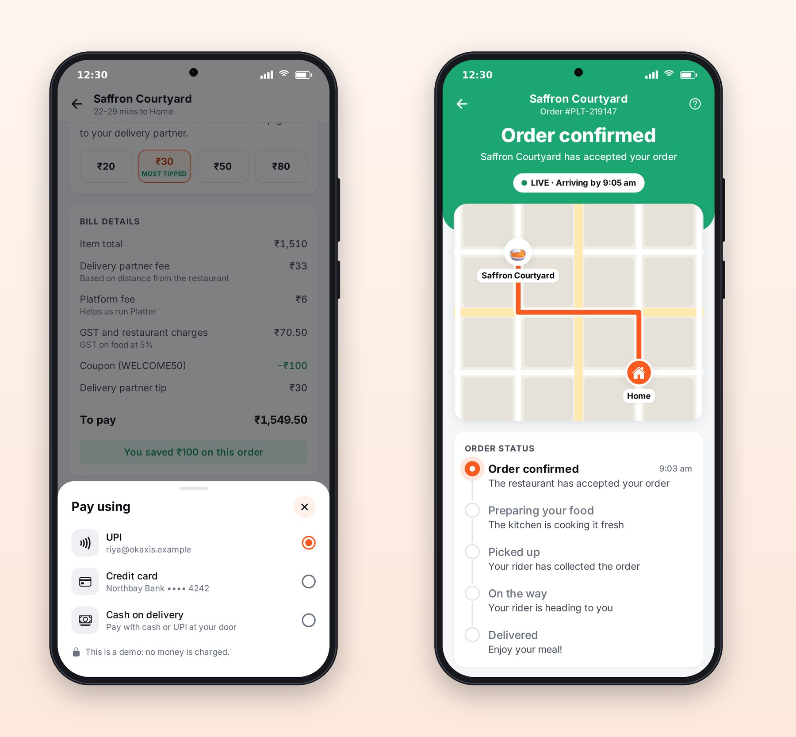

# Chapter 9: Cart, Customization and Checkout

The cart is where a food delivery app earns or loses the order. Users abandon carts when the total jumps unexpectedly, when they can't find a coupon, or when a payment step feels unsafe. This chapter looks at how Platter's cart and checkout are built to keep them going.



## Anatomy of the Cart

From top to bottom, Platter's cart screen has:

1. **A header** with the restaurant's name and the delivery time to the chosen address.
2. **A savings banner**: "You're saving ₹100 on this order", celebrating the coupon.
3. **The items**, each with its options ("Full, Medium"), a stepper and a line total, and an "Add more items" link back to the menu.
4. **Cooking instructions**, a free-text field restaurants actually read.
5. **Offers**: the applied coupon with a Remove button, or a row that opens the coupon sheet.
6. **Tip your delivery partner**, with preset amounts and the most popular one marked "Most tipped".
7. **Bill details**, line by line.
8. **A sticky pay bar**: the payment method on the left ("Pay using UPI"), and "Place order ₹1,549.50" on the right.

The pay bar never scrolls away. Whatever the user is looking at, the next action is visible.

## The Bill Tells the Truth

The bill comes from the server and is displayed by the shared `BillDetails` component, using the `billLines` function you saw in Chapter 6. The rules that make it trustworthy:

- Every fee is its own line, with a short note under it: "Based on distance from the restaurant", "Helps us run Platter", "GST on food at 5%".
- A waived fee isn't hidden; it's shown struck through with "FREE", so the user sees the saving.
- The coupon line names the coupon: "Coupon (WELCOME50)".
- The tip is shown as its own line, never folded into fees.
- The total is labelled "To pay", in bold.

> **Warning:** Never compute money in the app. The app displays what the server calculated. If the app adds up its own total, sooner or later it will disagree with the server by a rupee, and the user will see two different prices for the same order.

## Coupons

The coupon sheet lists the coupons available to this user and this cart, each with its code, a one-line description, the saving it would give, and its conditions ("on orders above ₹199"). Coupons the cart doesn't qualify for are shown but disabled, with what's missing, such as "Add ₹120 more to apply". Applying one updates the bill and shows a toast, "'WELCOME50' applied. You saved ₹100!"

Session 2's screenshots caught that toast covering the pay bar; the fix was to give the toast provider a bottom offset, which is why the root layout in Chapter 4 has `<ToastProvider bottomOffset={120}>`.

## Payment



Platter's payment step is a bottom sheet with UPI, a saved card and cash on delivery. In this book's apps, no real payment is taken; the methods are defined as demo data:

```ts
@include code/apps/platter/src/lib/payment.ts#L8-L31
```

Note the details even in demo data: a UPI ID on a `.example` domain, a card shown only by its last four digits. Chapter 23 replaces this with real payment providers (Razorpay, Stripe, Apple Pay and Google Pay), and explains why the app must never decide on its own that a payment succeeded.

## Placing the Order

When the user taps "Place order", the app sends the cart, address, tip, coupon and payment method to the server. The server recalculates the bill, creates the order, starts the simulator for it, and returns the order. The app then replaces the cart screen with the tracking screen, so Back from tracking goes to the restaurant or home, not to an empty cart.

The button shows a loading state while the request is in flight and can't be tapped twice. Double orders are a classic bug in hurried apps, and a classic support headache. If you build your own app, also ask Claude to send an **idempotency key** with the request, a unique ID the server uses to recognize a retried request so it never creates the same order twice.

> **Try It:** Ask Claude to add a "Delivery instructions" option to Platter's address step (for example "Leave at the door", "Avoid calling", "Pet at home"), stored with the order and shown on the tracking screen. Ask for server validation, a test for the new field, and a screenshot of both screens.

## Key Takeaways

- A professional cart announces savings, lists every line, offers coupons with clear conditions, invites a tip, and keeps the pay button pinned.
- The server computes every amount; the app only displays it.
- Waived fees stay visible, struck through; coupons say what they do and what's missing.
- Guard order placement against double taps and retries.
