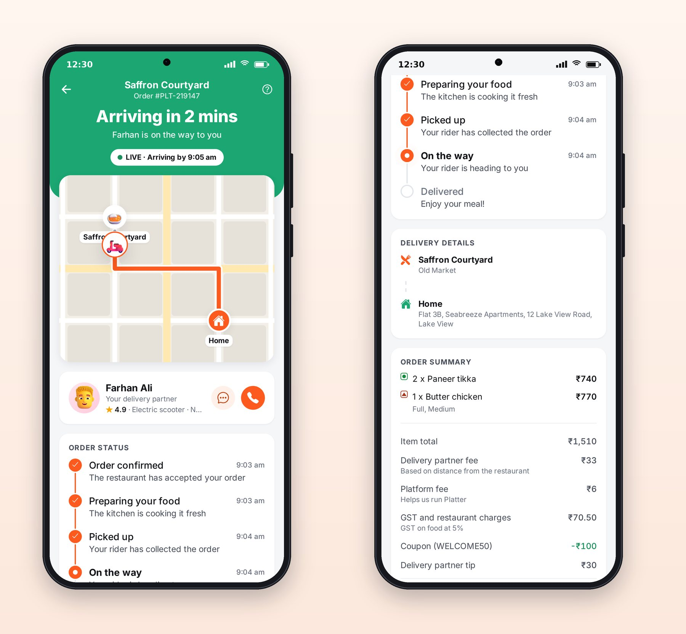
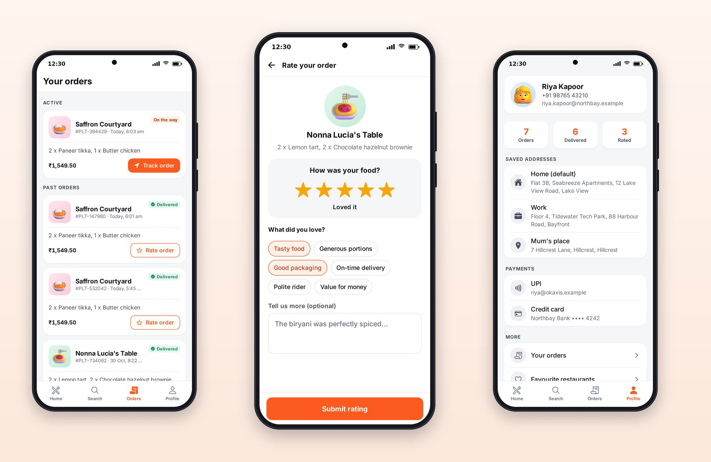

# Chapter 10: Live Order Tracking

The 30 minutes after an order is placed are the most anxious part of the food delivery experience, and the tracking screen exists to make them calm. A great tracking screen answers four questions at a glance: Is my order really happening? Where is it now? When will it arrive? Who is bringing it? This chapter shows how Platter answers them, using the live event stream from Chapter 6 and a map drawn from scratch.



## The Layout

1. **A colored header** with the restaurant, the order number, the headline ("Arriving in 1 min"), a subtitle ("Imran is on the way to you") and a pill: "LIVE · Arriving by 6:05 am". The pill reads "Connecting" when the live stream isn't open, so the user is never shown stale information as if it were live.
2. **The map**, overlapping the header's curved bottom edge.
3. **The rider card**, with avatar, name, rating, vehicle and number plate, and chat and call buttons.
4. **The order status timeline**: Order confirmed, Preparing your food, Picked up, On the way, Delivered, each with its time.
5. **The bill**, so the user can check what they paid, and a **Cancel** button while cancelling is still allowed, with a confirmation sheet.

## Words That Change with the Order

The headline and subtitle change with each step, and the copy is written as a pure function:

```ts
@include code/apps/platter/src/lib/tracking.ts#L16-L48
```

Three details are worth copying. The ETA never shows "0 mins"; it stays at least 1 until the order arrives. "1 min" is singular, "2 mins" plural. And a cancelled order says what happens to the money: "Any amount paid will be refunded in 3 to 5 days." Users read status copy like a contract.

## A Map Without a Map SDK

Most delivery apps use a map SDK such as Google Maps or Mapbox. Those need API keys, billing accounts and native setup, and they don't render in a browser screenshot the same way. The project rules asked for something simpler: a map of the fictional city of Northbay, drawn with SVG, that works the same on Android, iOS and the web.

```tsx
@include code/packages/ui/src/components/MapView.tsx#L121-L170
```

The server sends the rider's route as a list of points along Northbay's street grid, and a `progress` value from 0 to 1. The map splits the route into the part already travelled and the part ahead, draws them in different styles, and moves the rider with a 900-millisecond linear animation to each new position, so one update per second looks like smooth motion. The first position is set instantly, so the rider doesn't slide in from the corner when the screen opens.

The map is also a single accessible element with a meaningful label: "Delivery map. Rider is 47% of the way to you." A screen reader user gets the same information a sighted user does, in one sentence.

> **Note:** For a real app, you'll use a real map. The `MapView` component's props, a route, a progress value and markers, are a good contract to keep: build a version on Google Maps or Mapbox with the same props, and the tracking screen won't need to change. Chapter 20 covers keeping map rendering smooth.

## Keeping It Live

The tracking screen gets everything from one hook:

```tsx
const { order, rider, connected, error } = useOrderStream(id);
```

As you saw in Chapter 6, `useOrderStream` opens the server's event stream, puts every status change into the shared cache, and exposes the rider's latest position. When the order is delivered or cancelled, the stream closes itself. When the screen unmounts, the hook closes the stream, so a user leaving the screen doesn't leave a connection open.

What happens on a flaky network? The SSE helper reconnects, and the server always sends a fresh snapshot of the order first, so the screen catches up even if it missed events while disconnected. Meanwhile the pill says "Connecting", and the last known state stays on screen rather than a spinner.

## After Delivery



When the order is delivered, the tracking screen offers "Rate your order". The rating screen asks for stars first, then offers quick tags, which are much faster to tap than writing, and an optional comment. The orders tab keeps active orders at the top with a Track button, and past orders below with Rate or a rating already given. The profile has the user's stats, saved addresses, payment methods and sign-out with a confirmation.

## How Platter Was Checked

Session 2 checked tracking with a Playwright script that signed in, added dishes, applied a coupon, added a tip, placed an order and then photographed the tracking screen about 75 seconds later, with the rider part-way along the route. Its tests cover the tracking copy at every step, the live update path with a fake event stream, cancellation, and the rating flow. Session 2 also reported that a tracking test passed alone but failed in the full suite, and fixed it before finishing.

## Key Takeaways

- A tracking screen answers: is it happening, where is it, when will it arrive, who is bringing it.
- Write status copy as a pure function and test every step; small details like "1 min" and refund wording matter.
- An SVG map with a route, progress and markers renders everywhere; keep the same props when you switch to a real map SDK.
- Live updates should degrade gracefully: say "Connecting", keep the last known state, and resync with a snapshot.
