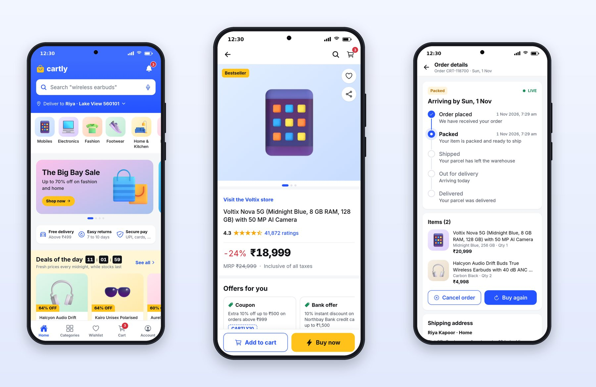

# Part III: Cartly, E-Commerce

# Chapter 11: Planning a Store App

Shopping apps are information-dense in a way few other apps are. A single product card carries an image, a title, a rating with a count, a price, a struck-through maximum retail price, a discount percentage and sometimes a delivery promise, and a home screen stacks dozens of them under banners, categories and deals. The challenge is to make all that density easy to scan and to build trust at every step toward "Buy now". This part builds Cartly.



## The Patterns Users Expect

The PRD's section on Cartly lists them, in the category's vocabulary:

- **A branded header** with search ("Search 'wireless earbuds'"), a microphone, and "Deliver to Riya · Lake View 560101": the delivery pincode is always visible because prices and dates depend on it.
- **A category strip** with illustrated tiles: Mobiles, Electronics, Fashion, Footwear, Home and Kitchen.
- **Hero banners** for sales, and trust badges: free delivery above a threshold, easy returns, secure payment.
- **Deals of the day** with a live countdown, "Fresh prices every midnight, while stocks last".
- **Product cards** with a discount badge, rating, price, MRP strike-through and a wishlist heart.
- **Search with suggestions** as you type, recent and trending searches, and highlighted matches.
- **Filter and sort sheets**: price, brand, rating, discount; relevance, price low to high, newest.
- **A product page** with a swipeable gallery, the brand store link, title, rating summary, price block, variant pickers, a pincode delivery check, offers, highlights, reviews, and a sticky "Add to cart" / "Buy now" bar.
- **Cart with "Save for later"**, checkout with address and payment, an order confirmation, order details with shipment steps, and returns.

## The Prompt

Session 3's prompt for Cartly:

```text
@include sessions/03-cartly.prompt.md
```

It's shorter than Platter's because the method was now established: "Look at apps/platter first and follow the same structure and conventions … and reuse the shared components instead of copying." The prompt spends its words on what's specific to shopping: density, deals with live countdowns, fast search, filter and sort sheets, the gallery, the sticky buy bar, and trust in checkout.

## What Moved to the Shared Packages

While building Cartly, the session moved the pieces both apps need into the shared packages. That refactor is worth understanding, because it's what keeps a family of apps consistent:

- `AddressSheet`, `CouponSheet` and `PaymentSheet` live in `@pro/ui`, used by Platter, Cartly and later Minutely.
- The signed-in session (token storage, sign-in state, sign-out) lives in `@pro/api` as `SessionProvider`, the provider you saw in Platter's root layout in Chapter 4.
- Phone number formatting, debouncing and the query error component moved too.

Each app now holds only what's unique to it. When you review an AI's work on a second or third app, check for this. The natural tendency, for people and for AI agents alike, is to copy what worked in the first app; the professional move is to share it.

## Key Takeaways

- Store apps are dense; scannability (consistent cards, clear price blocks) and trust (delivery pincode, badges, honest totals) are the design goals.
- Later app prompts can be shorter: point to the first app's conventions and spend words on what's new.
- Commit after every successful session, so you can always see exactly what the next one changed.
- Move shared pieces into shared packages as soon as a second app needs them.
