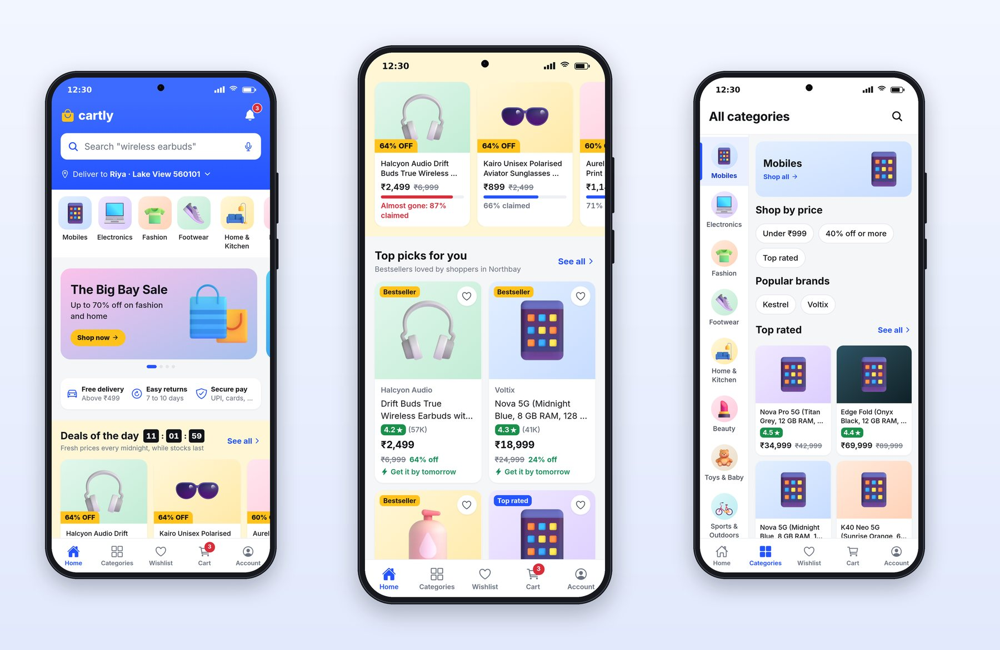
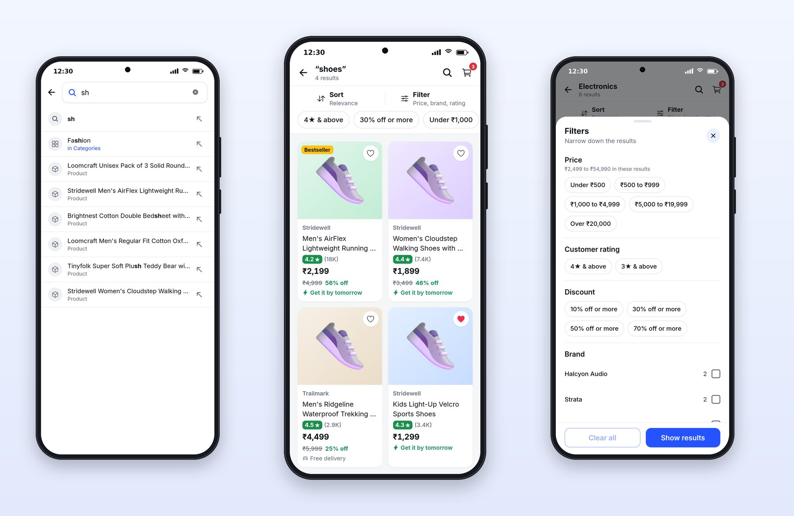
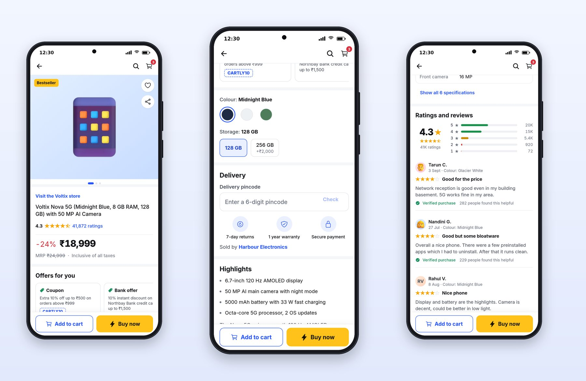

# Chapter 12: Home, Search, Filters and Product Pages

This chapter walks through how Cartly helps people find a product and decide to buy it: the home screen, search, listings with filters, and the product page.

## The Home Screen



Cartly's home screen leads with its brand color and three things a shopper needs before anything else: search, the delivery location and the categories. Then it sells: a hero banner, trust badges, and "Deals of the day" with a live countdown in boxes, "11 : 01 : 59".

A countdown is a strong motivator, and it must be honest. Cartly's deals end at midnight, the countdown is computed from the server's end time, and it ticks once a second from the shared `CountdownTimer` component. Avoid fake urgency, such as countdowns that reset when the app reopens; users notice, and app stores and consumer law in many countries treat it as a deceptive pattern.

## Search



Search is where shopping apps win or lose customers. Cartly's search screen shows recent searches and trending searches before you type, then suggestions of four kinds as you type: products, categories, brands and plain queries, with the matching text in bold. The logic is small and testable:

```ts
@include code/apps/cartly/src/lib/search.ts#L9-L40
```

`addRecent` puts the newest search first, removes case-insensitive duplicates and caps the list at eight. `highlightParts` splits a suggestion around the match for bold display. `suggestionHref` decides where each kind of suggestion goes: a product opens its page, a category or brand opens a filtered listing.

## Listings, Filters and Sort

The listing shows results in a two-column grid of product cards. Above it, a bar shows the result count and buttons for Sort and Filter, each opening a bottom sheet. Applied filters appear as chips you can remove one by one. The filter sheet groups its options into sections (price, brands with a count beside each, rating, discount) and ends with two buttons: "Clear all" and "Show results". Changes are kept as a draft until "Show results", so a user can experiment and back out without disturbing the listing.

Bottom sheets are the right component here. They keep the listing visible behind them, so the user doesn't lose their place, and they're easy to dismiss with a swipe down.

## The Product Page



The product page is the most important screen in any store app, and it follows a well-established order:

1. **Gallery** with dots, a Bestseller badge, wishlist and share buttons.
2. **"Visit the Voltix store"**, the brand link.
3. **Title** with the key variant in brackets: "Voltix Nova 5G (Midnight Blue, 8 GB RAM, 128 GB) with 50 MP AI Camera".
4. **Rating** with stars and the number of ratings, linking to reviews.
5. **Price block**: "-24%" in red, the price large and bold, "MRP ₹24,999" struck through, "Inclusive of all taxes".
6. **Offers**: coupons and bank offers in swipeable cards.
7. **Variants**: color and storage pickers, with unavailable options shown but disabled.
8. **Delivery**: a pincode field and the estimated delivery date for that pincode.
9. **Highlights** and **reviews**, with a rating breakdown and the most helpful reviews first.
10. **A sticky bar**: "Add to cart" and "Buy now", always visible.

The variant logic shows how to keep that page honest:

```ts
@include code/apps/cartly/src/lib/variants.ts#L6-L47
```

The default selection is the first option that's in stock, not just the first option. The price updates with each variant's price difference. And the buy buttons check `isSelectionAvailable`, so an out-of-stock combination can't be added to the cart. Every price on the screen, including the struck-through MRP and the discount, comes from the shared `Price` component:

```tsx
@include code/packages/ui/src/components/Price.tsx#L30-L66
```

Two professional touches: prices use tabular figures, so digits line up in lists, and the whole price block is one accessible element with one spoken label, "Price ₹18,999, MRP ₹24,999, 24% off", instead of three separate fragments a screen reader would read out of context.

## Key Takeaways

- Lead the home screen with search, delivery location and categories; sell with banners, trust badges and honest deals.
- Search needs recents, trending, typed suggestions of several kinds and highlighted matches; keep the logic in tested functions.
- Filters and sort belong in bottom sheets; show applied filters as removable chips.
- A product page follows a familiar order, ending in a sticky buy bar; default variants to what's in stock and block unavailable combinations.
- Format prices in one component with tabular figures and one spoken label.
