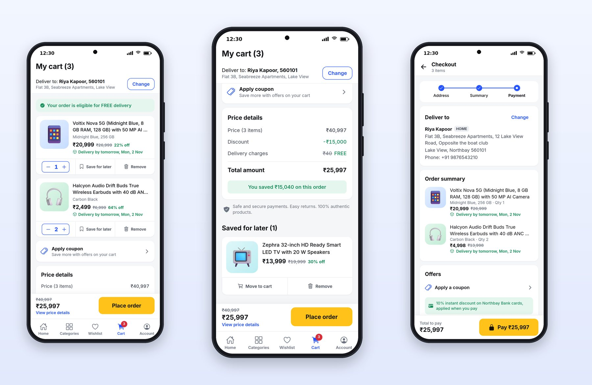
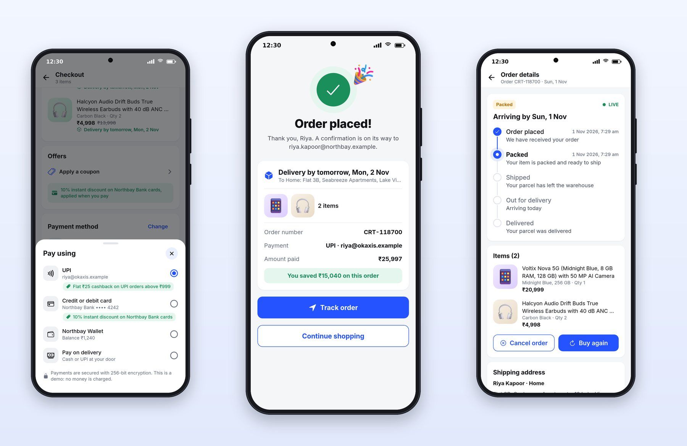

# Chapter 13: Cart, Payments and Orders

A shopping cart is not a food cart. It holds items from many sellers, often for days, and people treat it as a shortlist with a checkout button. This chapter covers how Cartly handles the cart, checkout, payment and the life of an order after it's placed.

## A Cart People Leave Things In

From top to bottom, Cartly's cart shows:

1. **"Deliver to: Riya Kapoor, 560101"** with the address and a Change button, because delivery dates depend on it.
2. **A good-news banner:** "Your order is eligible for FREE delivery".
3. **Each item** with its variant, price, MRP and discount, its own delivery date ("Delivery by tomorrow, Mon, 2 Nov"), a stepper, **Save for later** and **Remove**.
4. **Apply coupon.**
5. **Price details:** price, discount, delivery charges (struck through, "FREE"), the total, and a green band: "You saved ₹15,040 on this order".
6. **A trust line:** "Safe and secure payments. Easy returns. 100% authentic products."
7. **Saved for later**, with Move to cart and Remove.
8. **A sticky bar** with the MRP struck through, the total, "View price details", and a yellow "Place order" button.

Save for later is the feature food carts don't need. People use it to decide between two phones, to wait for payday, or to watch a price. It keeps items out of the total without losing them. And the savings band is the most persuasive number on the screen: it turns a ₹25,997 total into a ₹15,040 win.

Quantity steppers respect each product's limit; the server rejects more with a specific message ("You can add up to 5 of …"), and the app shows it as a toast instead of failing silently.

## Checkout

Checkout is one scrolling screen with a step indicator at the top (Address, Summary, Payment), so the user knows exactly how far they are from done. It confirms the delivery address, lists each item with its delivery date, shows the offers that apply ("10% instant discount on Northbay Bank cards, applied when you pay"), and ends with the payment method and a sticky bar: "Total to pay ₹25,997" and a "Pay ₹25,997" button with a padlock.

Putting the amount on the button is a small, powerful detail. The user knows exactly what tapping it will do.

## Payment, Confirmation and Order Details

**The payment sheet** lists UPI, a card, a wallet with its balance, and pay on delivery. Each method can carry its own offer ("Flat ₹25 cashback on UPI orders above ₹999"), and the sheet ends with a plain statement of what happens: "Payments are secured with 256-bit encryption. This is a demo: no money is charged." In your real app, the second sentence goes; Chapter 23 replaces the demo with real payment providers.

**The confirmation** celebrates: a check mark, a party popper, "Order placed!", and "Thank you, Riya. A confirmation is on its way to riya.kapoor@northbay.example." It shows the delivery date and address, the items, the order number, the payment method, the amount paid and the savings, then two clear next steps: **Track order** and **Continue shopping**.

**Order details** becomes the home of the order: a status badge and LIVE indicator, "Arriving by Sun, 1 Nov", the shipment steps (Order placed, Packed, Shipped, Out for delivery, Delivered) with their times, the items, the shipping address, and actions that fit the status. Before shipping, that's **Cancel order** and **Buy again**; after delivery, it becomes a return.

The steps update live over the same event stream Platter uses for its rider, from the same shared `ProgressSteps` component as Platter's timeline, with labels from the server. Cartly's demo schedule takes an order from placed to delivered in about three minutes.

## Key Takeaways

- A shopping cart is a waiting room: support save for later, show each item's delivery date, and spell out the savings.
- Show server errors such as quantity limits as friendly messages, never silent failures.
- Show checkout progress with steps, and put the amount on the pay button.
- After purchase, celebrate, give two clear next steps, and make order details the live home of the order.
