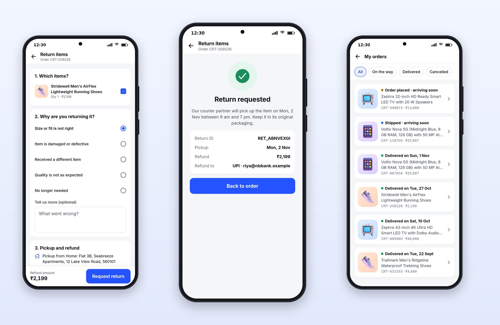
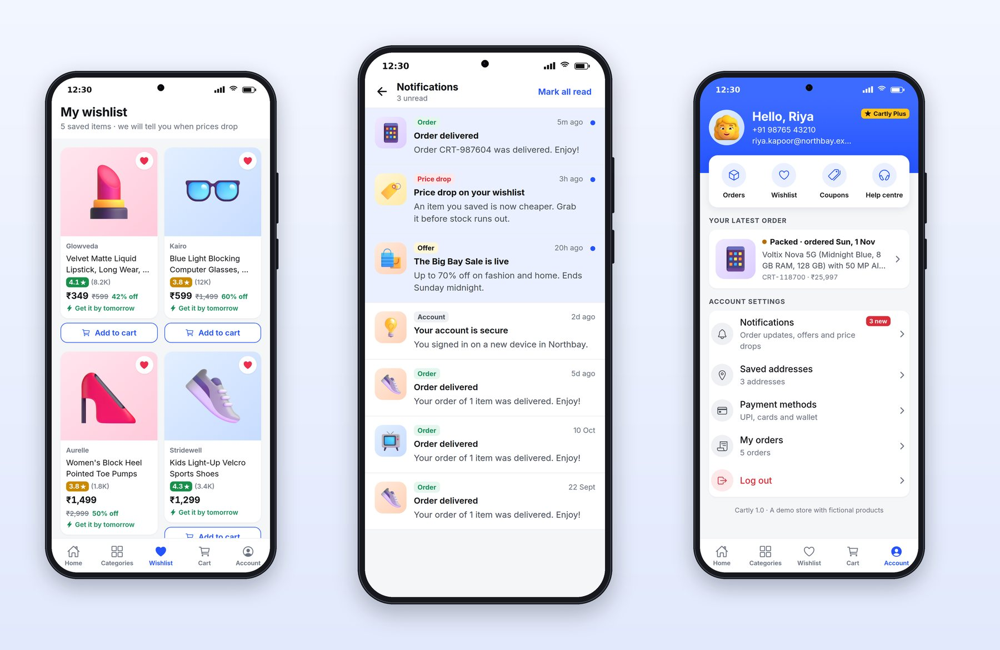

# Chapter 14: Returns, Wishlist and Notifications

The screens in this chapter are the ones demo apps skip and real apps can't: returns, the orders list, the wishlist, notifications and the account. They don't sell anything directly, but they decide whether a customer buys a second time.

## Returns



A good return flow is quick and leaves no doubt about what happens next. Cartly's is one screen in three numbered steps:

1. **Which items?** Each item in the order with a checkbox.
2. **Why are you returning it?** Five reasons, and an optional "Tell us more" box.
3. **Pickup and refund:** where the courier will collect it from, and where the money will go.

A sticky bar shows the refund amount and a "Request return" button. The rules behind the screen are pure functions:

```ts
@include code/apps/cartly/src/lib/returns.ts
```

The reasons are the ones that matter to the business (fit, damage, wrong item, quality, no longer needed), short enough to scan and specific enough to act on. The refund is calculated from the items selected and shown before the user submits, and the button stays disabled until at least one item and a reason are chosen. It's the returned items' share of what was actually paid: if a ₹200 coupon came off the order, part of it comes off the refund too, and no order can ever refund more than it cost. The server applies the same rule and has the final word.

> **Warning:** The first version refunded each item's full price, ignored the coupon, and accepted the same item three times in one request, which turned a ₹34,799 order into a ₹1,04,997 refund. A review of the server after the book's first draft caught it. Money rules deserve tests that try to break them: repeated items, coupons, and refunds that add up past the total.

The confirmation answers every question a customer has: "Our courier partner will pick up the item on Mon, 2 Nov between 9 am and 7 pm. Keep it in its original packaging." Then the return ID, the pickup date, the refund amount and where it's going ("UPI · riya@nbbank.example"), and one button: **Back to order**. Return statuses are written in plain words, "Return requested", "Pickup scheduled", "Refund completed", never internal codes.

## The Orders List

The orders list opens with filter chips (All, On the way, Delivered, Cancelled), then one card per order with a colored status line ("Shipped · arriving soon", "Delivered on Sun, 1 Nov"), the product, the order number and the amount. It's the screen people open most after buying, so its data shows instantly from the cache and refreshes in the background, which React Query does by default.

## Wishlist, Notifications and Account



**The wishlist** promises something useful in its subtitle: "5 saved items · we will tell you when prices drop". Each card has the product, rating, price, discount, delivery promise and an "Add to cart" button. Tapping a heart anywhere in the app updates the wishlist instantly, with an optimistic update that rolls back if the server refuses.

**Notifications** show a count of unread ones in the header ("3 unread") and a "Mark all read" action. Each has a colored type label (Order, Price drop, Offer, Account), a time, and an unread dot. Security notices belong here too: "Your account is secure. You signed in on a new device in Northbay." Each notification is a deep link; tapping an order update opens that order. Chapter 24 shows how to deliver them as push notifications when the app is closed.

**The account** screen greets the user by name ("Hello, Riya") with their phone, email and membership badge, then quick tiles (Orders, Wishlist, Coupons, Help centre), the latest order, and settings: notifications with a "3 new" badge, saved addresses, payment methods, orders, and **Log out** in red. A small footer says what the app is: "Cartly 1.0 · A demo store with fictional products."

Logging out clears the stored token and every cached query, so the cart badge, orders and wishlist disappear with it, and the next person to use the phone sees nothing of the last. Platter asks "Log out?" first; Cartly logs out straight away. Both are common, and asking is kinder when logging back in takes a one-time code.

> **Try It:** Ask Claude to add a "Price drop alert" bell to Cartly's product page: it saves the current price and, through the notifications list, tells the user when the price falls. Ask for the server route, the client hook with an optimistic update, a test for the server rule, and a screenshot.

## Key Takeaways

- Returns take one screen in numbered steps: items, a short list of reasons, pickup and refund, with the refund amount shown before submitting.
- The confirmation should answer every next question: when, where, how much, and to which account.
- Give the orders list status filters and plain-word statuses.
- Wishlist toggles are optimistic; notifications carry types, unread state and deep links; the account screen gathers everything personal.
- Logging out clears the token, the cache and every trace of the user.
