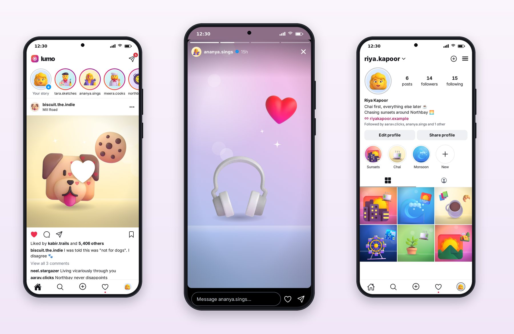

# Part IV: Lumo, Social Photos

# Chapter 15: Planning a Social App

Social apps are the opposite of commerce apps. Instead of dense information, they show one thing at a time, full width, and get everything else out of the way. The chrome is quiet, black and white with a single accent; the content is loud. And the quality is in the motion: a story bar filling, a heart bursting, a sheet sliding up for comments. This part builds Lumo.



## The Patterns Users Expect

The PRD for Lumo, in the category's vocabulary:

- **A stories row** at the top of the feed: round avatars with a gradient ring for new stories and a gray ring for seen ones, "Your story" first with a plus badge.
- **Posts**: avatar, username and location; a square photo; like, comment, share and save icons; "Liked by kabir.trails and 5,406 others"; the caption with the username in bold; "View all 3 comments"; a couple of comments inline.
- **Double-tap to like**, with a big heart that pops over the photo.
- **A story viewer**: full screen, progress bars at the top, tap right for next, tap left for previous, hold to pause, a reply box at the bottom.
- **A comments sheet** with quick emoji reactions.
- **Create**: pick, edit, caption, tag, share.
- **Explore**: a grid with some large tiles, and search for people.
- **Profile**: avatar, posts, followers and following counts, name, bio, link, highlights, and grid and tagged tabs.
- **Activity**: likes, comments and follows grouped by time.
- **Messages**: a conversation list with unread dots and a chat thread.

## Photos Without Photos

A social app needs photos, and this book can't use real people's photos. The prompt solved it with a new shared component:

> The "photos" are rich illustrated compositions: layered gradients plus the 3D art from @pro/ui (a scene component in @pro/ui that composes a backdrop, a hero illustration and small accents from a post's seed, so every post looks distinct).

The result is `PhotoScene`. Each post in the seed data names a tone and a few illustrations; the component draws a backdrop of layered gradients, a soft light, bokeh circles, a horizon and sparkles, all chosen deterministically from the post's ID, and places the illustrations on top:

```tsx
@include code/packages/ui/src/components/PhotoScene.tsx#L11-L44
```

The same post always looks the same, every post looks different, and the scenes work at feed size, as small grid tiles (with `compact` dropping the fine details) and as full-screen stories. In your own app, `PhotoScene` is replaced by an image component loading the user's photo.

## The Prompt

```text
@include sessions/04-lumo.prompt.md
```

Two lines are new compared with the earlier app prompts. "With the story viewer captured mid-story and a heart burst captured on a post if you can" asks for screenshots of motion, which is hard to capture and easy to skip. And "keep the work focused so it fits in one session of about an hour" came straight from the lesson of Cartly's overlong session.

## What the Session Did

Session 4 ran for 32 minutes over 112 turns and cost $7.57, the shortest of the four app sessions, helped by everything the earlier sessions had put into the shared packages. It added `PhotoScene`, seven photo filters, `StoryProgress`, `HeartBurst` and a `useDoubleTap` hook to the design system, and story ordering, story stepping and chat titles to the API package. The server already had the routes Lumo needed.

Its report included three fixes it made while checking screenshots (a timestamp wrapping in Messages, a hard-edged dark band at the top of stories, and loud pink outline buttons on profiles, which it made quiet gray) and two honest gaps: story replies don't send anything yet, because the server has no endpoint for them, and tagging offers only the people in your stories row, because there's no "following" list endpoint. It also warned that running `expo start` had rewritten two configuration files, which it restored.

## Key Takeaways

- Social apps put content first: full-width media, quiet black-and-white chrome, one accent color, and a lot of motion.
- When you can't use real photos, generate deterministic, distinct scenes from each item's ID, and keep the component's props easy to swap for a real image.
- Ask explicitly for screenshots of motion states, and size each session to the work.
- Note the honest gaps a session reports (here, story replies and tagging), and turn them into follow-up tasks.
