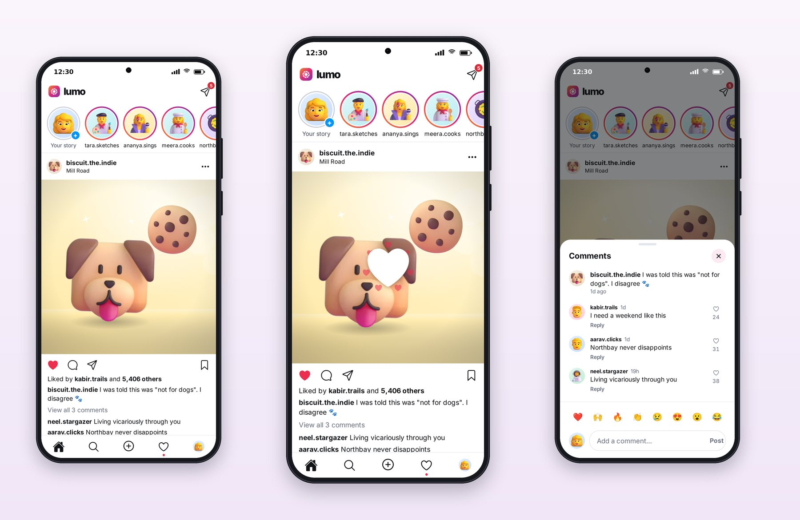
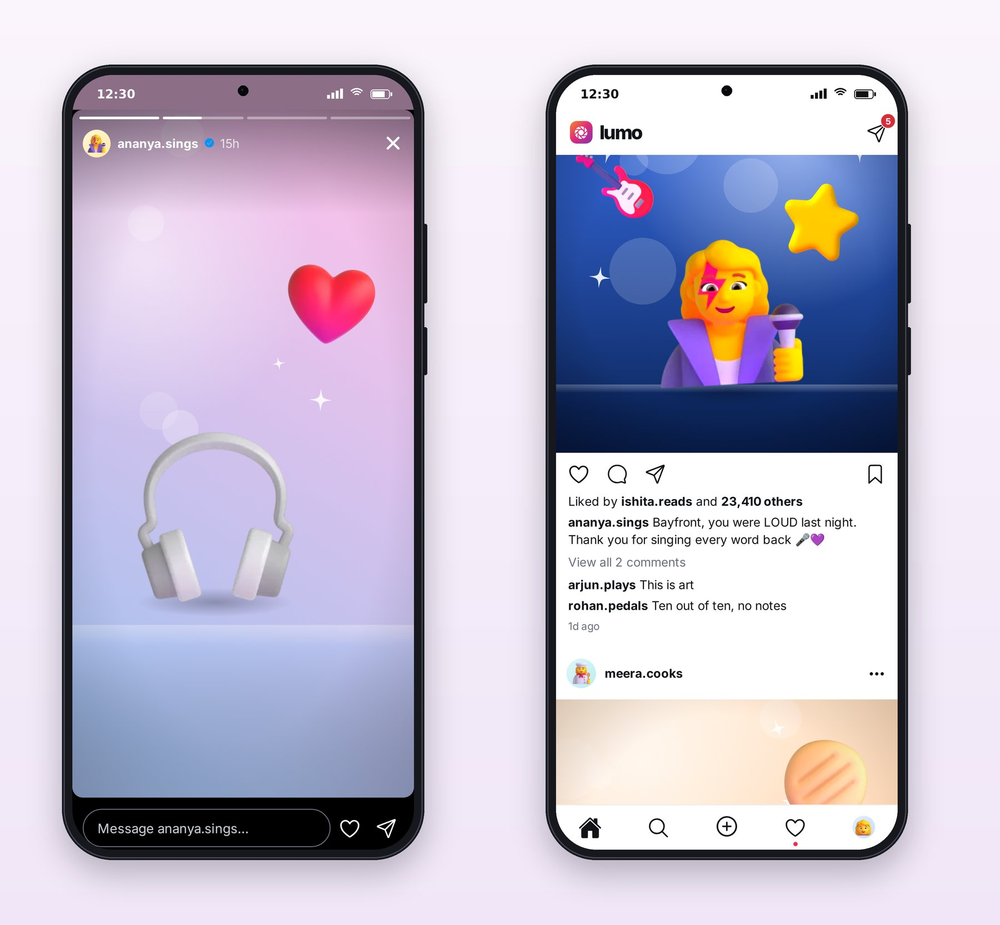

# Chapter 16: Feed, Stories and the Double-Tap Like

The feed and the story viewer are where users spend almost all their time in a social app, so they're where polish matters most. This chapter looks at how Lumo builds them, and at the small pieces of logic and animation that make them feel right.

## The Feed



Lumo's feed follows the pattern every social app user knows, and its details are what make it feel professional:

- **The header** is just the logo and a messages icon with an unread count.
- **Stories** use a gradient ring for new stories and a gray ring for seen ones, and the row is ordered the way users expect: your own story first, then people with new stories, then seen ones. That ordering is a tested function in the API package.
- **Captions** color @mentions and #tags and collapse long text behind "more".
- **The tab bar** shows icons only, a red dot when there's new activity, and your own avatar for the profile tab.

## The Double Tap

Telling a double tap from a single tap is a timing problem: if a second tap comes within about 280 milliseconds of the first, it's a double tap. Lumo's hook keeps that logic small and testable:

```ts
@include code/packages/ui/src/hooks/useDoubleTap.ts
```

`createTapDetector` is a plain function with a clock passed in, so its test can feed it exact times instead of waiting. A third quick tap starts a new sequence instead of counting as a second double tap.

A double tap sets the like, if it isn't set already (a double tap never un-likes, as in every big social app), and plays the heart burst:

```tsx
@include code/packages/ui/src/components/HeartBurst.tsx#L43-L77
```

A big white heart springs up with the `pop` spring while seven small hearts fly outward and fade, then everything fades away. Under the system's reduce-motion setting, only the big heart fades in and out, with no movement. The overlay ignores touches and is hidden from screen readers, because the like itself is announced by the like button.

The like button reacts too, with a small bounce, and the count updates immediately through an optimistic update. If the server refuses, the like rolls back.

> **Note:** Session 4 reported that the heart burst's animation kept running after its test finished and stalled the next test in the same file, so the double-tap and story tests were moved into their own files. Animations and timers are the most common cause of flaky tests in React Native; when a test passes alone and fails in a group, look for one first.

## Comments

The comments sheet slides up over the post, starting with the caption as its first item, then comments with avatar, username, time, like count and a Reply action. At the bottom sits a row of quick emoji replies and the comment field. The sheet keeps the post visible behind it, so the conversation stays in context.

## The Story Viewer



The story viewer is a small state machine:

- **Progress bars** at the top, one per story, filling over each story's duration (`StoryProgress` in the design system).
- **Tap the right side** to go to the next story; at the end of one person's stories, move to the next person's.
- **Tap the left side** to go back.
- **Press and hold** to pause; release to resume.
- **Swipe down or tap the close button** to leave.
- **Seen state**: each story is marked seen as it's shown, so the ring in the feed turns gray.

Stepping across people (the last story of one person, then the first unseen story of the next) is logic in the API package, tested without any UI. Profile highlights play in the same viewer.

## Key Takeaways

- Order stories as users expect: yours, then new, then seen; keep that order in a tested function.
- Detect double taps with a small timing function you can test with fake clocks; a double tap only ever likes.
- Animate with springs, respect reduce motion, hide decorative overlays from screen readers, and use optimistic updates for likes.
- Treat the story viewer as a state machine: next, previous, pause, close, seen, and stepping across people.
- When a test fails only in a group, look for animations and timers that outlive it.
