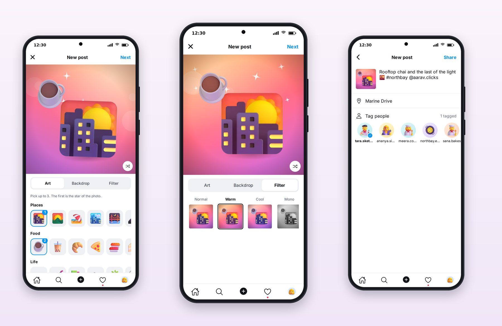
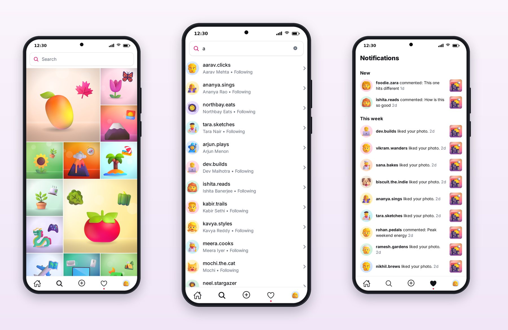
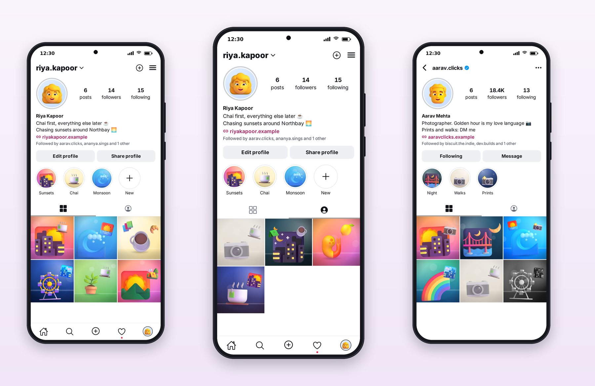
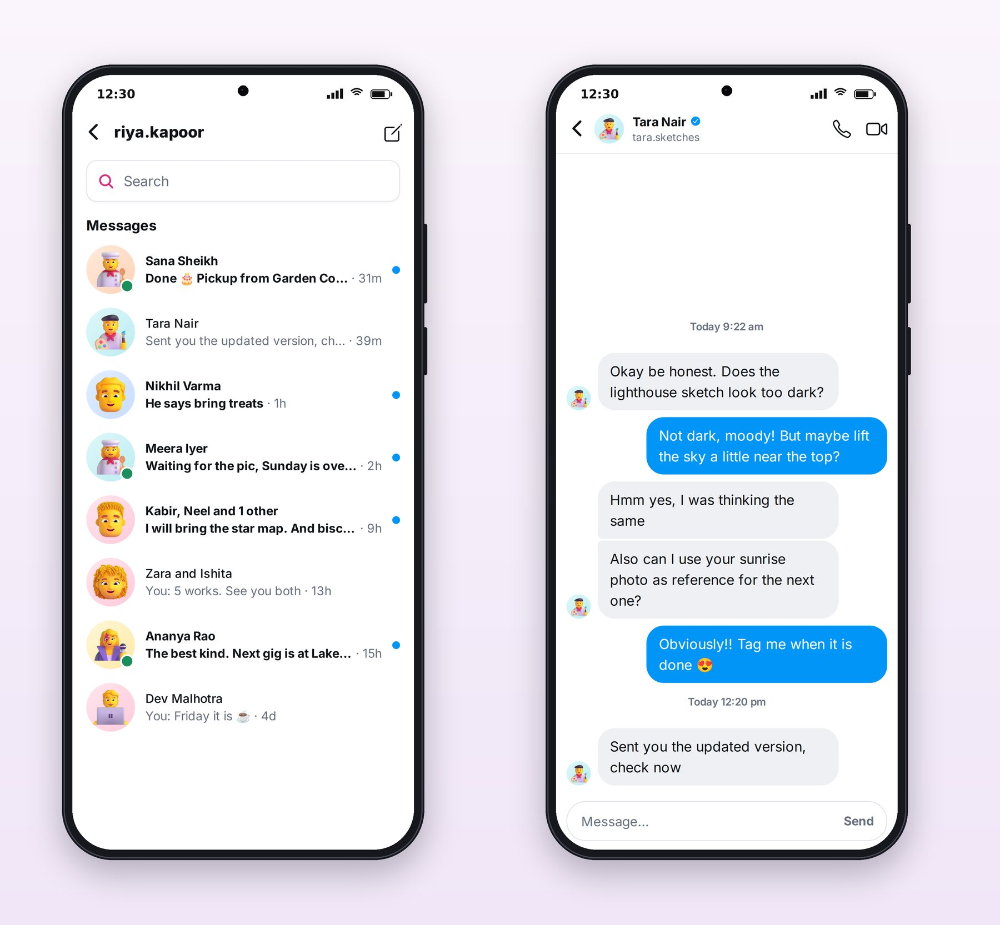

# Chapter 17: Create, Explore, Profile and Messages

The rest of a social app is about making things and finding people: creating a post, exploring, profiles, activity and messages. This chapter walks through Lumo's versions of each.

## Create

Lumo's create flow has two steps, as most photo apps do. The first builds the photo; the second adds everything about it.

**Step one, the photo.** Three tabs: **Art**, **Backdrop** and **Filter**. In Art, you pick up to three illustrations from categories (Places, Food, Life and more), and the picks are numbered: "Pick up to 3. The first is the star of the photo." A shuffle button rearranges the layout. The Filter tab shows the photo with each filter as a thumbnail (Normal, Warm, Cool, Mono and more), so you choose by seeing.

**Step two, the details.** The caption (with #tags and @mentions), a location, and **Tag people**, with avatars to tap and a count ("1 tagged"). Then **Share**.

Seven filters were built. Most use color transforms that work everywhere; session 4 reported that one, Vivid, uses a CSS filter that iOS doesn't support, so on iOS it looks like Normal. That's the kind of platform difference to write down in your release notes, or to ask Claude to fix with a different technique.

## Explore and Activity

**Explore** is a grid with a large tile every six posts, alternating sides, which breaks the monotony of a uniform grid and gives the most engaging posts more room. The search bar at the top searches people: typing "a" lists matching usernames with their names and "Following" where it applies.

**Activity** groups notifications into New, Today, This week and Earlier, with the post's thumbnail on the right and a Follow back button for new followers. Notifications are marked read when you leave the tab, and the tab bar's red dot disappears with them.

## Profiles

Profiles follow the familiar layout: avatar, counts (posts, followers, following), name, a bio that can contain emoji, a link, and "Followed by aarav.clicks, ananya.sings and 1 other". On your own profile the buttons are **Edit profile** and **Share profile**; on someone else's, **Following** and **Message**. Highlights sit below as labelled circles, then the **grid** and **tagged** tabs.

Session 4's first draft gave the profile buttons loud pink outlines; it noticed in its own screenshots and changed them to quiet gray, which is what users of the category expect. Small as it is, that change is a good example of what the visual check is for: nothing was broken, but it didn't look right.

## Messages

The messages list shows each conversation with the person's avatar (with a green dot when they're online), their name in bold when there are unread messages, the last message, its age and an unread dot. Group chats are titled from their members ("Kabir, Neel and 1 other"), a small rule written as a tested function.

The chat thread groups consecutive bubbles from the same person, shows the sender's avatar only on the last bubble of a group, colors your own bubbles in the accent blue on the right, and shows a timestamp only when the day or a long gap changes. The header carries the person's name, a verified badge, their username, and call and video buttons.

> **Try It:** Session 4 reported that story replies don't send yet, because the server has no endpoint for them. Ask Claude to add one: a server route that turns a story reply into a message in the right conversation, the client hook, a test for each, and an update to the story viewer's reply box. Then check that the reply appears in Messages.

## Key Takeaways

- Split creation into two steps: make the photo, then describe it; choose filters by seeing them.
- Vary an explore grid with large tiles; let search find people.
- Group activity by time and offer the obvious next action (Follow back).
- Profiles change their buttons for you versus others; keep the chrome quiet.
- Chat threads group bubbles, show avatars and timestamps sparingly, and title group chats from their members.
