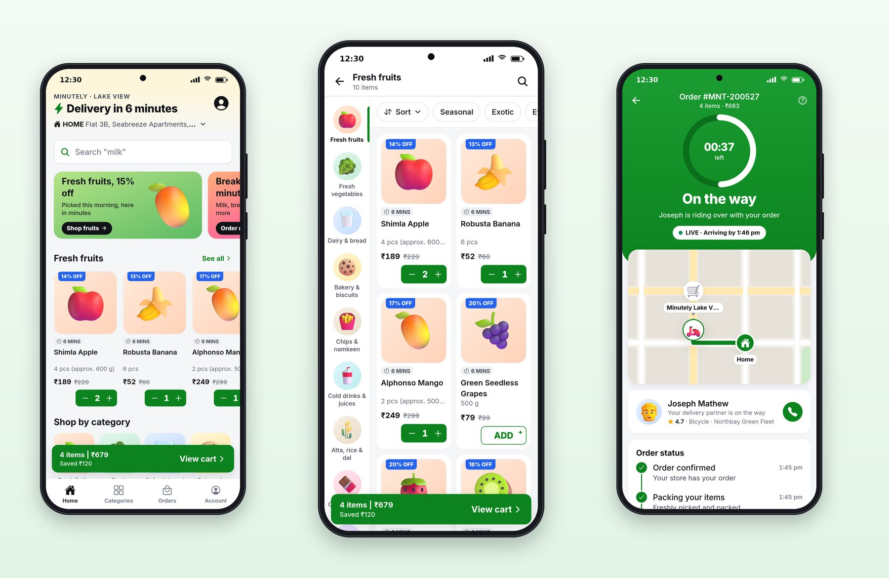

# Part V: Minutely, 10-Minute Grocery

# Chapter 18: Speed as a Feature: Planning Quick Commerce

Quick-commerce apps sell one thing above everything else: time. The groceries are the same as in any supermarket; the promise is that they'll be at your door before the kettle boils. So the app has to feel as fast as the delivery. Every tap answers immediately, the delivery time is the biggest text on the home screen, and the cart is never more than one tap away. This part builds Minutely.



## The Patterns Users Expect

Quick commerce borrows from both food delivery and shopping, and adds its own patterns:

- **The delivery time as the headline.** "Delivery in 6 minutes" in bold at the top of the home screen, with a lightning bolt, above the address.
- **ADD buttons that turn into steppers.** A product card's "ADD" becomes "− 1 +" in place, on the card, without opening anything.
- **A floating cart bar.** As soon as the cart has something in it, a bar at the bottom shows "4 items | ₹679", the savings, and "View cart". It sits above the tab bar on every screen.
- **Bright category tiles** in a grid, each with its own soft color.
- **A category page with a left rail**: categories as a vertical list on the left, products in a two-column grid on the right, filter chips across the top.
- **Savings everywhere**: discount ribbons on every card ("14% OFF"), MRP struck through, "You're saving ₹150 on this order" in green.
- **A cart that nudges**: progress toward free delivery, a tip for the delivery partner, a small-cart fee under a minimum.
- **Tracking with a countdown**: a ring counting down the minutes, a map with the rider, and the steps.

## Speed Is a Design Decision

Most of what makes Minutely feel fast isn't performance tuning; it's design:

- **Nothing waits for the server when it doesn't have to.** The stepper shows the new quantity the moment it's tapped.
- **Nothing opens a new screen when a sheet will do.** Tapping a product slides a product sheet over the current screen, so closing it returns you exactly where you were, scrolled to the same place.
- **The next action is always visible.** The cart bar is on every browsing screen; the "Proceed to pay" bar is on the cart; the pay button names the amount and the method.
- **The time shown is the real time.** Every screen uses the store's estimate from the server.

The last point came from a real mistake. Session 5's first draft hard-coded "9 minutes" in some places while the home screen, which reads the server, showed 6. The screenshots caught it. A speed promise that disagrees with itself is worse than no promise at all.

## The Prompt

Session 5 had two jobs: fix a flaky test in Cartly, and build Minutely.

```text
@include sessions/05-minutely.prompt.md
```

Notice how specific the "feel" paragraph is: "a bold 'Delivery in 9 minutes' header, instant ADD steppers, a cart bar that's always one tap away, … savings called out in green." Words like "fast" and "modern" give Claude nothing to check. A list of visible patterns gives it a checklist for the screenshot review.

## The Flaky Test, Solved Properly

The first job is a lesson in its own right. A Cartly test sometimes failed when the whole workspace's tests ran together and always passed alone. The easy fixes are to skip it or raise its timeout; the prompt ruled both out and asked for the real cause.

Session 5 found it. React Query hands cache updates to components with a zero-delay timer. The test pushed a "shipped" event and then checked at once that "Cancel order" had gone, which only works if that timer fires first. On a busy machine it sometimes didn't. Session 5 proved the cause by delaying React Query's notifications by 5 milliseconds, which made the test fail every time, then fixed it in two places: the shared test query client now delivers updates in a microtask, which always runs before the test continues, and the test now waits for "Cancel order" to disappear rather than assuming it already has. With the fix, the test passes even with a 200-millisecond delay. It also found and fixed a second problem on the way: a test file that left five-minute timers running, which made Jest hang at the end of a run.

> **Tip:** When you ask Claude to fix a flaky test, ask for proof: a way to make the failure happen every time, and the same check passing after the fix. "It passed three times" proves nothing about a test that fails one time in ten.

## What the Session Did

Session 5 ran for about 53 minutes and cost $9.08. It wrote a plan to `apps/minutely/PLAN.md`, built the app on the shared packages, and found that the server already had everything Minutely needed. It added two things to the design system, each with a test: `CountdownTimer` gained fill and track colors, because the white ring was invisible on the green tracking header, and `CartBar` gained `tone="primary"`, so Minutely's bar could be green instead of the accent yellow.

Its screenshot review fixed six problems before it finished: the header wrapping onto three lines, a search hint that read `Search "Search "bread""`, a category grid with three columns instead of four, prices breaking across lines on narrow cards, filter chips cut off at the edge, and a pay button that read "Pay ₹683UPI".

## Key Takeaways

- Quick commerce sells time; the app must feel as fast as the delivery promise.
- Speed is mostly design: instant steppers, sheets instead of screens, the next action always visible, and one real delivery time everywhere.
- Describe the feel you want as visible patterns Claude can check in screenshots.
- Fix flaky tests at their cause, with a way to reproduce the failure and proof that the fix holds.
