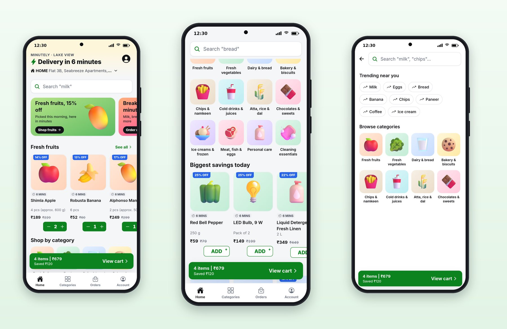
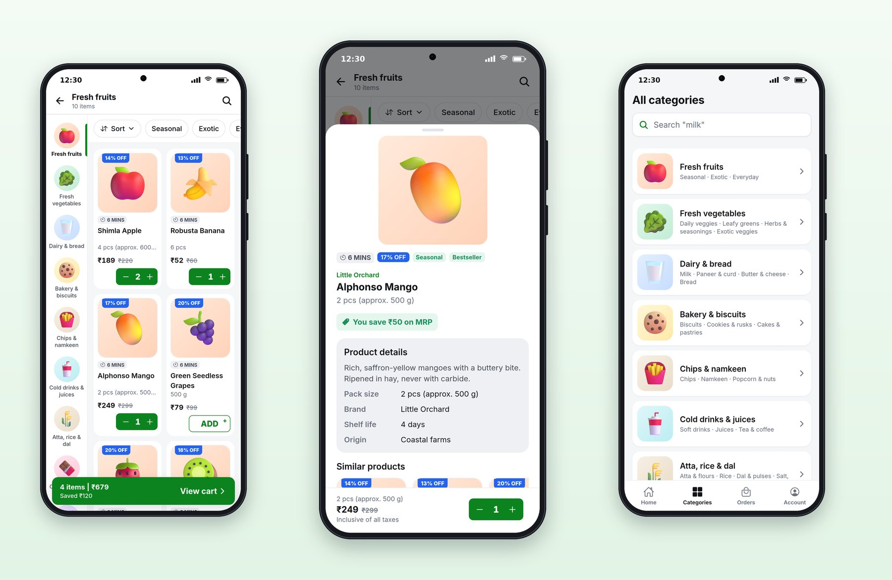
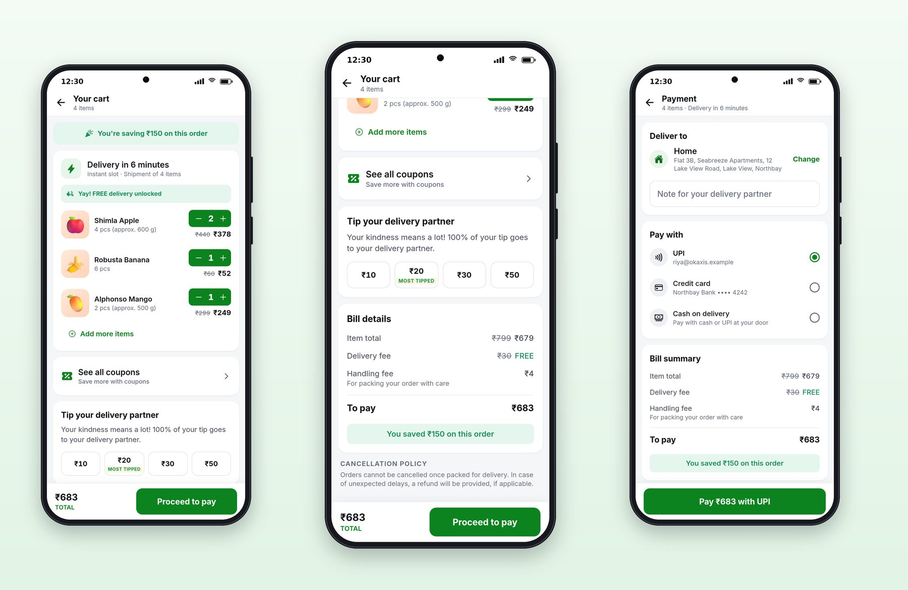
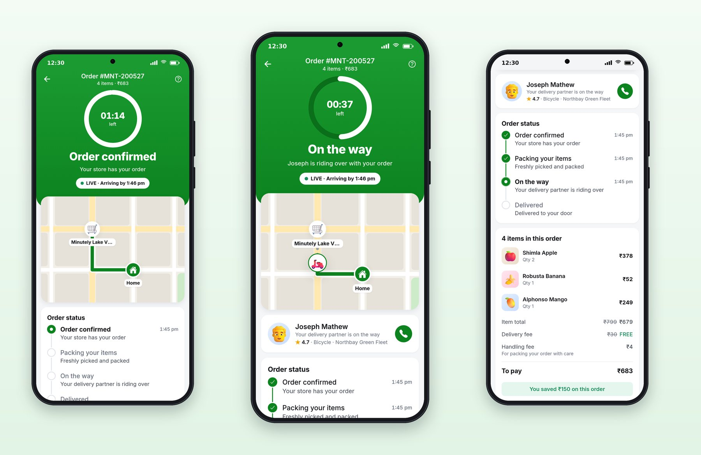

# Chapter 19: Catalog, Cart and the Countdown Delivery

This chapter walks through Minutely from the home screen to the doorbell, and looks closely at the one piece of logic that makes it feel instant: a stepper that moves before the server answers, on every screen at once.

## Home and Search



The home screen is built around its first line. "MINUTELY · LAKE VIEW" names the store; "Delivery in 6 minutes" with a lightning bolt is the promise; the address sits under it with a chevron to change it. Then:

- **A search bar** whose hint rotates through common items ("milk", "bread", "chips"), a quiet suggestion of what the store sells.
- **Offer banners**: "Fresh fruits, 15% off. Picked this morning, here in minutes", with a "Shop fruits" button.
- **Product rails** such as Fresh fruits, each card with a discount ribbon, the delivery time ("6 MINS"), the name, the pack size, the price with MRP struck through, and an ADD button or stepper.
- **Shop by category**, a grid of four columns of colored tiles.
- **Biggest savings today**, a rail sorted by discount.

The delivery time comes from one helper that never says "0 minutes" or "1 minutes":

```ts
@include code/apps/minutely/src/lib/delivery.ts#L4-L8
```

**Search** opens with "Trending near you" as chips and the category tiles below, so a user who doesn't know what to type still has somewhere to go. Results use the same product cards, and out-of-stock items sink to the bottom rather than disappearing.

## The Category Page and the Product Sheet



The category page is the quick-commerce layout: a narrow rail of categories on the left, each with its picture and name, the selected one marked with a green bar; a row of chips across the top (Sort, then subcategories such as Seasonal and Exotic); and a two-column grid of products. Switching categories in the rail changes the grid without leaving the screen.

Tapping a product slides up the **product sheet**: a large picture, badges (delivery time, discount, Seasonal, Bestseller), the brand in green, the name and pack size, "You save ₹50 on MRP", the product details (pack size, brand, shelf life, origin), similar products, and a bar with the price and the stepper. Because it's a sheet, closing it puts you back on the grid exactly where you were.

The **Categories** tab lists every category as a card with its subcategories underneath ("Milk · Paneer & curd · Butter & cheese · Bread"), which helps people who browse by aisle.

## A Stepper That Moves Before the Server Answers

The same product can appear in three places at once: a home rail, a category grid and the product sheet. When the user taps "+" in one, all three, and the cart bar, should change at once, before the server replies. Minutely does this with a small shop context that wraps the app:

```tsx
@include code/apps/minutely/src/components/ShopProvider.tsx#L36-L66
```

Each tap records a **pending** quantity for that product and sends the request. Every stepper asks `quantityOf(id)`, which returns the pending quantity if there is one and the server's otherwise, so every copy of the product shows the same number. When the request settles, the pending entry is cleared, and the server's cart, now updated, takes over. If the request fails, a toast explains why ("You can add up to 5 of …") and the stepper falls back to the server's number.

The `seq` counter handles fast tapping. If a user taps "+" three times quickly, three requests are in flight; only the answer to the last tap may clear the pending quantity, otherwise the stepper would flicker back to 1, then 2, then 3 as the answers arrive.

The cart bar needs totals that include the pending taps, and that is a pure function, tested without any UI:

```ts
@include code/apps/minutely/src/lib/pending.ts
```

> **Note:** This is a different shape of optimistic update from the cache-based ones in Chapter 6. Those edit the React Query cache directly; this one keeps pending taps beside the cache and combines them for display. It suits a stepper that may be tapped many times in a second, because the cache is never rewritten by an out-of-date answer.

## The Cart and Payment



From top to bottom, Minutely's cart shows:

1. **"You're saving ₹150 on this order"** in green, first, before anything else.
2. **The delivery slot**: "Delivery in 6 minutes. Instant slot · Shipment of 4 items".
3. **The free-delivery nudge**: "Add ₹51 more for FREE delivery" with a progress bar, which becomes "Yay! FREE delivery unlocked" once the cart passes ₹199.
4. **The items**, each with a stepper and its price with MRP struck through, and "Add more items".
5. **Coupons**: "See all coupons. Save more with coupons."
6. **Tip your delivery partner**: "Your kindness means a lot! 100% of your tip goes to your delivery partner", with ₹10, ₹20, ₹30 and ₹50, and ₹20 marked "MOST TIPPED".
7. **Bill details**: item total with MRP struck through, the delivery fee (₹30 struck through, "FREE"), a ₹4 handling fee "for packing your order with care", "To pay ₹683", and the savings again.
8. **The cancellation policy**, in plain words: orders can't be cancelled once packed.
9. **A sticky bar**: "₹683 TOTAL" and "Proceed to pay".

The fees are the server's (Chapter 6): a ₹30 delivery fee waived above ₹199, a ₹4 handling fee, and a ₹15 small-cart fee under ₹99. The app only shows them, with a one-line reason under each fee, because unexplained fees are the most common complaint about quick-commerce apps.

The **payment** screen confirms the address with a Change link, offers a note for the delivery partner, lists UPI, a credit card and cash on delivery, repeats the bill summary, and ends with one button that says exactly what will happen: "Pay ₹683 with UPI".

## Tracking With a Countdown



The tracking screen puts the promise at the top again, this time as a countdown. A green header carries the order number and a ring counting down the time left ("01:14 left"), with the stage in large type: "Order confirmed", "Packing your order", "On the way", "Delivered!". Under it, a LIVE pill shows the arrival time.

The ring's window runs from placing the order to its promised arrival, both from the server:

```ts
@include code/apps/minutely/src/lib/tracking.ts#L1-L15
```

The ring is the shared `CountdownTimer` with `variant="ring"`; session 5 added `fillColor` and `trackColor` to it so a white ring on a dark green track could sit on the green header. When the order is delivered, the ring is replaced by a party popper and "Delivered in 1 minute. Enjoy!", calculated from the real times.

Below the header are the same SVG map as Platter's (store, rider, home), the delivery partner card with a call button, the four status steps with their times, the items, and the bill. All of it updates live over the order's event stream.

The demo server delivers a Minutely order in 75 seconds (confirmed, packing at 4 seconds, on the way at 15, delivered at 75), so the ring counts seconds rather than minutes. That keeps a demo short; in a real app, the server sends real times, and nothing in the client changes.

> **Try It:** Ask Claude to add "Order again" to Minutely's Orders tab: one tap puts every item from a past order back into the cart, skips anything out of stock, and shows a toast such as "3 items added, 1 out of stock". Ask for the server route, a test for the out-of-stock rule, a screen test, and a screenshot.

## Key Takeaways

- Lead with the delivery time; make the ADD button turn into a stepper in place; keep the cart bar on every browsing screen.
- Use a left category rail and a product sheet so users browse without losing their place.
- Keep pending stepper taps beside the server's cart, let only the latest tap clear them, and compute the cart bar's totals with a tested pure function.
- Explain every fee in one line, show the savings first, and put the amount and the method on the pay button.
- Track with a countdown ring driven by the server's times, so a demo's 75 seconds and a real delivery's 10 minutes use the same code.
