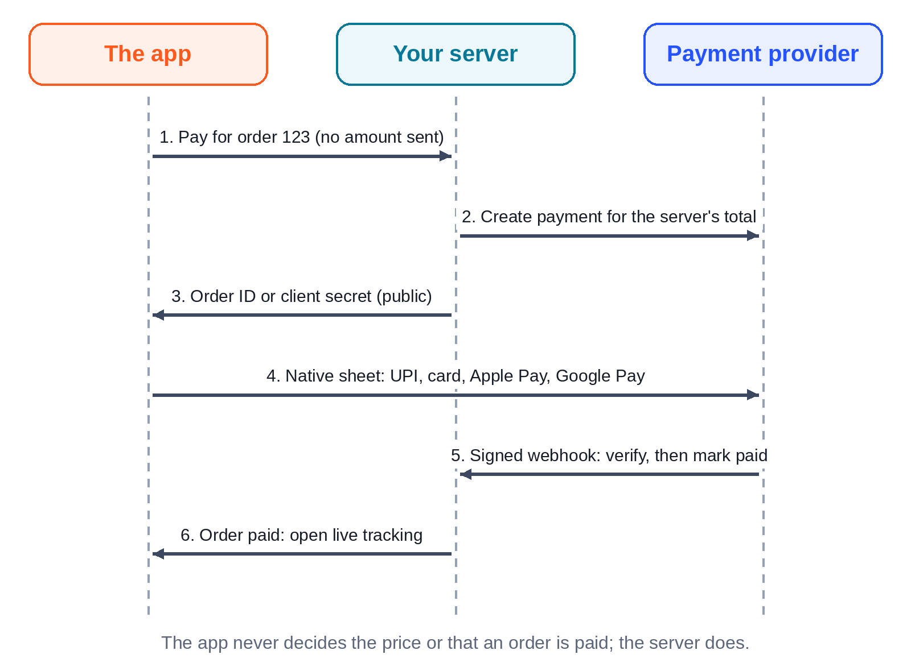

# Chapter 23: Payments for Real: Razorpay, Stripe, Apple Pay, Google Pay and UPI

Every app in this book has a payment sheet that says, honestly, "This is a demo: no money is charged." This chapter shows how to replace it with real payments, in the patterns professional apps use, and what's different about taking money in a mobile app.

> **Warning:** Payment rules, fees, onboarding and store policies change, and they differ by country. Check each provider's current documentation and your account dashboard before you build, and get advice on tax and legal requirements for your business. This chapter teaches the technical pattern; it isn't financial or legal advice. None of the live payment flows in this chapter could be run for this book.

## First, Which Store Rules Apply?

Before choosing a provider, check what you're selling. Both app stores separate two kinds of purchases:

- **Physical goods and services used outside the app**: food, groceries, products, rides, tickets. Platter, Cartly and Minutely are all this kind. You use a payment provider such as Razorpay or Stripe, and the stores take no commission.
- **Digital goods and features used in the app**: subscriptions to content, premium features, coins, extra filters. These generally must use the store's own in-app purchase system (Google Play Billing, Apple's In-App Purchase), with the store's commission. A streaming subscription like Reelhouse's (Chapter 30) falls here.

The exact rules, and the exceptions that some countries now require, are in the Google Play Payments policy and Apple's App Review Guidelines (section 3.1). Read the current versions before you design checkout; getting this wrong is a common reason for rejection.

## The Golden Rules Still Apply

A phone doesn't change the fundamentals of safe payments:

1. **The server decides the amount.** The app sends the cart; the server prices it and creates the payment for that amount. The apps already work this way (Chapter 6): the bill comes from the server.
2. **Secret keys never ship in the app.** Anything in your app bundle can be extracted. The app gets only public identifiers.
3. **An order is paid only when the server has verified it**, with a signature check or a webhook from the provider, never because the app said so.
4. **Handle every message exactly once.** Providers retry webhooks, and users tap twice.
5. **Test mode first.** Use test keys and test cards until everything is proven.



## The Flow in a Mobile App

Every provider below follows the same shape:

1. The user taps "Pay ₹683". The app asks **your server** to create a payment for the order.
2. The server prices the order, asks the provider to create a payment (a Razorpay order or a Stripe PaymentIntent), stores its ID with your order, and returns the public details (an order ID or a client secret).
3. The app opens the provider's **native payment sheet** with those details. The user pays with UPI, a card, Apple Pay or Google Pay inside the provider's own interface.
4. The provider tells the app the result and, separately, tells **your server** with a signed webhook.
5. The server verifies the signature, checks the amount and currency, and marks the order paid. The app moves to tracking when the server says so.

The app's job is small and safe: show the sheet and wait for the server. It never decides that an order is paid.

## Razorpay for India

Razorpay supports UPI, cards, netbanking and wallets, and offers a React Native SDK (`react-native-razorpay`) that opens its checkout. Because it contains native code, it doesn't run in Expo Go; you use a development build (Chapter 26). Test the Android build early: developers report different experiences with whether extra native configuration is needed, so check the library's current README for Expo.

After a successful checkout, the app receives a payment ID, the order ID and a signature, and sends them to your server. The server recomputes an HMAC-SHA256 of `order_id|payment_id` with its key secret, compares it with a timing-safe comparison, and only then marks the order paid. The webhook (`payment.captured`) is the backup that catches users who close the app at the wrong moment.

### UPI

UPI is the most used way to pay in India, and on a phone it's especially smooth: the user picks a UPI app on their phone, approves the payment there, and returns. Razorpay's checkout handles this "intent" flow and the "collect" flow (a request sent to a UPI ID). Two things to design for:

- **The user leaves your app.** Your screen must survive being backgrounded, and the result may arrive only through the webhook. Show "Waiting for payment confirmation" and poll your server or listen on the order's event stream.
- **Pending isn't failed.** A UPI payment can take a while to confirm. Don't tell the user it failed until the provider says so.

## Stripe, With Apple Pay and Google Pay

Stripe's React Native SDK (`@stripe/stripe-react-native`) offers a ready-made **PaymentSheet** that collects cards and wallets, and a `usePlatformPay` hook for Apple Pay on iOS and Google Pay on Android. In outline:

```tsx
const { initPaymentSheet, presentPaymentSheet } = useStripe();
// The country where your merchant account is registered (example only).
const merchantCountryCode = 'IN';

async function pay(orderId: string) {
  // 1. Your server creates the PaymentIntent and returns its client secret.
  const { clientSecret } = await api.createStripePayment(orderId);
  // 2. Configure and present Stripe's native sheet.
  const init = await initPaymentSheet({
    merchantDisplayName: 'Platter',
    paymentIntentClientSecret: clientSecret,
    applePay: { merchantCountryCode },
    googlePay: { merchantCountryCode, testEnv: true },
  });
  if (init.error) return showError(init.error.message);
  const { error } = await presentPaymentSheet();
  if (error) return showError(error.message);
  // 3. Wait for the server: the webhook marks the order paid.
  router.replace(`/order/${orderId}`);
}
```

The code is an outline, not a drop-in: check names and options against the SDK's current documentation. `merchantCountryCode` must be the country where the business taking the payment is registered (`IN` is only an example), not the customer's country, because wallet availability, currency and eligibility all depend on it. Apple Pay also needs a merchant ID and a payment processing certificate set up in your Apple Developer account and in Stripe, and the SDK's config plugin to add the entitlement; Google Pay needs the Google Pay API enabled for production. Neither wallet works in Expo Go.

On the server, the `payment_intent.succeeded` webhook, with Stripe's signature header verified over the raw request body, is what marks the order paid.

> **Note:** At the time of writing, Stripe's sign-up for new businesses in India is by invitation. Many Indian apps use Razorpay (or another Indian provider) for domestic customers and Stripe for international ones, chosen on the server per region.

## Designing the Payment Experience

The apps' payment screens already follow the patterns users trust; keep them when the money becomes real:

- **The amount and method on the button**: "Pay ₹683 with UPI".
- **Saved methods first**, with the last used one selected.
- **Clear progress** while the provider's sheet is open and while the server confirms.
- **Plain failure messages** with a way forward: "Payment didn't go through. You weren't charged. Try again or choose another method."
- **No double charges**: disable the pay button while a payment is in progress, and make the server's "create payment" call idempotent for the same order.
- **Refunds** shown in the order with an amount, a method and a date (Chapter 14).

## A Prompt for Real Payments

```text
Replace Platter's demo payment with Razorpay in test mode. The server
creates a Razorpay order for the server-calculated total, stores its ID
on our order, and verifies both the checkout signature and the
payment.captured webhook (HMAC-SHA256, timing-safe, raw body), checking
amount and currency, and processing each event once. The app opens
Razorpay checkout with react-native-razorpay in a development build,
then waits for the order's event stream to say "paid". Test the server
logic offline with known good, tampered and replayed messages. Never use
live keys. Finish by listing what can only be verified with real test
keys on a device, and anything in Razorpay's rules you're unsure about.
```

The last sentence is the most important. Claude can't reach the provider from your build machine, and a list of honest unknowns is a checklist for you.

## Key Takeaways

- Physical goods and services use a payment provider; digital goods and features usually must use the store's in-app purchases. Check the current store rules first.
- The server sets the amount, holds the secrets and marks orders paid only after verifying a signed message.
- The app's job is to open the provider's native sheet and wait for the server.
- Design for UPI's app switching and pending states; set up Apple Pay and Google Pay with their certificates and entitlements in development builds.
- Put the amount on the button, prevent double payments, and explain failures plainly.
